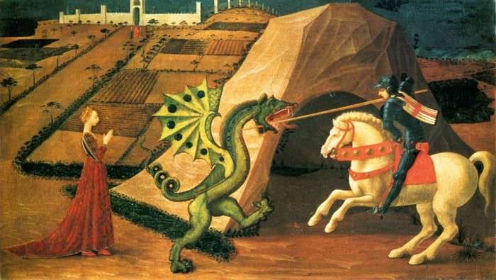
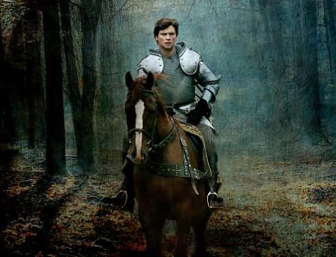

# Төрөлх, заяагдмал чанараа ойлго

Цагаан морьт баатар эр давхиж яваад, хааны гүнж рүү дайрч байсан луутай таарч тулалдан, хааны гүнжийг аварч, лууг ялав. Хаан, хатан хоёр түүнд, охиноо эхнэр болгон өгч сүр дуулиантай хурим болов. Хэсэг хугацааны дараа, тэр үед элбэгээс элбэг байсан луу бас л гүнж рүү дайрах үед, түүнийг хамгаалахаар баатар эр тулалдахаар ухасхийтэл, гүнж хатуу чанга дуугаар, -“Зогсооч, энэ хорыг аваад, түүн рүү цац” гэхэд нь ойлгохгүй хэсэг эргэлзсэнээ, хайранд нь уярдаг зангаараа авч давхин цацаж, лууг хордуулан алав. Бүх ардууд баярлалдан, түүнийг алдаршуулах ч, харин баатар эр өөрөө огт баярлахгүй байлаа. Маргааш өглөө нь, анд явахаар зэхэх үед, эхнэр нь, -“Нөгөө хороо авч яв, мартав, хэрэг болоо биз дээ” гэх мэтээр сургамжилж эхлэхэд арга буюу авч явав. Мөн буцаж ирэх үед нь луу, ардууд руу дайрч буйтай таарч, ойр зогсох эхнэрээ харан, сэлмээ сугалан тулалдах уу, эсхүл хороо цацах уу, алийг нь мэдэхээ больж тээнэгэлзэх үед нь эхнэр нь, -“Май, энэ бугуйл аваад, бугуйлд” гэснээр нь хийж мөн ялав. Ард олон баярлалдан байна. Харин баатар эрийн сэтгэл баяргүй, дүнсгэр царайлан ордондоо оров. Өглөө нь мөн анд явахаар зэхэх үед, эхнэр нь орж ирээд, -“Өнөөдөр тийш явна биз. Тийм, тийм юмаа авч яваарай” гэхэд нь, баатар эр юу ч дуугарсангүй шууд гарч, мориндоо мордон үл мэдэгдэх газар руу аялан оджээ. Хамгийн сонирхолтой нь, цагаан морьт баатар маань дахин нэг гүнжийг аврах биз ээ. Эхний үед, биеэ хамгаалах чадваргүй, зөөлөн эмзэг, энэ бүхэн нь баатар эрийг гавъяа байгуулахад хүргэдэг зантай байх гүнж маань, хэсэг хугацааны дараа, эр нөхрөө хянаж, удирдаж эхлэнэ. Хянуулах, удирдуулах дуртай ямар баатар эрс байх билээ? Ийм маягаар үеэс үед дамжсаар бидний үед энэ хандлага ердийн зүйлс болон иржээ. Эрэгтэйчүүд, эмэгтэйчүүд өөр өөрсдийн замаар явахаа больсон. Бид байнга, үргэлж үүрэг ролио сольж, энэ нь амьдралын нэгэн эмгэнэл болон хувирч байна. Тиймээс, өөрсдийн төрөлх чанараа ойлгох, заяагдмал, жинхэнэ мөн чанараа хадгалахыг эрхэмлэх хэрэгтэй болж буй нь илэрхий болсоор байгаа билээ. Хүн бүр, өөр өөрсдийн үүргийг биелүүлэн, өөрийн замаар явснаар аз жаргалтай амьдрах юм. Хүн, бусдын хийх үүрэг даалгаврыг төгс гүйцэтгэсэн ч аз жаргалтай болдоггүй гэнэ.
