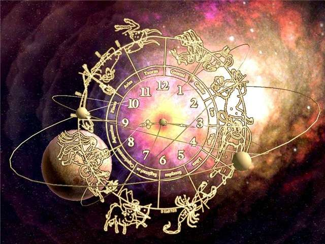
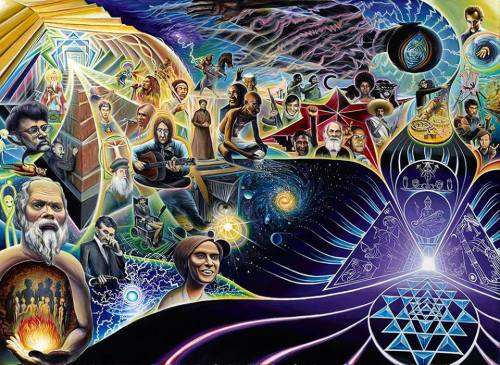

# Төрсөн өдөр ба “карма”-гийн даалгавар

Төрсөн өдөр нь зүгээр нэг өдөр биш гэдгийг хүн бүр мэддэг. Хүн бүр хорвоод мэндлэхдээ, өөрийнхөө тухай юуг ч юм мэдэх, ойлгох, таних мөн өөрт ноогдсон тавиланг эдлэх, амьдралд суралцах гэж ирдэг. Юуны төлөө энэ ертөнцөд ирсэн, ямар зорилготой, юу гүйцэтгэхээр ирсэнээ мэдэхэд, энэхүү төрсөн үеэс хамааралтай “карма” буюу төрсөн өдрийн зурхай тус болно.

**21/03-19/04. Байгал дэлхий сэрж, сэргэх үе.** Аливаа зүйл сэрэх үедээ эрч хүчээр дүүрэн байдаг. Энэ үед төрсөн хүмүүс, энэхүү эрч хүчээ зөв зарцуулахад гойд анхаарах хэрэгтэй бөгөөд таны “карма”, бусад хүмүүстэй сэтгэлээ хуваалцах, бусдыг ойлгож сургахад зориулагдсан байдаг. Та, хангалттай нээлттэй, илэн далангүй сэтгэлтэй, нийтэч байхад, танд аз завшаан үргэлж инээмсэглэж байдаг. /Та анзаараад үзээрэй/ Мөн, та, байгал дэлхий амилах үед төрсөн учираас, энэхүү амилалт, сэргэлтийн энергийг амьдралдаа гайхалтай үр дүнтэй ашиглах боломжтой . Өглөөд дасгал хийх нь таны эрч хүчийг улам эрчимжүүлж, эрч хүчээ зөв хуваарилахад, мөн сэтгэл санаагаа өөдрөг байлгахад нэн тустай. Ер нь дасгал, хөдөлгөөн таны заяагдмал чанар.\
**20/04-20/06. Өсч урган, дэвжих үе** Ургамал ургахад, ус, бордоо, сайхан хөрс хэрэгтэй байдаг. Танд ч мөн үүний адил, сайхан зөв хоол хүнс, чөлөөт орон зай, гоёмсог эд хэрэглэл заяагддаг. Энэ бол таны “карма”. Энэ нь, таны өсч хөгжих хөрс, зохилдлогоо чинь болж өгдөг. Та өөрийн орон зайг эрхэмлэхийн адил мөн бусад хүмүүс ч тийм байдгийг мартаж болохгүй. Таны даалгавар, бусдын үзэл бодлыг хүндлэх, шалтгаангүй маргаан үүсгэхгүй байх, бусдыг ойлгоход суралцах.\
**21/05-20/06. Цэцэглэх үе.** Цэцэг, зөгий хоёр хоорондоо хичнээн ялгаатай ч хоорондын хамааралтай зүйлс юм. Тэд бие биегүйгээр тун хэцүүднэ. Эсрэг тэсрэг зүйлс бие биенээ нөхдөг гэдэг. Оюун ухаан, зүрх сэтгэл тань зөрчилдөөд байна уу? Энэ бол таны “карма”. Хоорондоо тэмцэлдсэн эдгээр зүйлсээ, мөн эсрэг тэсрэгийг эвлүүлэн эвцэлдүүлэх нь таны даалгавар. Хувийн амьдралдаа мэдрэмжээ ашиглаж харин, ажил дээрээ ухаанаа зарцуул. Энэхүү зохилдлогоо нь амьдралыг тань өөд татах ганц хөшүүрэг.\
**21/06-21/07. Урт өдрүүдийн гэгээн үе.** Та, амар тайван, гэгээн, сайхан үед төржээ. Бодож санасан бүх зүйлсээ хийж амжуулахаар сайхан урт өдрүүд энэ үед налайж байдаг. Ихийг бүтээх цаг зав, таны “карма”. Уйдсандаа, өнгөрсөн үеийн харамсал эсвэл ирээдүйн мөрөөдөлдөө умбах гээд байх нь бий. Тиймээс, амьдралын хамгийн сайхан, сонирхолтой зүйлс өнөөдөр, яг одоо болж байдгийг анзаарч сурах хэрэгтэй. Байгаа зүйлсээ үнэлж сурах, өнөөдрөөр амьдарч сурах нь таны даалгавар. Үүнээс, жинхэнэ сэтгэлийн ханамжийг авах юм.\
**22/07-21/08. Боловсрох үе** Та, энэ ертөнцийн олон зүйлсийг өөрчилж болохгүй гэдгийг санаж явах хэрэгтэй. Маргааш, байгал дэлхий өөрөө бүхнийг эргүүлэн зун дуусч намар ирнэ. Хорвоо ертөнцийг байгаагаар нь хүлээж авахад суралцах нь таны даалгавар. Бусадтай харилцах үедээ, хөнгөхөн мэдрэмж өгөх, сайхан сэтгэл гаргах зэрэг харилцааны уян хатан байдлаа өсгөснөөр амьдрал тань хамаагүй хөнгөрөхийг мэдрэн, аз жаргалтай болно.\
**22/08-21/09. Ургац хураах үе.** Аливаа зүйлсийн бүх үр шим нүдэнд харагдахуйц боловсордог үед та төржээ. Мөн ургац хураах үе бөгөөд та, юу ч эрж хайсан дэргэд чинь л байдаг. Од эрхэс таныг, хэрэгтэй цагт хэрэгтэй газарт чинь аваачдаг. Энэ бол таны “карма”. Ямар нэг зүйлийг заавал өөрчлөх гэж хүчээ гаргах хэрэг байна уу? Сэтгэл санаагаа үймүүлсэн бодлууд, толгой өвтгөсөн зовиуруудаа март. Эрч хүчээ ухаалаг зарцуулах, тэсвэр тэвчээртэй байхад суралцах нь таны даалгавар.\
**22/09-21/10. Навчис унах үе.** Намар, модод навчисаа гөвөх мэт, та, амьдралынхаа туршид, хуучин эсвэл илүүдэл зүйлсээ гээн, шинэ ашигт зүйлсийг олж авч байдаг. энэ бол таны “карма”. Магадгүй та, эргэлдэн нисэх алтан навчисын адил шинэ газар орныг үзэхээр аялан явна уу? Суурин байсан ч аялан явсан ч, та, аль алинаас нь ухаан суусаар байдаг. Таны даалгавар аливааг бодитоор авч үзэхэд суралцахад оршино. Заримдаа бодит байдал мөрөөдлөөс илүү сонирхолтой байдаг юм шүү. Хамгийн гол нь, анзаарч ажиглаж сурах хэрэгтэй.\
**23/10-22/11. Сэрүүсэлт.** Хүйтэн сэрүүнээс урьтаж бүхнийг амжуулах хэцүүхэн үе. Эртдэж хөдөлвөл бас, алдах эрсдэлтэй. Ийм үед, ажиглалт, хэмжээгээ мэдэх чанар хамгийн чухал байдаг. Та адгуу зантай ч, гүйх, яарах хамгийн хэрэгтэй үедээ гараа хумхин суудаг. Болж буй үйл явдал, тохиолдлуудыг ажиглаж сурах, өөрчлөлтүүдийг эрүүлээр хүлээж авах чадвараа хөгжүүлэх нь таны даалгавар.\
**22/11-21/12. Урт шөнүүдийн үе.** Шөнөдөө унтах хэрэгтэй нь зүйн хэрэг. Гэхдээ яг энэ үед, өдөржин зүүрмэглэсэн, ид шидийн чадавхи тань сэргэж байдаг гэнэ. Зөн совингоо сонсож сурах нь таны даалгавар. Хэн нэг ойр дотныхон эсвэл найз нөхдийн чинь нэгэнд тусламж хэрэгтэй байна уу? Хэнд, өөрийн “солиотой” зөвлөгөөг тулгамаар байна? Дотоод дуу хоолой чинь танд эргэлзээгүй зөв хариултыг өгнө. Энэ бол таны “карма”. Таны гол даалгавар, цаг тухайд нь түүнийг сонсож сурах, мөн бусдад тусалснаар аз жаргалыг өөртөө эргүүлэх.\
**22/12-19/01. Шинэчлэгдэх үе** Өвөл, газар дэлхийг цасаар хучиж, байгал дэлхийг шинэчлэн, бүх зүйл цэгцтэй цэмцгэр үе. Та ч, бас тавьсан зүйлээ байранд нь байлгах дуртай, эмх цэгцийг эрхэмлэгч. Гэхдээ бүх зүйл цэгцрэх аргагүйг ойлгох хэрэгтэй. Бага зэргийн цэгцгүй байдал магадгүй сэтгэлийг чинь хөгжөөх ч юм бил үү? Бас тэгээд эргэн тойрныхон тань таныг “ядаргаатай” гэж үзэхээ болих ч юм бил үү? Цаг үргэлж, амьдралынхаа дассан дүрэм журам, ердийн амьдралын хэмнэлээ өөрчилж байх нь таны даалгавар.\
**20/01-18/02. Цэвэрлэгдэх үе.** Урин дулаан хаврыг угтан байгал дэлхий цэвэрлэгдэн, наран ээж, хүйт уярч, тэнгэр хүртэл цэлмэг, өөрийн эрхгүй мөрөөдөлд автах гайхалтай үе. Тиймээс, таны сэтгэл, үе үе үүлэн дунд хөвөх нь олонтаа. Энэ үед, сод зохион бүтээгчид, эрдэмтэд төрдөг гэдгийг мэдэж аваарай. Гараа хумхин суухгүй урагшил. Та, энэ дэлхийг сайжруулж, цэвэрлэх гэж ирсэн гэдгээ санаж яв. Энэ бол таны “карма”.\
**19/02-20/03. Хүчит салхины үе.** Хүчит салхи зам дээрхи бүхнийг хаман авах чадалтай. Тэрхүү салхины аясаар, туяхан бургас найган гуйвна. Энэ бол “карма”. Танаас цаг үргэлж, хэн нэгэн, ямар нэг зүйл гуйж, хүсч байдаг. Толгой дараалан туслахаас татгалзах чадвартай бай. “Хумхийн тоос” мэт сарнин алга болохгүй байхад суралцах, хүсэл зорилго, эрч хүч, зүтгэлээ нэг зүйл дээр төвлөрүүлж сурах нь таны даалгавар юм.
