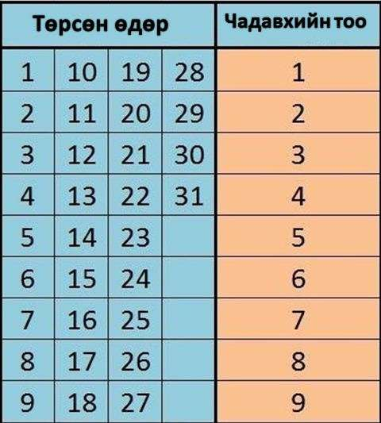

# Төрсөн өдөр ба төрлөхийн чадавхи

Хүний төрсөн өдөр нь, хүний чухал шийдвэр гаргах чадвар болон албан тушаалын сонголтод хэрэглэж болох дотоод авъяас чадварыг харуулдаг. Та энэхүү чадварын тоогоо дараах хүснэгтээс уншиж харгалзах тайлбарыг уншаарай. Жишээ нь, төрсөн өдрийн тань тоо 14 бол, таны тоо 5.

**1-н тоо, 1,10,19,28**\
1-биеэ даасан, өвөрмөц, бүтээлч, төрлөхийн манлайлагч, бүхний урд явах чадвартай байдаг\
10-бүтээлч, урлаг уран сайхны авъяастай, идеалист, гэрийн хүрээлэлд баригддаггүй\
19-дээрх зан чанар, чадавхиудыг агуулна. Гэхдээ дээрхи чадавхиуд нэг бол их хүчтэй үгүй бол маш сул хөгжсөн байх магадлалтай\
28-эмзэг, мөрөөдөмтгий, биеэ даасан. Эрх дураараа. \
**2-н тоо, 2,11,20,29**\
Хоёр талаас авч үзэхээр хоёрдмол хувь хүн. Та, эв эеийг тогтоогч, маш сайн гүйцэтгэгч. \
2-мэдрэмтгий, сэтгэлийн хөдөлгөөнтэй, багаар ажиллах чадвартай. Гэхдээ, бусад хүмүүс үүнийг чинь ашиглаж, зөөлчилөхөөс болгоомжил\
11-та, урам хайрлагч, зөн билэгтэн, маш мэдрэг, сэтгэлийн хөдөлгөөнтэй хүн\
20-эвлэг зантай, дипломат, хөгжимд дуртай. Дуулах авъяас бий\
29-туйлшрамтгай, мөрөөдөмтгий, гэр орны хүрээллээс хамааралтай\
**3-н тоо, 3,12,21,30**\
3-нөхөрсөг урлаг уран сайхны авъяастай, оюунлаг, хошин шогийн мэдрэмжтэй, өөрийгөө илэрхийлж чаддаг\
12-аж ахуйч, сахилга баттай, логик ухаан илүү хөгжсөн\
21-нийгэм олон нийтийн ажилд сонирхолтой, төрөл бүрийн зүйл сонирхдог, зочломтгой\
30-төрлөхийн жүжигчний авъяастай, төсөөлөн бодох чадвар сайтай, зөн совинтой, хар ажилд дургүй\
**4-н тоо, 4,13,22,31**\
Биеэ даасан аж ахуйч, шинэчлэгч, үзэл санааны төлөө тэмцэгч\
4-нямбай, шударга, жижиг зүйлүүдийг ч анхааралтай авч үзэж байдаг, бага зэрэг зөрүүд 13-гайхалтай хөдөлмөрч, гэр орноосоо хамааралтай, сайн удирдагч болох чадвартай\
22-олон талын мэдлэгтэй, зөн совин сайн хөгжсөн, сэтгэлийн хөдөлгөөн багатай, цухалдуу\
31-бизнесийн чадвартай, санаачлагатай, шийдэмгий\
**5-н тоо, 5,14,23**\
Тогтвор султай, эрх чөлөө, өөрчлөлтөд дуртай. Шинэ зүйл туршиж үзэхээс татгалзах нь ховор. \
5-өөрийнхөө мэдрэмжээр аливааг хийдэг, ухаантай, оролдлоготой, сонирхол түргэн буурах магадлалтай\
14-хоёрдмол зан чанар. Та энэрэнгүй, сэтгэлийн хөдөлгөөнтэй, мөрийтэй тоглоомд азтай, /зурхай тань үүнийг баталдаг/\
23-хүчирхэг хувь хүн. Сайн сэтгэдэг, тухайн ажлынхаа жинхэнэ мэргэжилтэн болох ирээдүйтэй\
**6-н тоо, 6,15,24**\
Таны амьдралд, найз нөхөд, компани, хайр дурлал чухал үүрэг гүйцэтгэдэг.\
Хариуцлагыг өөр дээрээ авах хандлагатай\
6-ажил алба, гэр орноо тэнцүү хайрладаг. Хөгжимд дуртай, бага зэрэг зөрүүд, маш сайн эх эцэг болдог\
15-уудам сэтгэлтэй, уран сайхны авъяастай, тохиолдлуудыг ашиглаж чаддаг, амьдралаас ихийг сурч олж авч байдаг\
24-та, гэр бүлийн гал голомтны төлөө төрсөн хүн. Дээдэс ахмадуудаа сайн халамжилдаг. Нийгмийн ажил зохино\
**7-н тоо, 7,16,25**\
Төрлөхийн ухаалаг, шинжлэх ухаан, мэдлэгт тэр дундаа эзотерикт сонирхолтой. Бие мах бодийн ажилд дургүй\
7-өвөрмөц, ёсорхуу, зөрүүд, хурц ухаантай, зөн билгийн чадвартай\
16-шинжлэн дүгнэх оюуны чадвартай, хувирамтгай байж болзошгүй, хайр, харилцаанаас хамаарч байдаг\
25-зөн совин тань гайхалтай хөгжсөн, далдын хүч, эзотерикт сонирхолтой, боломжоо хэтрүүлэн тооцох хандлагатай\
**8-н тоо, 8,17,26**\
Бодол сэтгэлгээний хөгжил сайтай, бизнесийн ертөнцийг удирдах чадвартай\
8-сайн гүйцэтгэгч, нийгмийн хэв журам, хуулийг зөрчихгүйгээр мөнгө хийх чадвартай\
17-амьдралыг бодитоор харж чаддаг, зорилготой, бизнесийн мэдрэмж сайтай\
26-сэтгэлийн хөдөлгөөнтэй, зохион байгуулах авъяастай. Гэр бүл, орон гэр тань, таны бахархал болж байдаг\
**9-н тоо, 9,18,27**\
Энэрэнгүй, өөрийгөө ч үл хайрлан нийгэмд, хүмүүст үйлчлэхээр заяагдсан хүмүүс\
9-энэрэнгүй, урлагт сонирхолтой, ухаантай, өгөөмөр\
18-биеэ даасан, ажилдаа мэргэжихдээ гаргуун, сайн зөвлөгч\
27-олон талын сонирхолтой, хүчтэй, шийдэмгий, сэтгэлийн хөдөлгөөнтэй, бухимдуу. Мөн зөн билгийн чадвар байдаг.

---

Энэхүү, заяасан, төрмөл чадавхиудаа мэдсэнээр, өөрийн ажил мэргэжил, амжилтад хүрэх замаа сонгоход тустай юм.
