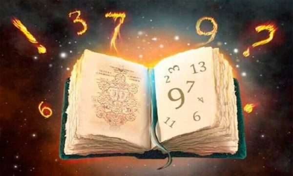

# Төрсөн он, сар өдөр ба эд баялгийн тоон утгууд

Хүний төрсөн өдөр, тухайн хүнийхээ хувь хүний өсөлт цэцэглэлт, амжилтынх нь код болдог гэж тоон утга судлаачид үзсээр байна. Энэхүү төрсөн он, сар, өдрийн тоог хооронд нь нэмж гаргасан нэг оронтой тоо буюу код нь, сайхан ирээдүйг цогцлоох чиглэлийг тань тогтоох код болж өгөхөөс гадна, амьдралдаа сайн сайхан, эд баялагийг татах, мөн алдаа онооноос сэргийлэх боломж олгодог гэнэ. Төрсөн он, сар өдрийн тоонуудыг энгийн аргаар нэг бүрчлэн нэмж, мөн нийлбэр болох хоёр оронтойг хооронд нь нэмэх маягаар нэг оронтой тоо гаргаж авдаг. Харин 11, 22 гэсэн нийлбэрийг хооронд нь нэмдэггүй онцгой тоо гэж үздэг байна. Жишээ нь, 1985.10.28=1+9+8+5+1+0+2+8=34, 3+4=7

*Тооцож гаргасан тооныхоо харгалзах утгыг уншаарай.*

#### Нэг

Манлайлах увидастай хүчирхэг хувь хүнийг харуулдаг. Амбицтай, командлуулах дургүй, удирдах албан тушаал эрхэлдэг. Үйлдэл, үйл хөдлөлийн дарааллаа сайн мэддэг, бүтээлч чадавхитай хүн. Санхүүгийн эрх чөлөөнд, идэвхитэй үйл ажиллагааны үр дүнд хүрдэг бөгөөд бусдын санал бодлыг сонсохыг мөн мартаж болохгүй. Нумерологчид, 1 кодтой хүмүүст, хошин шог зантай байх, аливааг хошигнон өнгөрүүлэх чадвартай байхыг сануулдаг бөгөөд энэ нь, олон таагүй зүйлийг давахад нь тустай гэж үздэг. Давуу сайн чанарууд: тууштай байдал, бардам байдал, хүчирхэг сэтгэхүй. Сул тал: хувиа хичээмтгий, эргэн тойрныхноо ойшоохгүй байх хандлага, онгироо зан, залхуудуу. Эдгээр нь эхэлснээ дуусгахгүй байхад хүргэх магадлалтай. Хамгийн аз дагуулах өдөр нь 3-дах өдөр. Нарыг дүрсэлсэн зүйлс, махчин шувууд, лууны дүрс эд баялагийг дуудах сахиус нь болж өгөхөөс гадна хүссэндээ хүрэх, өсч дэвжихэд нь тусалж, сэтгэл хөдлөлд нь сайнаар нөлөөлнө гэж зөвлөдөг байна.

#### Хоёр

Энэ тоо амжилтад багаараа хүрэх боломжийг заана. Ганцаар бус, хамтран ажилласны үр дүнд амжилтад хүрэхэд шаардагддаг сайхан сэтгэл, нийтэч зан, ойлголт зүтгэл гэсэн бүхий л сайхан чанарууд эдгээр хүмүүст заяагдсан байдаг. Харилцааны чадвараа хөгжүүлж, бие организмдаа санаа тавьж, төрөл бүрийн дасгал хийх маягаар биоритмдээ анхаарах хэрэгтэй. Ихэвчилэн гэр бүлтэй холбоотой асуудлаар эд баялагийг олж авна. Гэрлэлт, эсвэл гэр бүлийн харилцаатай холбоотой ажил алба эрхлэх зэргээс. Сонирхолтой нь, аливааг хоёр хурууны тусламжтай хийх, жишээ нь гарын үсгээ хоёр хуруугаараа үзгээ барьж зурах гэх мэтээр үйлдэх нь сайн байдаг гэнэ. Эрсдэлээс айх, эргэн тойрныхныхоо сэтгэл санааг ойшоохгүй байх, ичимхий бүрэг байдал, гомдомтгой зан, хэт мэдрэг байдал гэсэн сул талуудаа ялж чадвал эд баялагт хүрэх зам нь нээгддэг аж.

#### Гурав

Төрөлхийн азтай, урам зоригтой, мөн элбэг хангалуун байдал, амжилт цэцэглэлтийг өөрсдөө ч татаж чадах хүчтэй хүмүүс. Илүү их амжилтад хүрэхийн тулд, зөн совингоо ажил хэрэгтээ ашиглаж сурах хэрэгтэй. Төрөлхийн манлайлах чанар нь хүссэн албан тушаалдаа богино хугацаанд хялбар хүрэх боломжийг олгодог. Бусдыг итгүүлэн үнэмшүүлэх чадвартай. Атаархагчидыг анхаарахгүй байж, өөрийн баялаг төсөөлөл, мэдрэмжээ уран санаа, сонирхолтой төслүүддээ л хандуулдаг байх нь их зүйлд хүргэнэ. Усаар хол аялахаас болгоомжилох. Хэт яриа зан, хар сэр, өөрийгөө доогуур үзэх үнэлэмж зэргээ ялж чадвал амжилт, алдар нэр, эд баялаг гарт нь байдаг. Алтан эдлэл ээлтэй, бүргэд, лууны дүрст чимэг сайн. Үе дамжиж ирсэн эдлэл хишиг буянаа өгнө.

#### Дөрөв

Эдгээр хүмүүс, төрөлхийн бүтээн босгогчид, мөн оюун ухаан нь илүү хөгжсөн, жижиг сажиг зүйлсийг анзаарахдаа гаргууд, тэдгээрийг ашиг тустай болгон хувиргах увидастай. Эд баялагт хүрэхийн тулд, урт хугацааны төслүүд дээр ажиллах, хураасан мөнгөө ариглан хадгалах, хариуцлагаас зугтахгүй байх хэрэгтэй болдог. Мөрийтэй тоглоомоос хол байх нь өлзийтэй. Орчин тойрныхныхоо үзэл бодолд хүндэтгэлтэй хандах, бусдыг хэт шүүмжилдэг зангаа засах, залхуурлаас салах, тэвчээрт суралцах зэрэг нь, амжилтад хүргэх замыг тань нээж өгнө. Эд баялаг татах сахиус: Байгалийн гаралтай материалаар хийгдсэн, яс, мод, чулуун яст мэлхий. Өөрөө хүслээ шивнэн сүлжсэн цэвэр даавуу утсан оосор уяа.

#### Тав

Эдгээр хүмүүс, хөдөлгөөнтэй, идэвхитэй, тэвчээргүй, бүхнийг нэг дор, шууд авах хүсэлтэй байдаг. Элбэг хангалуун амьдралд хүрэхийн тулд, нарийн график, дүрэм журамд баригдаагүй ажил төрөл эрхлэх хэрэгтэй. Та олон талт зүйлст дуртай учираас өөрийн жинхэнэ амьд, сонирхол, хүслийг татсан үр бүтээл гарах ажил хөдөлмөр барьж авсан нь дээр. Төрөлхийн нийтэч зан нь, бусдад итгэл төрүүлж, тусламж туслалцаа дагуулж байдаг. Архи болон бусад хортой зуршилууд орлого мөнгөний энергийг нь хаадаг тул хориглохыг зөвлөдөг. Амжилтад хүрэхийн тулд, хариуцлагагүй байдал, хэнэггүй зан, аминч байдлаа ялах хэрэгтэй. Ордынхоо чулууг зүүж хэрэглэх маш сайн, задардаггүй мөнгө хэтэвчиндээ байлгах хэрэгтэй.

#### Зургаа

Энэ хүмүүс илэн далангүй байдал, бусдад сайныг хүсдэг сайхан чанараараа ялгарч байдаг. Тэдний аз амжилт, орчин тойрных нь хүрээллээс ихээхэн хамаардаг. Нумерлогчид, тэдэнд, ая тух, тайван тухтай байдал, сайхан өөдрөг хүмүүсээр өөрийгөө хүрээлүүлэхийг онцлон анхааруулдаг. Тэдний элбэг хангалуун байдал, гэр орон, гэр бүлтэй нь шууд холбоотой байдаг. Тиймээс гэр бүлийн бизнес эрхлэхийг зөвлөдөг. Тэд эмч багш болвол гайхалтай сайн. Ялах ёстой сул талууд: зөрүүд, хэт бардам, бусдын хэрэгт оролцох дуртай, бусдад дарамт шахаас үзүүлэх зан, хайхрамжгүй байдал. Төмөр, мэс заслын гангаар хийсэн эдлэл, шувууны дүрс бүхий зүүлт чимэг, фэн-шуйн билэгдлүүдийг хэрэглэх сайн.

#### Долоо

Ажигч гярхай, өөдрөг хүмүүс. Ганцаараа байх дуртай. Өөрийгөө боловсруулах, авъяасаа хөгжүүлэх, гайхалтай санаануудаа дэвшүүлж хэрэгжүүлэх замаар санхүүгийн эрх чөлөөнд хүрэх боломжтой. Бие мах бодын хөдөлмөрөөр амжилтад хүрэхгүй. Ажилдаа төвлөрч ажиллах, мөн тэвчээртэй чанар нь амжилтад хүргэнэ. Ялах ёстой сул талууд: хэт нууцлаг, меланхолик, тэвчээргүй, буруу зуршилууд. Энергийн хамгаалалт хийлгэх, улаан утас зүүх сайн.

#### Найм

Эдгээр хүмүүс манлайлагч байхыг эрмэлзэх, уран илтгэлээр хичээллэх, бусдын төлөө ажиллах хамгийн тохиромжтой. Мөнгөний энерги нь хэрхэн ажиллаж буйгаас нь хамааралтай байдаг. Бизнесийн авъяастай, энэ нь өргөн боломжуудыг нээж өгч байдаг ч, ихээхэн зүтгэлийг шаарддаг. Харилцааны чадвар, тууштай чанар, ажиллах гайхалтай чадавхиа бүрэн ашиглаж байх хэрэгтэй. Санхүүгийн эрх чөлөөнд хүргэх замыг нь эрүүл мэндээ хайхрахгүй байх, хэт амбицтай зан, тэвчээргүй байдал нь хааж байдаг. Хэт үрэлгэн эсвэл хэт нарийн байхаас болгоомжлох.

#### Ес

Эдгээр хүмүүс төрөл бүрийн хосгүй авъяастай, оюунлаг хүмүүс. Санхүүгийн эрх чөлөөнд хүрэхийн тулд, орчин тойрондоо тэвчээртэй хандах, ашгийн бус салбарт ажиллах чадвараа сайжруулах шаардлагатай байдаг. Өндөр оюун сэтгэхүйгээс нь үүдэлтэй хязгааргүй нөөц чадварууд нь ямар ч салбарт богино хугацаанд эд хөрөнгөжих боломжийг олгодог. Хэт эрх мэдэлтэй эсвэл хэт санаа тавих ажилаас илүүтэй бусдын сайн сайханд чиглэгдсэн биеэ даасан ажил эрхлэвэл, сэтгэлийн болоод эд материалын сэтгэл ханамжид хүрдэг. Баяжихад нь саад болдог сул талууд: уур бухимдал, сэтгэлийн дарамт, нарийн хахир байдал, сэтгэлийн тэнхээгүй зан, шийдэмгий бус байдал, сэтгэл санааны тогтворгүй байдал, эдгээр нь тэднийг сэтгэл санааны уналтад оруулж, идэвхитэй, үр бүтээлтэй ажиллаж хүссэндээ хүрэхэд нь саад учируулж байдаг. Аль болох өөрийн гараар урласан даавуун дүрс, урлал, мөн үнэт металлан бөгж, бугуйвч. Эдгээрийг биеэс салгахгүй байх нь хүссэн болгоныг нь амьдралд нь оруулах сахиус нь болж өгдөг байна.

#### Арван нэг

Энэ тооны хүмүүст хязгааргүй их зөн билгийн авъяас чадвар нуугдаж байдаг. Элбэг хангалуун амьдаръя гэвэл, зүгээр л өөрийн дотоод дуу хоолойгоо сонсч, зөн совингоо хөгжүүл гэдэг. Таагүй зүйлсээс зайлсхийж, амжилтад хүрэх замаа хурдавчилах, авъяас чадваруудаа ашиглан бусдад туслах зэрэг бүх боломжууд дотор нь байдаг. Гэхдээ, амжилт нь тэдний шударга бус, сэтгэл гаргаагүй байдлаас ихээхэн шалгаалдаг гэдгийг мартаж болохгүй. Гайхалтай дипломатч, улс төрч, олон нийтийн зүтгэлтэн болох бүрэн боломжтой. 11-ийн тоотой холбоотой, хуурмаг зан, аминч зан, хайхрамжгүй хандлага, өөрийн ашиг сонирхлоо дээр тавих зэрэг сул талуудаа ялснаар амжилт, эд баялаг, элбэг хангалуун байдалд хүрнэ. Хагас үнэт чулуун эдлэлүүд зүүх, эгц босоо шатыг дүрсэлсэн зураг дүрс байлгах нь сайн сайхныг татахад нь тустай байдаг.

#### Хорин хоёр

Энэ тооны хүмүүс өөрийнхөө чадвар нөөц бололцоогоо далайцтай хэрэгжүүлэх чадвартай. Тиймээс манлайлагч чанараа ашиглан алдартан болох боломжтойгоос гадна хувь тавилангаа шийдэх хэмжээний бүхий л зүйлс гарт нь байдаг. Энэ хүмүүсийн хувьд, улс орондоо зүтгэх, өндөр албан тушаал хаших, бусдыг удирдах чиглэлтэй холбоотой бүх зам нээлттэй. Амжилтад нь, хэт бухимдуу адгуу байдал, онгироо зан, хэт том ажилыг тооцоогүй шүүрч авах зэрэг байдлууд нь садаа болдог тул анхаарах. Голж шилэлгүй ажиллах нь өгөөжтэй. Байгалийн гаралтай материалаар хийгдсэн лууны дүрс, шаазан хонх зэргийг өөртөө байлгах ээлтэй. Эдгээр нь, зөвхөн өөрийн зүтгэлийг үнэлэхийн зэрэгцээ өөрийнхөө өсөлтөд оруулсан бусдын хувь нэмэр, хөдөлмөрийг үнэлж сурахад тустай байдаг гэнэ.
