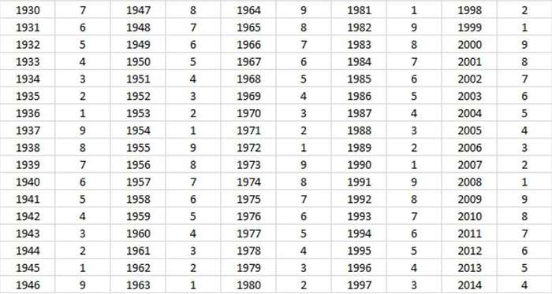

# Төрсөн оны карма

“Карма”-г, үйл, үйлдэл, үйлийн үр гэж нэрлэдэг бөгөөд түвдүүд, хүний сүнсийг 9 удаа хүртэл хүний биед биелэн төрдөг гэдэг байна. Шинэ амьдрал бүртээ, өөр өөр тавилангаар амьдарч, мөн урд насны амьдрал нь, тухайн амьдралд нь тусгагдаж байдаг гэж үздэг. Хүний тавилан, карма-г төрсөн оноор тодорхойлох түвдийн арга байдгийг танилцуулъя. Дараах хүснэгтээс, төрсөн оноо олж, харалдаа тоо буюу “мева”-н тайлбарыг уншаарай.

**1.** Та, тайван бус, бага зэрэг уруу үзэлтэн хүн юм. Гаднаас тань харахад, та илэн далангүй, найрсаг хүн хэдий ч, дотроо зөрүүд бяцхан хүүхэд мэт зантай. Ихэнхи тохиолдолд, нөхцөл байдалд амархан дасна, харин аливааг өөрчилөх тань ховор. Амьдралын явцад архи, мансууруулах бодисын асуудал гарах магадлалтай. Бөөр, давсаг, сав, бэлхүүс хавийн өвчилөлөөс сэргийлж байх ёстой. Сэтгэл санаагаар огцом унах, сэргэх байдал ажиглагддаг. Мөрөөдөлдөө автахгүй. Хайраар их дутагдаж байдаг.\
**2.** Та, уур уцаараас хол, найрсаг, эелдэг зантай хүн юм. Заримдаа амбицтай, санаачлагагүй байдал гаргах, аливааг хэт нарийвчилан үзэх байдал гаргадаг. Та, манлайлахаас илүүтэй сайн ажиллахыг хичээдэг. Хариуцлагатай ажилтан, багаар ажиллах сайхан чадвартай. Хамгийн амжилттай үе тань, 40-47 нас. Та, амттанд дуртайгаас, ихэвчилэн махлаг байх хандлагатай. Карма-н өвчилөлүүд тань, нурууны өвчин, арьс, гэдэс, цустай холбоотой байх магадлалтай. Хань ижилдээ анхаарал халамжтай. Бодол сэтгэлээс илүү мэдрэмжээ удирдлага болгодог. Материаллаг байдал дунд зэрэг. Мөрийтэй тоглоом, хонжворт сугалаа зэргээс хол байх хэрэгтэй. Муу төгсгөлүүд хүлээж байдаг. ажил мэргэжлийн хувьд, олон нийт, хүмүүстэй харьцдаг мэргэжлүүд, байгал дэлхийд ойр хөдөө аж ахуйн ажил хөдөлмөр сайхан зохидог\
**3.** Та, ээжийн эрх хүүхэд биш. Эрт ухаажиж, биеэ даадаг ба өсч төрсөн гэр орноосоо, өөрийн замыг эрж хайхаар эрт явдаг. Биеэ даасан, өөдрөг зантай, залуу сэтгэлгээтэй. Мөн маш зөрүүд, тэвчишгүй хүн боловч, өөдрөг зан, эерэг энергээр тань дарагдаж байдаг. нөхцөл байдалтай эвлэрэхдээ муу. Хамгийн амжилттай үе, 34-38 нас. Өдрөөрөө амьдардаг, унах босох нь элбэг. Олсоноо амархан үрдэг, хурааж хадгалах сонирхолгүй. Сайхан бие галбиртай, хүчирхэг, хөдөлгөөнтэй. Хөлний өлмий, мэдрэлийн системийн өвчилөлөөс болгоомжилж байх хэрэгтэй. Таагүй зүйлс, мансууралтай холбоотой зүйлсээс хамааралтай болохоос сэргийл. Иймэрхүү зуршилуудад нэг мөсөн автах аюултай. Өөрийгөө бүрэн илэрхийлж чадах мэргэжлүүд, багш, илтгэгч, зохиолч, хөгжимчин. \
**4.** Хангалттай эерэг зан төрхтэй хүн. Гэхдээ таны байр байдалд, айдас болгоомжилол, хүч чадал дутмаг чанар тань саад болж байдаг. Төрлөхөөсөө маш эмзэг, сайхан сэтгэлтэй хүн. Амжилтын оргил үе тань, 38 нас хүртэл үргэлжилдэг. Бие султай байх магадлалтай. Өндөр том духтай. Халдварт өртөмтгий. Амьсгалын замын өвчилөлөөс сэргийлж, гэдэс ходоодондоо анхаарч байх хэрэгтэй. Ийм карма-тай эмэгтэй бэлгийн замын өвчинөөс сэргийлж, болгоомжилж байх ёстой. Гадаад төрх нь аятайхан дур булаам байдаг. Өсч төрсөн гэр бүлийнхээ хүүхдүүд дундаас хамгийн түрүүнд ухаажиж, өсдөг. Харин, гэр бүлийн хамтын амьдралыг урт удаанаар зохиох асуудал нь, өөрөөс шалтгаалахгүй хүндрэлтэй байх нь олонтаа. Таныг зальдах, мөн хуурагдахаас болгоомжилж байх хэрэгтэй. Мөнгө төгрөг, эд материал тогтворгүй. Нийгэм олон түмэнтэй харилцах мэргэжилүүд тохирдог. \
**5.** Та, дундач байж чаддаггүй хүн. Нэг бол маш сайн эсвэл маш муу. Зөв эсвэл дутагдалд автсан. Зорилготой эсвэл залхуу. 42 насны үед амьдралын таагүй байдал учирна. Өөрийгөө хамгаалах өндөр инстинктэй. Эрүүл бие мах бодтой, барагтай өвчинийг организм нь дарах чадвартай. Гэхдээ хавдар, даралт, цусны өвчилөлөөсс сэргийлж байх хэрэгтэй. Хайрлуулах, хамтын амьдралаар амьдрах маш чухал. Харилцаандаа, бүхнийг өөрөөрөө байлгах гээд байх хандлагатай. Аз завшаан тэр бүр таныг дагахгүй ч, алдагдал, гарз хохирлоос хурдан гарах чадвартай. Мөрийтэй тоглоомд дурлах байдал ажиглагдна. Бүхнийг сүйрүүлэх тул болгоомжил. Өндөр албан тушаалыг эрэлхийвэл зохино. Ийм нөхцөлд, жинхэнэ өөрийгөө нээж амжилтад хүрдэг. \
**6.** Зөн совин тань гайхалтай хөгжсөн хүн юм. Төрлөхийн манлайлагч, шинийг бүтээгч. Иаш өндөр зорилго тавьж, түүн рүүгээ итгэл төгс алхдаг. Өөртөө сэтгэл хангалуун байдаг цөөнх хүмүүсийн нэг. Гэхдээ азгүйтлийг үзэж чаддаггүй. 40 насандаа бүхэнд хүрнэ. Туранхай ясархаг бие галбиртай. Сэтгэл санааны байдал, сэтгэл хөдлөл, ажиллах чадвартаа анхаарч байх ёстой. Учир нь амархан ядарч туйлддаг. Мэдрэлийн ядаргаа, толгойн өвчинд өртөмтгий. Уушиг, яс, зүрхний асуудалтай. Хамтын амьдралын харьцаанд, давж ч чадна, бууж өгч ч чаддаг. Мөнгөтэй харьцах харьцааны хувьд, хурдан мөнгөжиж, мөн түргэн үрдэг. Амжилттай худалдааны ажилтан, багш, илтгэгч, шашины зүтгэлтэн, номлогч болох боломжтой. \
**7.** Өөдрөг, мөн түргэн зантай. Гайхалтай уран илтгэгч, уран үгтэй. Анхаарлын төвд байх дуртай, хэн ч анхаарахгүй бол уурладаг. Аливааг нарийвчилан шинжиж байдаг. 40 наснаас амьдрал тогтно. Туушгүй учираас бие дааж аливаа зорьсондоо хүрэхэд хэцүү. Бие султай, бөөр давсаг, бэлэг эрхтэн, мэдрэлийн системийн өвчилөлд өртөх магадлалтай. Хайр дурлалын харьцааны хувьд, мэдрэг, сэтгэл татам. Төрлөхийн эрх чөлөөнд дуртай. Хань ижлээ сонгох сонголт нь эдгээр хүмүүсийн хувьд маш чухал байдаг. Хуульч, санхүүчийн мэргэжлээр амжилтад хүрдэг. \
**8.** Өөртөө итгэлтэй, зөрүүд. Өөрийн чинь бодлоос өөр ямар нэг зүйлд итгүүлэн үнэмшүүлэхэд бэрх. Төвийг сахигч, өөрийн үзэл бодлоо бусдад тулгах дуртай. Орчин тойрныхондоо тайван томоотой хүн мэт харагддаг ч, дотроо хатуу чиг шугам баримталж нугардаггүй. Ер нь, өөрийн үнэлэмж өндөртэй “чоно” гэсэн үг. Биерхүү, том биетэй. Эрүүл. Атесклероз, нуруу нугас, мэдрэлийн системийн өвчинөөр өвдөх магадлалтай. Залуудаа, хайр дурлалын хувьд замбараагүй байдаг. Эрт алдар нэрд хүрдэг ч, мөнгөнөөс их хамааралтай амьдардаг. Тогтвортой, итгэлтэй ажил төрөл эрхлэх дуртай. \
**9.** Та, маш нарийн мэдрэмжтэй, мэдрэг хүн. Гунигтай кино үзээд уйлах, эсвэл үхтлээ инээх, таных. Гялалзсан сайхан, ашиг багатай амьдралаар амьдрах нь бий. Тухайн нөхцөл байдал болон сэтгэл хөдлөлөөрөө аливааг шийдэх гээд байдаг. бусдыг шүүмжлэх дуртай. Эргэн тойрныхноосоо, хэт ихийг хүлээж, шаарддаг. Хайр дурлалын харьцааны хувьд, өөрийгөө нэгд тавьна. Төрлөхийн идеалист, материаллаг байдлыг шүтдэггүй. Дунд нас амжилттай, цаашид буурах магадлал ажиглагддаг. Та, хүчирхэг, уян хатан чанартай, дундач бие галбиртай хүн. Зүрх, нүд, мэдрэлийн өвчилөлүүд, нойргүйдэлд өртөж байдаг. материаллаг байдлын хувьд, туйлбаргүй зангаасаа болж амжилтад хүрэхгүй байх нь элбэг. Бусдыг байлдан дагуулах чадвартай. Аз завшаанаар дүүрэн амьдралтай. Дипломат, жүжигчин, урлагийн салбарт амжилтад хүрдэг. \
Та, үүнийг уншсан бол баярлалаа. Гэхдээ, ямар ч тохиолдолд бид, өөрсдийн хувь тавилангаа бүтээгчид бөгөөд амьдрал маань зөвхөн биднээс хамаардаг гэдгийг санаарай. Дээр дурдагдсан зүйлсийн, болгоомжлох хэрэгтэй зүйлсийг нь анхаарч, эерэг сайхныг нь ажил амьдралдаа урам зориг болгон хэрэглэх хэмжээнд хүлээж аваарай.
