# Төрсөн сарын чулуугаар шинжих нь

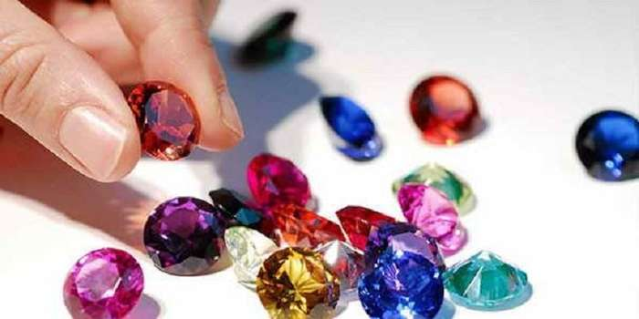

Бид,хүмүүсийг шинжих төрөл бүрийн аргуудыг, өөрсдийгөө таних үүднээс сонирхон хүлээж авдаг. Уруулын будгийн хэлбэрээр, гарын алганы зураасаар гэх мэт олон төрлийн шинжих аргууд нь, итгэмээргүй байдаг боловч таардаг нь сонирхолтой байдаг. Төрсөн сарын чулуу, хүний зан чанарыг яаж илэрхийлэх билээ гэж бодох тань дамжиггүй. Гэтэл ордуудын чулуу, таны төрсөн сартай уялдаатай байдаг учраас олон зүйлээр холбогдсон байдаг байх нь.

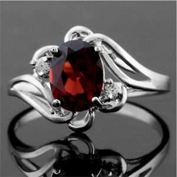

#### 1 сар –анарТа их амбицтай, төлөв хүн. Маш үнэнч, үргэлжийн ажиллаж байдаг. үзэл бодлоо дээдэлдэг. Их эмзэг сэтгэлтэй, мөн хүмүүстэй харьцах дуртай, бусдыг сургаж, сурч байдаг.

---

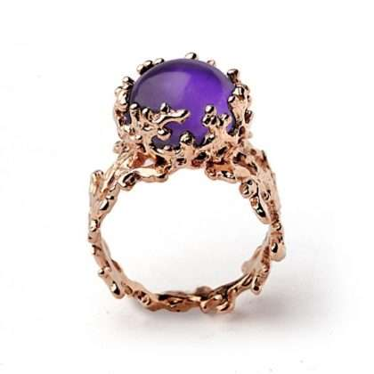

#### 2 сар –ягаан болорТаны бүтээлч, оюунлагийн хүч тайван, даруу байдалтай чинь хоршиж байдаг. Танд эрх чөлөө зайлшгүй чухал. Ийм хүмүүс ер нь зоримог, мөрөөдөлдөө хүрэхийн төлөө тэмцдэг. .

---

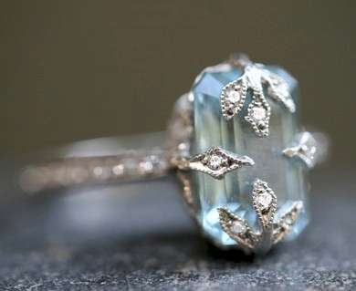

#### 3 сар – аквамаринЭнэ хүмүүс зөөлөн, шударга өгөөмөр байдаг. Хурдан дурладаг, мөрөөдөх дуртай. Бага зэрэг нууцлаг, дайван байдал, эв эеийг юунаас ч илүү эрхэмлэдэг. .

---

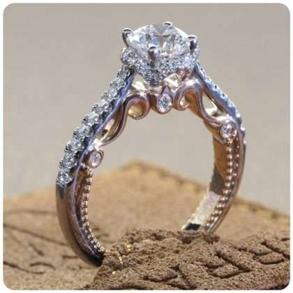

#### 4 сар – алмазТа хүчирхэг, түрэмгийдүү, гэвч хүмүүстэй сайн учраа олдог. Мөн зоригтой, аймшиггүй боловч, өөртөө анхаарал тавиулахыг хүсч байдаг. Дурламтгай, өгөөмөр, сэдэл сайтай хүмүүс. .

---

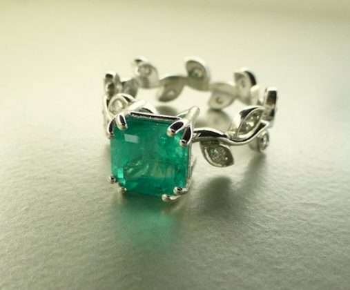

#### 5 сар – маргадМаш өргөн төсөөлөлтэй, зоригтой, зөрүүд, бусдыг маш сайн ойлгодог. Хөдөлмөрч, бусдад жаргал өгөхийг хүсдэг. .

---

#### 6 сар – александритТа яриасаг, зугаатай хүн. Хүмүүстэй сайхан харьцдаг, ямархуу сэтгэгдэл төрүүлэхээ мэддэг. Эмзэг, мэдрэг мөн эелдэг. Хэрэв гомдоож шархлуулвал эргэж сэргэхдээ удаан. .

---

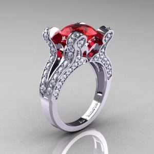

#### 7 сар – бадмаарагХөгжилтэй, аядуу, хүний аяар, овжин хүмүүс. Та, уг нь сэтгэл хөдлөмтгий боловч, бусдыг боддог хүндэлдэгээс, тэр бүр сэтгэл хөдлөлөө илэрхийлдэггүй, нууж явдаг. Та маш өөдрөг сэтгэлтэй учраас ямарваа маргаан, асуудлуудыг хялбархан зохицуулж шийдэж чаддаг. .

---

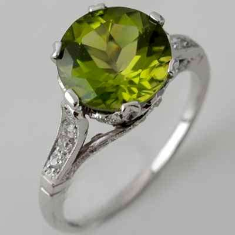

#### 8 сар – биндэрьяАймшиггүй, их бодит эерэг хүмүүс. Танд, асуудлуудыг нөхцөл шалтгаанаар нь бодож өвөрмөцөөр шийдэх авъяас байдаг, энэ чанарыг тань хүмүүс магтан шагших нь бий. .

---

#### 9 сар – индранилТа маш өндөр шалгуур стандарт тавьдаг, мөн бусдад санаа тавьдаг, шинэ санаанд дуртай, шинэлэг зүйлсийг эрэлхийлж байдаг шинэлэг хүн. Мөн уран бүтээлч чанар бий. .

---

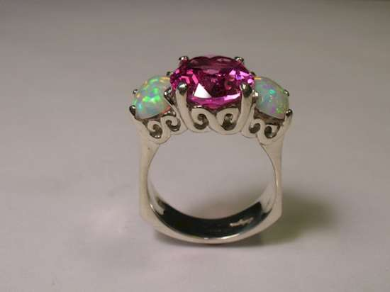

#### 10 сар – ягаан турмалинХүчирхэг биеэ даасан хүмүүс. Нөхөрсөг, нийгэмсэг, аятайхан хүн. Эв эеийг эрхэмлэн харьцуулалт жишилтээс зайлсхийж явдаг.

---

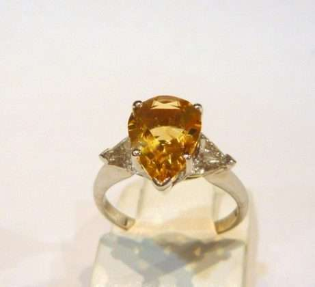

#### 11 сар – молорАмбицтай, өөрийн сэдлээр л хөдөлдөг, магтаал сайшаалаар дутахгүй боловч, магтсан хүнд дуртай. Ухаантай, хүмүүсийг ойлгодог.

---

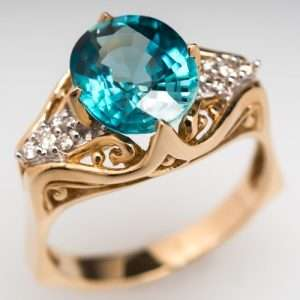

#### 12 сар – цирконЭрч хүчтэй хөгжилтэй хүмүүс. Байнгын хөдөлгөөнтэй, ямагт туршилт судалгаа хийх бэлэн байдалд байдаг. Таныг бусад хүмүүс, тоглоомч, өгөөмөр хүн гэж боддог, учир нь та, хүмүүсийг үргэлж инээлгэж явдаг.
