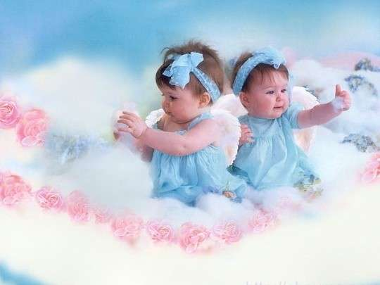
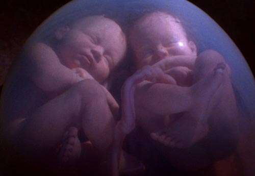

# Төрсөний дараа амьдрал байдаг уу?

Бидний сонирхолыг, үхсэний дараа амьдрал байдаг болов уу? гэсэн асуулт ихэд татаж байдаг. Гэтэл, эхийн хэвлийд байгаа хоёр хүүхэд хоорондоо, төрсөний дараа амьдрал байдаг болов уу? гэж ярилцаж байх юм гэнэ. Энэ хоёр хүүхдийн нэг нь Бурханд итгэдэг, харин нөгөөх нь итгэдэггүй аж. Энэ яриаг уншаад, бидний тайлагдашгүй гарал үүсэл, мэддэггүй нууцууд улам ихсэх шиг мэдрэмж төрөх юм. Та, юу гэж бодож байна?

Бурханд итгэдэггүй хүүхэд:\
-Чи төрсөний дараа амьдрал байгаа гэдэгт итгэдэг үү?\
Бурханд итгэдэг хүүхэд:\
-Тийм, итгэдэг. Төрсөний дараа амьдарал байгаа. Бид энд, хангалттай хүчтэй болж, биднийг хүлээж байгаа зүйлд бэлтгэгдэж байгаа гэж боддог.\
-Бүү тэнэгт. Төрсөний дараа амьдрал байх боломжгүй. Байвал ямар байна гэж?\
-Би нарийн, сайн мэдэхгүй л дээ. Гэхдээ тэнд илүү гэгээтэй, магадгүй бид хөлөөрөө явдаг, амаараа юм иддэг болох байх.\
-Яалаа гэж дээ. Бид чинь энд хүйгээрээ хооллодог. Амаараа идэх... инээдтэй юм бүү ярь. Тэгээд ч би чамд хэлчихье, төрсөний дараа амьдрал байхгүй, хүй бол бидний амьдрал юм. Хүй тэгээд ч маш богинохон.\
-Магадгүй л дээ. Гэхдээ л, би өөрөөр төсөөлж байна.\
-Гэсэн ч тэндээс хэн ч буцаж ирээгүй юм даа. Төрсөнөөр амьдрал дуусдаг. Амьдрал гэж, энэ устай, харанхуй орчинг л хэлдэг юм.\
-Үгүй ээ, үгүй. Би, төрсөний дараа амьдрал байгаа гэдгийг мэдэж байна. Тэнд байгаа, биднийг халамжилж байгаа ээжийгээ ямар ч гэсэн харна.\
-Ээж ээ? Чи бас ээжид итгэдэг юм уу? Тэр тэгээд хаана байгаа юм?\
-Тэр биднийг тойроод байгаа шүү дээ. Бид дотор нь байж, түүний ачаар амьдарч байна. Тэр байгаагүй бол бид байхгүй шүү дээ.\
-Худлаа. Би түүнийг хэзээ ч хараагүй. Тиймээс тэр байхгүй!\
-Үгүй ээ! Би түүнийг аяархан ч гэсэн хааяа, дуулж байхыг нь сонсдог, би илж байхыг нь мэдэрдэг. Би, бидний жинхэнэ амьдрал төрсөний дараа эхлэнэ гэдэгт хатуу итгэдэг.
