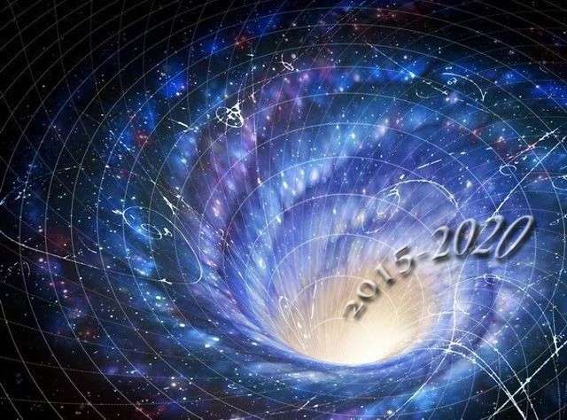
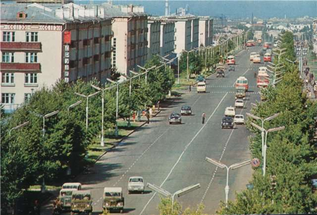

# Цаг үеийн өөрчлөлт

Цаг үеийн өөрчлөлт гэж гайхамшиг юм. Бидний хоорондоо утсаар ярилцдаг энэхүү үгсийг, 30 жилийн өмнө хүмүүс сонсвол галзуу, мэдрэлийн гажигтайд тооцон, түргэн дуудах байсан биз ээ...

-цаг хэд болж байна? утас маань унтарчихаж...\
-утсаараа гэрэлтүүл дээ харагдахгүй байна...\
-чамтай ярихад, гар даараад байна...\
-золиг гэж, хуудас руугаа орж чаддаггүй ээ...\
-би чамд, 10 минутын өмнө мессеж /зурвас/ бичсэн, уншив уу?\
-утсанд минь мөнгө хийгээдхээч...\
-утсан дээрээ үржүүлчихээч...\
-автобусанд суух 500 төгрөг өг дөө.../тэр үед автобусны билет 50 мөнгө, сарын дундач цалин 500 төгрөг байсан/\
-машинаар явж байхдаа ном сонсоод амжчихсан шүү...\
-утасны цэнэг дуусаад зураг авч чадсангүй...\
-гэрийн кино театр авдаг юм билүү...\
-би санамсаргүй “Дайн ба энх”-ийг устгачихлаа...\
-зараа цацсан уу...\
... Харин бид, өөрсдөө 30 жилийн дараа, энэхүү үгсээ дурсан, тийм байж билээ гэж хөхрөн суух болов уу...
