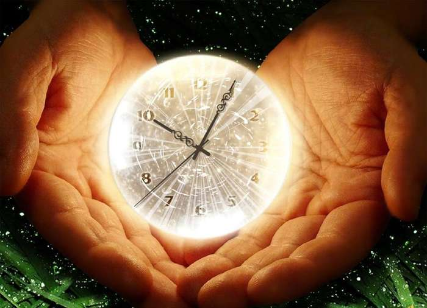

# Цаг явж байна...

Унтаж байхад ч цаг явж байдаг. Хооллож байхад ч цаг явсаар. Унаагаар явж байх зуур ч цаг явж л байна. Мөнгө хэрхэн олохоо бодож байх үед маань ч цаг явж л байх...

Он жил нь сарууд, сар нь долоо хоног, долоо хоног нь өдрүүд, өдөр нь цаг, цаг маань минут, минут нь хором, харин, хором маань гялс хийн алга болдог. Бидний цаг хугацаа олон гялс хийн өнгөрөх, хормуудаар хорогдон, хэзээ ч дахин ирэхгүйгээр урссаар... Гэтэл, цаг хугацаа, амьдралын хамгийн үнэтэй зүйл гэдгээ, бид, эрсдэлээ тооцож бодсоор суух тэр хугацаанд, өөр нэгэн эрсдэлээ даван амжилтад хүрч байдаг, бид, шийдвэр гаргахаар бодож суух тэр хугацаанд, өөр хүн шийдлээ олж амжилтад хүрч байдаг, бид, ажил төрөлдөө түүртэн суух тэр хугацаанд, хэн нэгэн зууны нээлт хийж байдаг, бид, ямар ч ашиггүй зүйл эргэлдүүлэн суух үед, хэн нэгэн ашигтай зүйлийнхээ үр шимийг хүртэн суудаг зэрэг цаг хугацааг үр ашигтай зарцуулдаг хүмүүсийн амжилттай жишээнүүдээр харуулан, үнэлшгүй зүйл гэдгээ мэдрүүлсээр байдаг. Цаг хугацааг хэзээ ч буцааж болдоггүй, мөн танд, надад хичнээн өгөгдсөн нь ч тодорхой биш байдаг хамгийн үнэтэй зүйл гэдгийг бид, мах цусандаа ойлгох ёстой. Цаг хугацаагаа үр ашиггүй үрэхээс татгалзаж, сэтгэлээрээ амьдарч, зөвхөн таалагддаг зүйлээ эрхлэн, аз жаргалыг өгдөг хайр, эв эеэр өөрийгөө хүрээлүүлэн, хайртай дотныхноо байгаад нь баярлаж үнэлэн, аз завшаан, боломж бүрийг ашиглан амьдрахад цаг хугацаа дуртай байдаг мөн уртасч байдаг ажээ. Мөн, өөрийн оюун сэтгэхүйг хөгжүүлснээр, цаг хугацааны утгаас үл хамаарах, мөнхийн оюунд хүрэх боломж байдгийг, үнэт цаг хугацаа маань, шивнэн сануулах юм...
