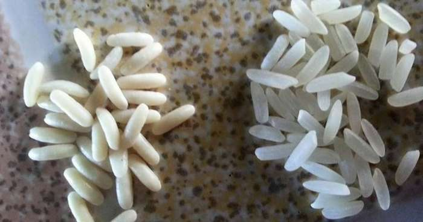
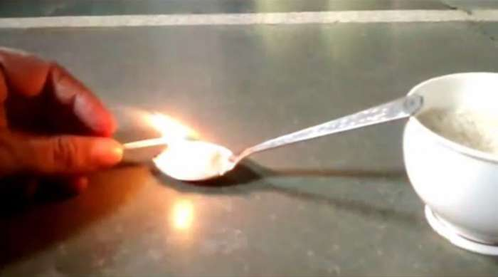
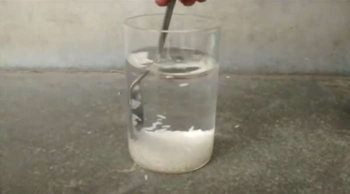

# Цагаан будааг шатааж шалгаад хэрэглээрэй

Сүүлийн үед, хүнсний бүтээгдэхүүнийг хуурамчаар хийдэг болсон тухай дэлхий даяар яригдаж байна. Хятадад хуванцарын орцтой цагаан будаа хийж гадаадын зах зээлд гаргаж байгаа тухай солонгосын Korean Times сонины мэдээлснийг, хуурамч цагаан будааг, хэрхэн таньж мэдэх аргын хамт хүргэе. Энэхүү будаа нь тэр чигтээ хуванцар биш, төмсний цардуул дээр будааны хэлбэрийг гаргахын тулд хуванцар нэмсэн байдаг бөгөөд үүнийг идэж хэрэглэх нь бидний нэрлэж заншсан “гялгар уут”-ыг идэхтэй адил юм байна. Тиймээс дараах шалгах аргуудыг хэрэглэж заншаарай! \
-хүйтэн усанд хоолны халбага цагаан будаа хийж сайтар хутгахад, будаа ёроолдоо тунаж байвал хэрэглэж болно. Хөвбөл хуурамч будаа юм байна.\
-халбагатай будааг чүдэнз зураад шатаагаад үз. Хуурамч будаа шууд асч шатна. Хуванцар үнэртнэ.\
-уур нүдүүрэнд хийгээд нүдэхэд, жинхэнэ будаа бутарч гурил шиг цагаан өнгөтөй болно. Харин хуурамч нь шаргал өнгөтэй зууралдсан зүйл болдог.\
-болчихсон будааг шалгахдаа, хэсэг будааг битүү саванд хийгээд орхиход хэсэг хугацааны дараа хөгцөрнө. Хуурамч будаа хэвээрээ байдаг

---

