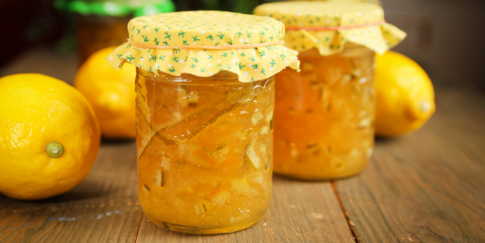
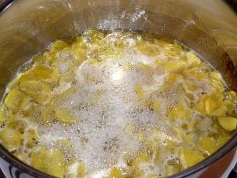

# Цагаан гааны чанамал

Цагаан гааны ашиг тусыг, мэдэхгүй хүн бараг үгүй биз ээ. Энэхүү эрүүл мэндэд ашигтай ногооны хэрэглээ маань, хоолны хачир, ханд, цайгаар хязгаарлагддаг. Тэгвэл, ашигтай элементүүд нь хадгалагдсан, амттай чанамал хийж хэрэглэхийг зөвлөе.

Цагаан гаа 200 грамм. Цэвэрлээд, нимгэн хэрчинэ.\
200 грамм, лимоныг угаагаад, хальстай нь, мөн адил нимгэн хэрчиж жижиглээд, цагаан гаан дээрээ хийнэ.\
400 грамм, элсэн чихэр нэмж, ширүүн гал дээр, элсэн чихрээ түлэхгүйн тулд, байнга хутгана. Хүчтэй буцалмагц , модон халбагаар, тасралтгүй 5 минут хутгаж буцалгаад бэлэн болно.

---

