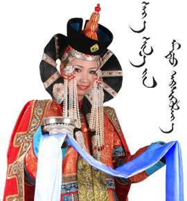

# Цагаан сар

Цагаан сар, монголын хамгийн хүндэтгэлтэй, хүлээдэг, хамгийн том баяр бөгөөд ирж буй жилдээ өвчин зовлонгүй, аз хийморьтой байхын тулд шинийн эхний өдрүүдэд, аль болох сайн үйл хийхийг хичээх, ахмад залуу үеийн холбоог бэхжүүлэх, сэтгэл санаагаа сайхан “цагаан” хүсэл, зорилгуудаар дүүрэн байлгахыг эрхэмлэх ёстой гэнэ.

Тиймээс, цагаан сар нь, хүмүүс болон байгаль дэлхийн шинэчлэлт, сэтгэл санааны цэвэр байдал, итгэл найдвар, сайн зүйлсийн хүлээлтийг билэгдсэн баяр бөгөөд жил гарахаас өмнө, өнгөрч буй жилийн гэм нүглээ гэмших, сэтгэл санаагаа цэвэрлэх, нэг өдрийн мацаг барих гэх мэтээр өөрийгөө ариусгах үйлдлүүд хийдэг байжээ. Мөн, битүүнээс шинийн нэгэн гарах шөнө, Эрлэг номун хааныг ялсан Лхам бурхан газарт бууж ирэн тооллого хийж адисладаг гэх бөгөөд өөрийн биеэр газар дэлхийг бүлээцүүлэн гэсгээж хаврын эхний өдрийг золгуулснаар амьтан бүхэн дулаан ирж буйд баярлан, айл хотлоороо золгон мэндчилдэг ажээ. Золгохдоо, ахмадаа тохойн дороос нь барьж түших маягаар золгодог нь, хүндлэл, амлалт, туслах дэмжих санааг илэрхийлдэг. Энэ баяраар, хол суудаг садан төрлүүд ч бие биетэйгээ уулзаж амар мэндээ мэдэлцэн, билэг ерөөл, бэлэг юугаан солилцдог гэр бүл ахан дүүсийн нэгдэн ойртох уламжлалт баяр билээ. Орчин үед, энэ баяраа хэт хавтгайруулан уух идэх, ширээ засал, бэлэг сэлтээрээ уралдан тэмдэглэж, өөрсдийгээ хүндрүүлэх болсон нь харамсалтай юм. Өвөг дээдсээсээ уламжлан ирсэн, хүндэтгэлт баяраа зөв сайхан тэмдэглэж, үр хүүхэддээ ёс заншил, зан үйлээ өвлүүлэхэд илүү анхаарах нь зүйтэй юм. Цагаан сараа, цагаан сүү, цагаан хүсэл, цагаахан сэтгэлээр угтаж, гарч буй жилдээ, цалгиж халгисан сайхан хүслүүд тань биелэх өлзийтэй ерөөлийг дэвшүүлье.
