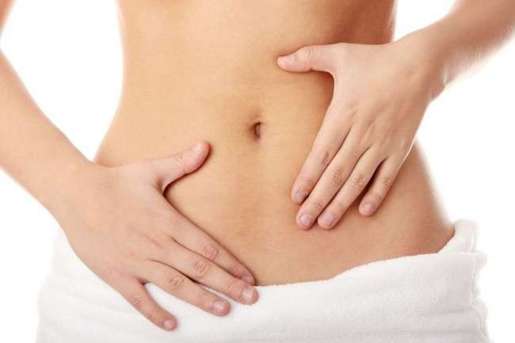
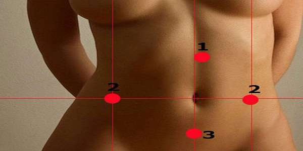
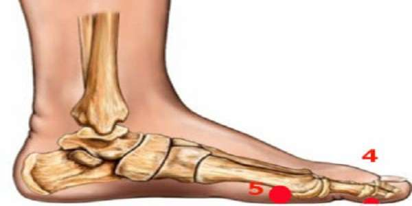

# Цэгийн массаж хийж, илүүдэл жингээс салах арга

Илүүдэл жингийн хамгийн гол шалтгаан нь, биеийн бодисын солилцоо муудсантай холбоотой байдаг байна. Хэрэв, та, бие галбиртаа сэтгэл хангалуун биш байдаг бол дараах 5 цэгт массаж хийж өгснөөр, жингээ хасах үр дүнд хүрэх аж. Эдгээр цэгүүдэд тус бүр 3 минут орчим, хурууны өндөгөөр нар зөв эргүүлэн массаж хийх хэрэгтэй.

Нэг дэх цэг. Хоолны дуршилыг тохируулна. Гэдэсний дунд хэсэгт, хүйс, өвчүүний хонхорхой хоёрын голд байдаг. Энэ массажыг хийх нь, өлсөх мэдрэмжийг дардаг\
Хоёрдох цэг. Бүдүүн гэдэсний үйл ажиллагааг сайжруулна. Хүйсний хоёр талд, хөхний толгойноос доош харалдаа байрлана. Өдөрт хэдэн удаа, массаж хийх маш сайн.\
Гурав дах цэг. Биеэс хор гадагшлуулдаг. Хүйснээс доош, 4 хуруу орчим зайтай байрлана. Өдөрт нэг удаа массаж хийж өгөх хэрэгтэй.

---

Дөрөв дөх цэг. Хөлийн эрхий хурууны уг, хурууны үен дээр өлмий талаас байрладаг. Хөлийг эрүүлжүүлж бэхжүүлэн, сэтгэл санаанд эрч хүч өгч, нүүрс уснаас хамааралгүй болгодог\
Тав дах цэг. Хөлийн эрхий хурууны угны, овгор ясны хажууд байрлана. Эрүүлжүүлэх цэг гэдэг.
