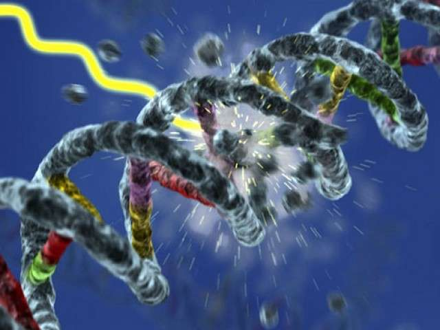
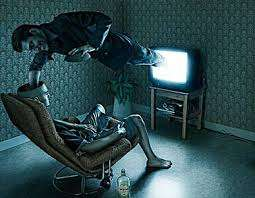

# Цэнхэр дэлгэцийн тулгадаг, харилцааны загвар

Бидний тархи, өдөр тутмын мэдээллийг хүлээн авч, боловсруулан цаашдын амьдралд хөтлөх программыг суулгаж байдаг гэж үздэг. Өдөр тутмын цэнхэр дэлгэцийн мэдээллүүд, хүмүүсийн харилцааг хэт загварчилж хайрцагласан байдлаар тулгах хэмжээнд үйлчилж байгаа талаар сэтгэл зүйчид эмзэглэн хүлээж авч бичсээр байгаа билээ.

Эрэгтэй, эмэгтэй хүмүүсийг кино, жүжиг, амьдрал ахуйн талаарх мэдээллүүдээр загварчлан салгаж, хүмүүс хоорондын бие биеэ үнэлэх үнэлэмжийг үгүйсгэж байгаа нь ч анзаарагдаж байдаг бөгөөд хүмүүс,байгалаас тасран, хувь хүний шинж чанараа гээх эрсдэлд орж буйг үгүйсгэхийн аргагүй үнэн юм. Цэнхэр дэлгэцийн өмнө хир удаан сууна төдий чинээ сэтгэн бодох чадвар ажиллахаа больж, сэтгэц идэвхигүй болж донгийн хэмжээнд шилждэг гэдэг нь нотлогдоод байгаа юм. Байгал дах араатан амьтдын амьдрах зарчим байгалийн хуулиар явагдаж, эрэгчин, эмэгчиний харилцаа анх байсан хэвээр хадгалагдан ирснийг араатан амьтанд итгүүлэн үнэмшүүлэх арга хэрэглэж болдоггүйн үр дүн гэж үздэг ажээ. Яагаад, оюун ухаант хүн, бие биеийн сэтгэхүйн тусгаар байдалд халдан сэтгэл зүйн дархан байдлаа алдна вэ? Үүнийг, бид бүгдийн тархинд, үзэж харсан зүйлсээс сургамж авдаг, сургаал болно гэсэн хямдхан үгээр итгүүлэн, түүнд нь итгэн ирсэн бидний буруу үнэмшлээр тайлбарлаж болох юм. Цэнхэр дэлгэцийн нэвтрүүлгийн давталт тархи сэтгэхүйд нөлөөлөх нь зайлшгүй бөгөөд үүнээс улбаатай “тархи угаалт” гэсэн үг гарч, газар авч байгаа нь сэтгэхүйн тусгаар байдлаа алдаж байгаагийн аюултай хэлбэр, жишээ юм. Тиймээс, цэнхэр дэлгэцээс авах мэдээллээ сонгож үзэх, олон давтамжит нэвтрүүлэг сурталчилгааг үзэхээс зайлсхийхийг сэтгэл зүйчид зөвлөж байгаа юм. Үүнийг, хүлээн авч, байгалийн хуулийн дагуу амьдрах гараагаа болгон хэрэгжүүлээрэй. Цэнхэр дэлгэцээр үзүүлэх нэвтрүүлгүүд, бидний амьдардаг гайхалтай ертөнцийн талаар, хүмүүсийн амьдралаа сайжруулахад тустай зүйлсийн тухай, зүрх сэтгэл, сайн сайхан бодол, сэтгэлгээг сэрээж өдөөх эерэг зүйлсээр дүүрэн байвал, хүн төрлөхтөний амьдралыг өөрчлөх агуу хүчит зэвсэг, хүч байхсан.
