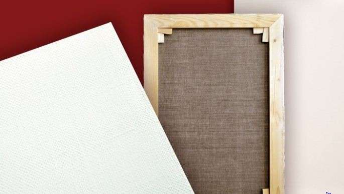

# “Цэвэрхэн цагаан цаас”

Олон зүйл дээр, яриан дунд, “цэвэрхэн цагаан цаас” гэсэн үгс хэрэглэгдэж байдаг. Үүнийг би, аливаа зүйлийг тэгээс нь зөв эхлэх гэж ойлгож явсан, гэтэл дараах тайлбар их сонирхолтой санагдаж, охид бүсгүйчүүдэд маань хэрэгтэй болов уу хэмээн хуваалцахаар шийдлээ.

Нэг охин, ээжээсээ, “цэвэрхэн цагаан цаас” гэж хүмүүс ярьцгаах юм. Юу гэж ойлгох нь зөв вэ? гэж асуухад, ээж нь, хуудас цаас, будаг бийр авсанаа, -Чи хардаа, би чамд бодитоор тайлбарлахыг хичээе. Бүсгүй хүн бол энэ цэвэрхэн цагаан цаас. Харин залуу эрэгтэй бол бийр будаг бүхий зураач юм. Зураач, хуудас цаасан дээр, нэг өнгөөр зурж байснаа бийрээ угаахгүйгээр өөр өнгөнд дүрж түүгээрээ зурахад, өнгүүд холилдож сааралтан муу зураг болно. Тэгмэгц, тэрээр уг цаасаа базаж хаяад дараагийн цэвэр цаасыг авч зурах маягаар хэдэн удаа ийм үйлдэл хийх нь бий. Гэтэл жинхэнэ зураач, нэг өнгөөр зурж, түүнийгээ хатмагц дараагийн өнгөөр зурах маягаар тод, солонгорсон сайхан зураг зурна. Уг зураг нь түүнд таалагдаж, тэрхүү зургаа насан туршдаа хадгална.\
Бас нэг зүйл бий, зураач хамгийн ойр дэлгүүрээс, хамгийн хямд цаас авах нь бий. Харин өөр нэг нь, хамгийн чанартай цаасыг урт удаан хугацааны турш эрж хайсаар, ертөнцийн хязгаар хүртэл явсаар олж авах нь ч бий.\
Тиймээс, чи, ердийн хуудас цаас болоход бүү яар. Харин хамгийн үнэтэй, сод бүтээл болох тэрхүү чанартай хуудас цаас байхыг хичээ. Өөрийгөө базаад хаядаг цаас мэт бүү байлга. Өнгө нь холилдож сүүдэртсэн зургийг бүү өөр дээрээ зуруул, харин урлагийн бүтээлийг өөр дээр чинь зурах чадвартай тэрхүү зураачийг хүлээ гэжээ.
