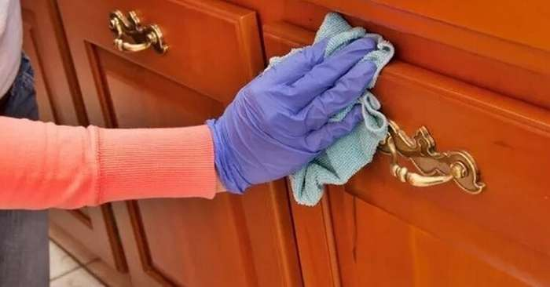
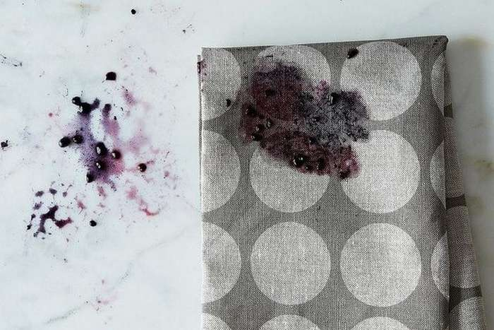

# Цэвэрлэгээ хийх хугацааг уртасгадаг бодис

Уг бодисыг томоохон зочид буудлууд, музейн цэвэрлэгээнд ашигладгийг тэр бүр хүмүүс мэддэггүй. Цэвэрлэгээ хийх хугацааг уртасгадаг хямд , үр дүнтэй энэхүү бодисыг глицерин гэдэг. Тоос тогтдог тавилга, шил, толь, шал ер нь бүхий л хатуу гадаргуутай эд хогшил, зүйлсээ микрофибр буюу бидний нэрлэдгээр нейлон алчуурт хоёр дуслыг шингээн арчихад, маш нимгэн үл үзэгдэх тунгалаг хальс мэт бүрхүүл тогтон тоос тогтох хугацааг уртасгадаг аж. Хуучин паркетан шал ч устай найруулан арчихад гялалзан өнгө ордог. Мөн глицерин нь, жимс, жимсний чанамлаас тогтсон толбыг арилгадаг бөгөөд толботой хэсгээ глицеринд дүрээд багахан давстай усаар зайлахад арилдаг байна. Глицериний гоо сайхны хэрэглээг мэдэхгүй хүн үгүй биз ээ. Сайртаж, хагарсан хөл гарын арьс, хөлийн эвэршиж хатуурсан арьсанд дангаар нь эсвэл суурь тосондоо нэмж түрхээд хөвөн даавуун бээлий, оймс өмсч унтахад гайхалтай зөөлөрдөг. Мөн нэг удаа угаахад хэрэглэх шампуньдаа нэг дуслыг нэмэхэд үс гялалзуулах үйлчилэл үзүүлдэг байна.

