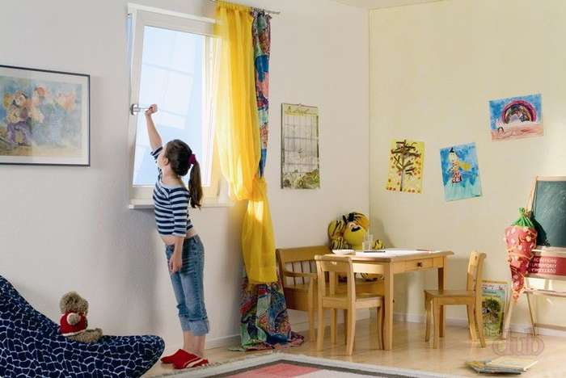

# Цонх хаалгаа онгойлгож салхилуулж байх нь, эрүүл мэндэд тустай

Оксфордын их сургуулийн эндокринологч Эшли Гроссман, голландын эрдэмтдийн дэлхийн дулаарлын эрүүл мэндэд нөлөөлөх нөлөөллийн талаар хийсэн судалгаан дээр үндэслэн хийсэн туршлага судалгаандаа тулгуурлан, таргалалт, болон чихрийн шижин өвчнөөс цонх хаалгаа онгойлгон салхилуулдаг байснаар зайлсхийж болно гэж үзэв. Судлаачид, дэлхийн уур амьсгал, жилд цельсийн нэг градусаар дулаарах нь, чихрийн шижний өвчлөлийг нэмэгдүүлдэг гээд үүнийг, хүний организм, халуун дулаан нөхцөлд биеийн дулааныг барихад илчлэгээ зарцуулахаа больж, инсулины мэдрэмж өсч, үүнээс үүдэлтэй таргалалт явагддаг гэж тайлбарлажээ. Мөн, цонх хаалгаа онгойлгож салхилуулах, ялангуяа шөнийн цагт нээж байх нь өвчлөлийн эрсдэлийг бууруулна гэж судалгааны ажилын дүгнэлтдээ цохон тэмдэглэсэн байна.
