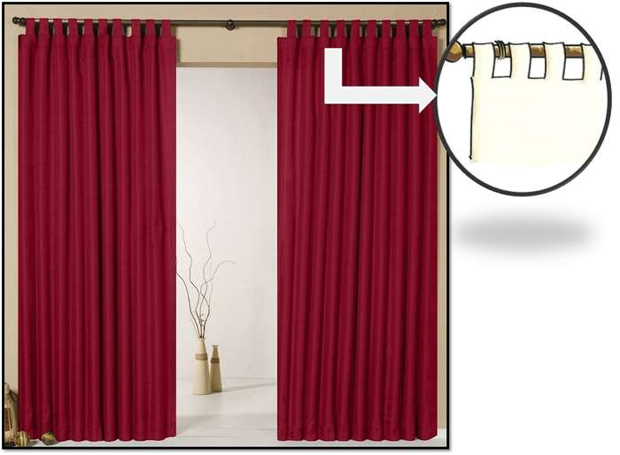
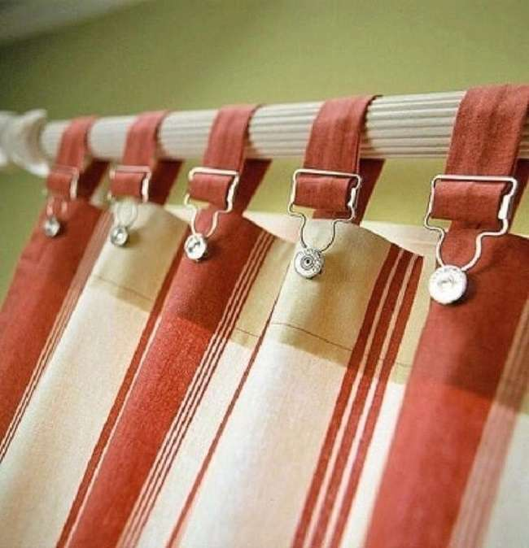
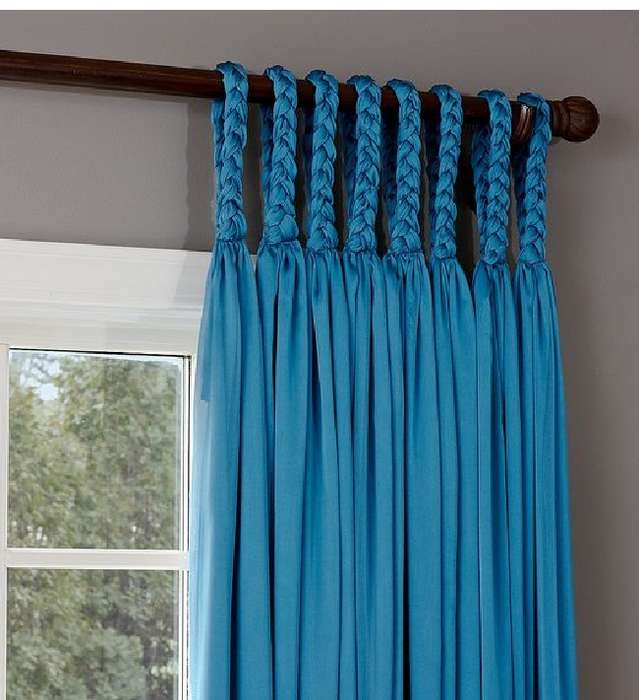
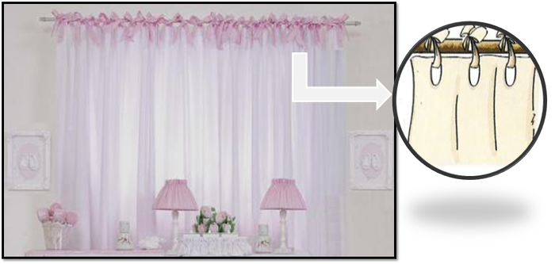
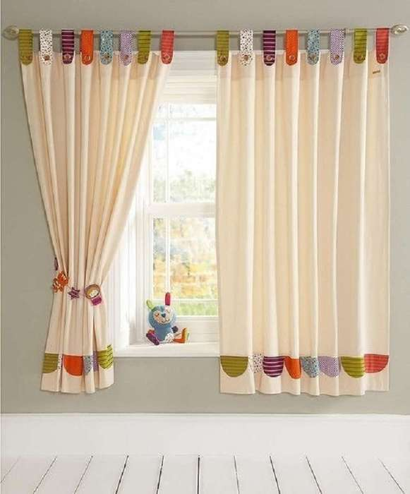
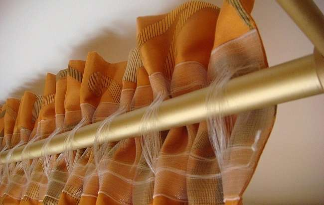
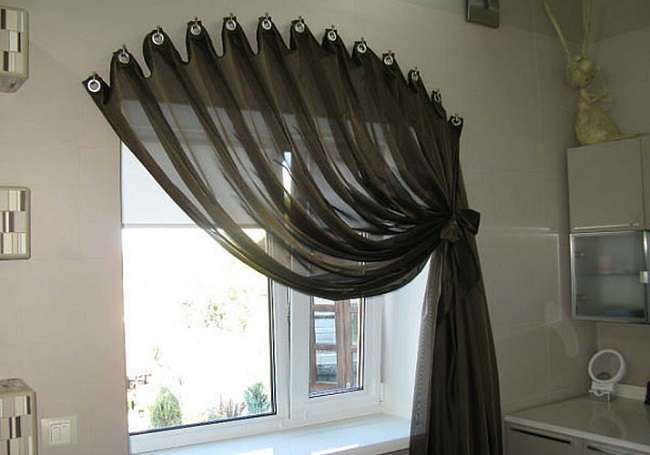

# Цонхны хөшиг өлгөх өвөрмөц, гоёмсог аргууд

Багахан хүч, цаг хугацаа зарцуулаад, цонхныхоо хөшгийг улам сайхан харагдуулах, тохь тухаа нэмэх өвөрмөц шийдлүүдmta танилцаарай.

Тухайн хөшигний материалаар гогцоо оёх арга

---

Тэр болгон таардаггүй сонирхолтой арга

---

Сүлжиж хийсэн гогцоо. Татаж, нээхэд сул талтай

---

Цэцэглэн зангидсан гогцоо, тансаг, хөнгөхөн харагдуулдаг

---

Хүүхдийн өрөөнд хамгийн тохиромжтой, хөгжилтэй хялбар санаа

---

Ард талдаа, ийнхүү бэхлэгддэг хөшиг, карнизыг нуух сайн талтай

---

Хананд бэхэлсэн дэгээ төмрүүдэд өлгөх арга. Хаана ч байхгүй өвөрмөц шийдэл
