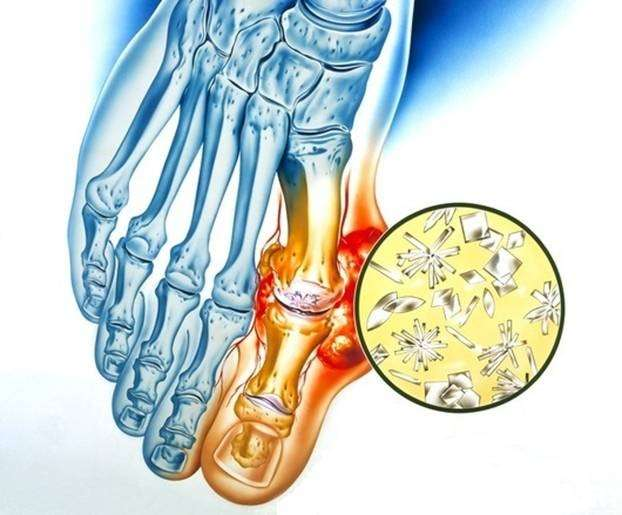

# Тулай өвчинд тустай зөвлөгөө

Шээсний хүчил үен дээр хуралдан талсжих, энэхүү өвдөлт ихтэй хамгийн таагүй өвчиний зовиурыг дарах, илүүдэл шээсний хүчилийг биеэс хөөхөд тустай хялбар аргуудыг танилцуулъя.

#### Хүнсний сод

Шээсний хүчлийг багасгах үр дүнтэй арга. Тал цайны халбага хүнсний содыг, нэг стакан усанд хутган байнга хэрэглэхэд, шээсний хүчлийг үенд хуралдахаас сэргийлнэ. Хэрэв, зовиурууд эхэлчихсэн бол нэг халбага содыг нэг стакан усанд хийж, өдөр бүр хэргэлнэ.

#### Нимбэгтэй ус

Энэ арга, шээсний хүчлийг үүсэхээс сэргийлж, организмын шүлтлэг орчинг өсгөнө. Тал нимбэгний шүүсийг шахаж, 230 грамм бүлээн усанд хутгаж, өглөөд өлөн элгэн дээрээ уух хэрэгтэй.\
Тулайг эмчилэхийн тулд, дараах хүнсний бүтээгдэхүүнүүдийг хүнсэндээ түлхүү хэрэглэж байх хэрэгтэй бөгөөд үүнд, ойн жимсүүд, хан боргоцой, куркума, маалингын үр, яншуй ордог. Мөн, өвдөлтийн үед нь, халуун хүйтэн сэлгэсэн комресс 15 минутын турш тавихад тустай байдаг байна.
