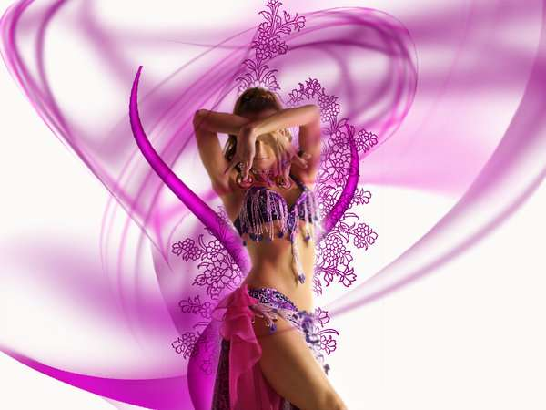

# Тураах бүжиг

Өөрийнхөө үнэлэмжийг дээшлүүлэх, сэтгэл татам дур булаам болоход тустай олон аргууд байдаг бөгөөд эдгээрээс бүжгийг, хамгийн ашигтай, тааламжтай арга гэж үздэг.

Тураах бүжгийг гэрээсээ гарахгүй ч хийж болох ба бүх насны эмэгтэйчүүдэд ижил үйлчлэлтэй гайхалтай үр дүнтэй байдаг гэнэ. Энэ үр дүнтэй арга эрт дээр үеэс улбаатай бөгөөд бэлтгэл дасгал болон бүжгийн хөдөлгөөн нь биеийн бүх булчинг чангалж, бэхжүүлэн таатай мэдрэмж өгөхөөс гадна эрүүлжих үр дүнтэй нь олон туршилтуудаар нотлогдсон байдаг. Бүжиглэх үед, хүний биеийн бүх булчин агшиж сунаж, амьдрах үеийн бүх хөдөлгөөнийг түвэггүй болгох үр дүнтэй хөдөлгөөнүүд хэмнэлттэйгээр хийгдэж байдаг. Байгал дах бүхий л үзэгдлүүд, тэр дундаа хүний физиологи, ертөнцийн физик онцлог бүхий хэмнэлд эрхшээгдэн байдаг бөгөөд бүжиг нь, оршихуйн хэмнэлд зохицсон хүний үйл ажиллагаа, эрүүл мэнд, зохилдлогоог тэтгэх увидастай байдаг аж. Хүн бүжиглэх үедээ, өөрийнхөө хийж чадна гэж огт санаагүй хөдөлгөөнүүдийг гүйцэтгэдэг ба огтхон ч хөгжүүлээгүй олон булчин биеийн хэсгүүдийг хөдөлгөөнд оруулж тэр хэсгээ гайхшран мэдэрдэг ба үүний зэрэгцээ алхаа гишгээ, галбир, хөдөлгөөний уян хатан байдал гайхалтай сайжирч байдаг гэнэ. Удаан хугацаагаар хийж дасгалжих бүжгийг, өөрт таалагддаг дуртай аяыг сонгон хийх хэрэгтэй. Биеийн галбир засах, илүүдэл жингээс салах бүжгийн үед, эмэгтэй дааврын ялгаралт нэмэгддэг гэж үздэг. Эдгээр бүжигт, араб бүжгүүд, реггетон, стрип-дэнс, ирланд бүжиг, зумба зэрэг тааз, бэлхүүс, цээжний эрчимтэй хөдөлгөөн шаардагддаг бүжгүүд ордог. Турах зорилгоор, долоо хоногт 5-6 удаа, 40-60 минут бүжиглэх хэрэгтэй болдог. Эсвэл долоо хоногт 3 удаа 1.5-2 цаг бүжиглэх хэрэгтэй. Дээрх бүжгүүдийг заасан бичлэг, хичээлүүдийг олж авахад түвэггүй, мөн бүжгийн сургалтаар нэг удаа заалгаад авахад үргэлжлүүлэн бие даан гүйцэтгэх чадвартай болно.
