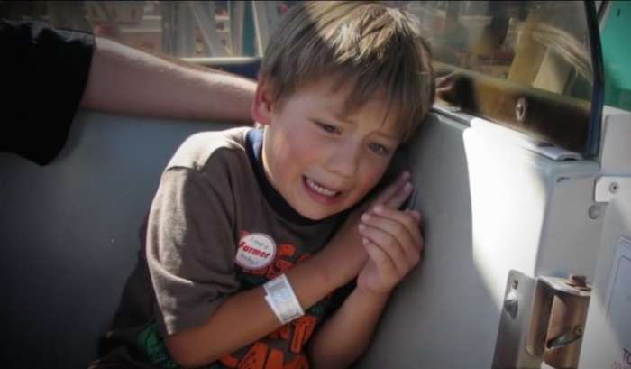
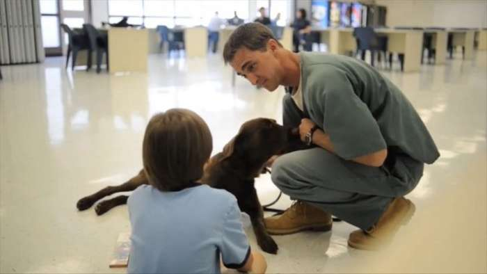
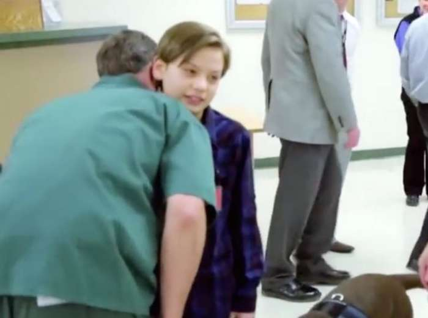
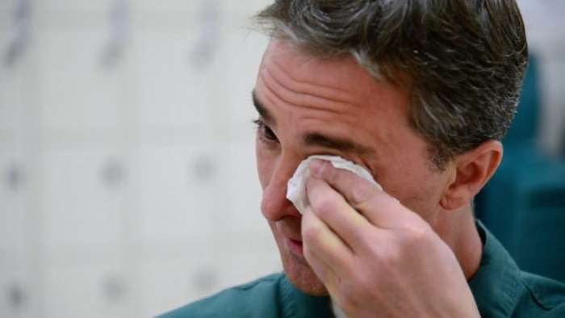
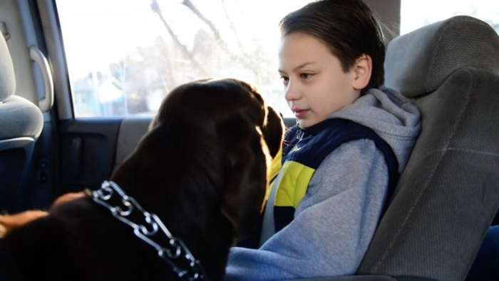

# Тусламж хаанаас ч ирж болно

Захарий Тукер хүүг, сургуульд орсоных нь дараахан, эмч нар аутизмын нэгэн төрлийн өвчтэй гэсэн онош тавьжээ. Уг өвчиний илрэлийн хамгийн хэцүү нь, тэр, айж мэгдэн, удаанаар тасралтгүй уйлж, огт унтахаа больдог зовиуртай болсон бөгөөд эх, эцэгтээ түүнийг тайтгаруулах боломж өгөхгүй, хэнийг ч өөртөө ойртуулахгүй орилж хашгирдаг байв. Аргаа барсан эх эцэг нь, хүүдээ туслахын төлөө,эрэл хайгуул хийсээр, интернэтээс, Крис Вогг гэдэг хүний тухай уншжээ.

Тэр хүн, нохой сургагч, тэр дундаа аутизмын өвчтэй хүүхдүүдэд тусалдаг нохой сургах мэргэжлээр мэргэшсэн хүн байжээ. Сьюзи, энэхүү хүнд хандан, хүүдээ тусламж авахыг хүстэл нэг асуудал гарсан нь, уг хүн 1998 оноос хүн амьны хэрэгтэй 48 жилийн ялтай шоронд сууж байгааг нь мэдсэн нь байлаа.

---

Гэхдээ энэ хүн, шоронд ч тэр, нохойгоо сургаж ихэвчилэн, сохор, дүлий хүмүүст зориулсан нохой бэлтгэж байгааг нь мэдэв. Ингээд, тэд, хүүгийнхээ төлөө Кристэй уулзаж тусламж авахаар шийджээ. Шоронд хүн амины хэрэгтэнтэй уулзсан анхны уулзалт, хүүгийн хувьд аймшиг мэт байсан гэдэг.

---

Гэхдээ, эхний эмчилгээний дараанаас, хүү Кристэй уулзахаар дуртай явдаг болсон бөгөөд Крисын нохой хүү хоёр амархан дасч нөхөрлөв. Нохой сургагч, өөрийн Клайд нохойгоо, Зак хүүгийн сандрал мэгдэлийг, зүрхний цохиолт нь олшроод эхэлмэгц мэдэрдэг, энэ үед нь өөртөө анхаарлыг нь татаж, тухайн дайрлагыг нь зогсоож чаддаг болгож сургав. Зак хүүгийн биеийн байдал аажмаар сайжирч эхэлсэн бөгөөд тэр, -“Миний айж сандрахаараа ордог хэцүү байдал маань, цөөрч, тайван болсон. Би найзуудтай болж байгаа. Урд нь надад найзууд байгаагүй” гэж ярьжээ.

---

Үүнээс хойш, хэсэг хугацааны дараа, тэд, гэр бүлээрээ Крисийг шоронд эргэж ирэхдээ, тэдний бүх зүйлээс өөрийгөө салгаж, тусгаарладаг өвчтэй хүү нь, аврагчийгаа, хийсэн хэргийг нь үл тоосон, халуун дотно тэврэлтээр тэврэхийг нь хараад баярлаж, уяран зогсоход, харин Крис, хүүгийн зан аашны өөрчилөлт, бие нь сайжирсан байдлыг нь хараад баярын нулимс мөн унагаж байсан аж. Крисийн хувьд, хийсэн хэргийнхээ талаар одоо ч, 21 жилийн дараа ярихад хэцүү байдаг. Тэр, найзтайгаа хамт, хүнтэй маргалдаад, өөрийгөө хянах чадвараа алдсанаас болж аймшигт хэрэг өдүүлсэн бөгөөд тэр, –“Би тэр үед, асуудлыг зөвөөр шийдэж чадахгүй үнэхээр хулчгар байсан. Аливааг дийлэх зан, хүчээр шийдэх асуудал бол бол жинхэнэ хулчгар зан юм. Уучлалт гуйгаад, буулт хийхээс хулчийсан байдал минь намайг ийм байдалд хүргэсэн” гэж ярьсан байна.

---

Тэр, мөн нохой сургаж, хүмүүст туслахаар хичээж байгаагаа, гэм буруугаа хүлээх, наманчилахад нь туслана гэж итгэдэг аж.

---

Харин, Зак хүү, Клайд нохой хоёрын нөхөрлөл, хүүгийн биеийн байдлыг сайжруулаад зогсоогүй, Зак олон найз нөхөдтэй болж, сургуульдаа ажжилттай суралцаж, найдваргүй гэсэн оноштой байсан Зак хүү маань, гэмт хэрэгтний ач тусаар, сургуулийнхаа гүнзгийрүүлсэн сургалттай ангид шилжин амжилттай суралцаж байгаа гэнэ. Энэ бүхнээс харахад, хүнтэй тохиолдох олон зүйл тааварлашгүй бөгөөд тусламж, хэзээ, хаанаас ирэхийг хүн, хэзээ ч урьдчилан мэддэггүй, дараа нь гайхширан хүлээн авах байдалд орж байдаг. Түүнчилэн, ихэнхи хүмүүс, өнгөрсөн үеийнхээ хар толбыг нууж явдаг, гэсэн ч, түүнийгээ засах, гэмших боломжууд байдаг гэдгийг энэ түүх өгүүлэх аж.
