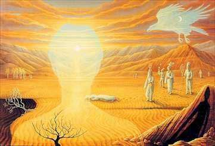
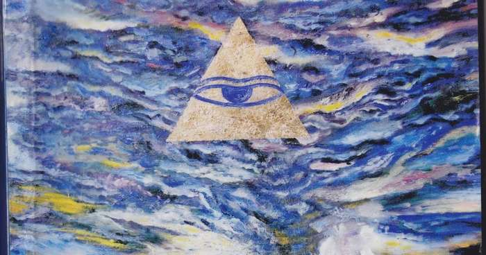

# Түвдийн гүн ухааны, энэхүү тестийн 3 асуултад хариулан, өөрийгөө таниарай

Үзэг цаас аваад, хамгийн түрүүнд толгойдоо орсон хариултаа бичээрэй.

1 Үхэр, бар, хонь, морь, тоорой, эдгээр амьтдаас хамгийн таалагддагаасаа дараалуулан бич\
2 Дараах үгнүүдэд тодорхойлолтыг нь ганц үгээр бичээрэй.\
Нохой-\
Муур-\
Хулгана-\
Кофе-\
Далай-\
3 Ойр дотнын 5 хүнээ, дараах өнгүүдэд тааруулан бичнэ:\
Шар-\
Улаан шар-\
Улаан-\
Цагаан-\
Ногоон-

---

Хариулт:\
1. Давамгай чанаруудыг тань дарааллаар нь илэрхийлнэ:\
Үхэр- албан тушаал ахих чадвартай\
Бар- өөрийн үнэлэмжтэй\
Хонь- хайраар дүүрэн\
Морь- гэр бүлсэг\
Тоорой- чинээлэг\
2. Амьдралыг дотроо хэрхэн хүлээж авдагийг харуулдаг:\
Нохойг яаж тодорхойлсон тань, өөрийг тань харуулна\
Муур, хамтрагч эсвэл ханьдаа хандах хандлага\
Хулгана- дайснаа яаж хүлээж авдаг\
Кофе- сексийн хандлага\
Далай- амьдралын хандлагыг, тус тус хэрхэн тодорхойлсноор харуулдаг\
3.Өнгүүд, хариултад оруулсан хүмүүсийг тань тодорхойлно:\
Шар- өнгөөр илэрхийлсэн хүн,таны амьдралд их нөлөөтэй, та, түүнийг, хэзээ ч мартахгүй\
Улбар шар- таны жинхэнэ найз\
Улаан- үнэн голоосоо хайрладаг\
Цагаан- үзэл бодол нэгтэй, ойр дотно хүн\
Ногоон- сэтгэл зүрхнээс салахгүй дурсагдах хүн

97%-н магадлалтай тест гэж үздэг, та шалгаарай.
