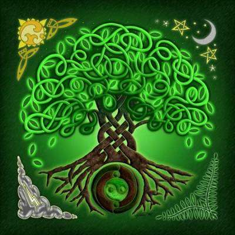

# Удмаас өвлөгддөг хүчний тайлал

Удмаар дамжих 3 төрлийн хүч байдаг: цусаар дамжих хүч, хүнээс хүнд дамжих хүч, уламжлалт хүмүүжлийн хүч.

• Цусаар дамжих хүчийг генийн ойлголт гэж үзэж болох бөгөөд үүнд, бидний авъяас чадвар, хандлагууд, дотоод зан чанар багтдаг. Энэхүү хүч нь хүмүүсийн амьдралын түвшин, байр суурьд нөлөөлдөг. Одоогоос зуу ч хүрэхгүй жилийн өмнө, мөн эрт дээр үед, хүүхдүүд, эцэг өвгөдийнхөө тавиланг давтдаг гэж хэлж болохоор амьдардаг буюу дарханы хүүхэд дархан, худалдаачины хүүхэд худалдаачин гэх мэт эцэг өвгөдийнхөө эрхэлж байсан ажил үйлсийг үргэлжлүүлэн эрхэлж, ижил шахуу хувь тавилангаар амьдардаг байжээ. Энэхүү цусаар дамжих хүчээр, хувь тавилан, мөн ажил, байр суурь нь дамждаг байсан нь, нэг талаас “эцэг өвгөдөөс өвлөгдөн ирсэн дадлага туршлага дээр суурилсан чанартай мэдлэг бүхий ажил, амьдрал”, мөн баталгаатай “орлого” дамжин ирэх давуу талыг агуулдаг байв. Харин орчин үед, дурын мэргэжлээ сонгон хувь тавилангаа өөрчлөх бүрэн боломжтой болсон нь нэг талаас сайн ч, нөгөө талаас, эцэг өвгөдийнхөө цусны хүч дэмжлэгээс салж, зөвхөн өөрийн хүчинд тулгуурлан амьдрах байдалд хүргэдэг бэрхшээл, асуудалтай амьдралыг дагуулдаг гэж үзэх нь ч бий. \
• Хүнээс хүнд дамжих хүч гэдэг нь, удмын туршлага, сүнслэг оюун санаа хоёрын нэгдэл юм. Ихэвчлэн биечлэн дамждаг бөгөөд жишээ нь, эмээ нь уран гартай оёдолчин байлаа гэхэд, ач охинд нь заагаагүй ч гарч ирдэг, гайхалтай “эчнээ” өвлөгддөг тэр авъяас чадварыг хэлдэг. Энэ хүчийг, үеэс үед, тусалж, харилцахыг эрмэлзэж байдаг удмын мөн чанарыг харуулдаг гэж үздэг. “Заримдаа, надад нэг зүйл туслаад байгаа юм шиг санагддаг”, “намайг эмээ хардаг байх аа, хэцүү байхад тусалсан”, “намайг осолд ороход аавын минь сүнс аварсан” гэх мэт яриа хөөрөөг сонсоогүй хүн байдаггүй. Эдгээр, мэдрэгдсэн зүйлээ илэрхийлсэн үгсийн цаана, удмын салшгүй холбоос үйлчилж байдгийг тэр бүр, бид мэддэггүй. Сэтгэлдээ хайрлан дурсах, хүндлэх, өршөөл эрэх зэргээр өвөг дээдэстээ зөв хандсанаар, зөн совин хурц болж, авъяас чадвар нээгдэн, орчиндоо нөлөөлөх нөлөөлөл ихэсдэг гэдэг. Эсрэгээр байх нь, таагүй зүйлсийг дагуулдаг. \
• Уламжлалт хүмүүжил нь, эцэг эх, эмээ өвөө нарын өгсөн хүмүүжлийн үнэт зүйлсээс өвлөгддөг хүч юм. Хүн, уламжлалаа дээдлэх, мөрдөх үедээ хүчирхэг болж, өдөр тутмын амьдралд урсгалаар амьдрах үедээ доройтож байдаг. Сэтгэл, зүтгэлийг тань, өвөг дээдэс тань үргэлж үнэлж байдаг гэдгийг бүү мартаарай. \
Та, удмынхаа аль хүчийг, хир эзэмшдэгээ мэдье гэвэл, дараах асуултуудад хариулахад хангалттай байдаг. \
-Эцэг өвгөдөөсөө /эцэг эх, эмээ өвөө/, ямар зан чанар өвлөсөн гэж боддог вэ? \
-Эцэг өвгөд, эмээ өвөө, ээж аавын мэргэжил, эрхэлж явсан ажлуудыг мэдэх үү? Ямар нэг зүйлээр алдаршиж явсан хүн байна уу? Яг юугаар бол? \
-Эмээ өвөө, ээж аав, эмэг өвөгийн тань чухам ямар зан чанар илүү хайр хүндэтгэлийг тань татдаг вэ? \
-Та, өөртөө, -“би, яг......./өвөө, эмээ, ээж, аав/ шигээ, адилхан ... зүйлд хүрсэн” гэж хэлж чадах уу? \
-Өөрийгөө, удмынхаа нэг салшгүй хэсэг гэж мэдэрдэг үү? Яагаад? \
-Ямар зан чанараа удамдаа өвлүүлнэ гэж боддог вэ? \
Эдгээр асуултуудад хариулсны дараа танд, өвөг дээдсээ мэдэх, таних, мэдрэх агуу хүсэл төрөх болно. Удамдаа бахархал нэмэх нэгэн гишүүн нь гэдгээ үргэлжид мэдрэн, өвөг дээдсээ хүндэтгэн залбираарай.
