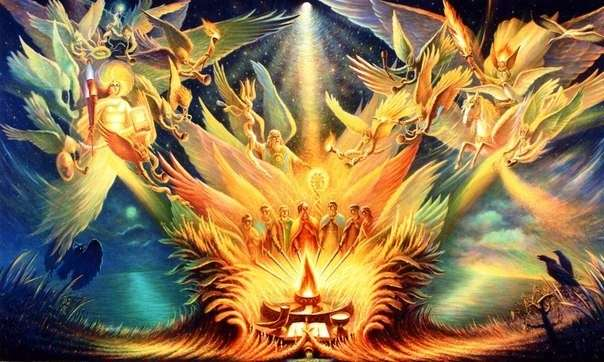
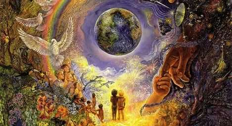

# Удмын энерги ба мөс чанар

Өвөг дээдэс, удам угсааг, тасардаггүй, хүйн холбоогоор холбогдсон хүмүүсийн энергийн мэдээллийн сан гэж үздэг. Хүмүүсийн бүрэн дүүрэн амьдралд, зуун зууныг дамжин ирсэн өвөг дээдсийнх нь амьдрал, эрхэлж байсан ажил үйлс, хүсэл эрмэлзлэлээс бүрэлдсэн нэгэн зүйл уялдаа холбоог нэн чухал гэж үздэг байна. Өвөг дээдэстэй холбогдох энэхүү уялдааг, хүний мөс чанараар илэрч байдаг гэх ба мөс чанарын үнэлэмж, ба түүний сэтгэлд эзлэх байр суурь нь, хүний, өвөг дээдэстэйгээ хир холбоотой байгааг харуулдаг аж.

Удам угсаагаа үл ойшоосон хандлага нь, үндэсгүй мод мэт амьдралыг заах бөгөөд үр удам тасрах хэмжээний аюулд хүргэдэг. Хэрэв, хүний үйлдэл, үйл ажиллагаа нь, өвөг дээдсийнх нь хүсэл эрмэлзлэлд нийцэж байвал удмынхаа мэдлэг, ой санамжийн шавхагдашгүй нөөцийг ашиглаж чадах боломжтой болдог байна. Бурхангүйн үзэл, хэт шинжлэх ухаанжсан үзэл суртал ноёлж байсан он жилүүд, олонхи хүмүүсийн удам судраа шүтэх ёс заншлыг тасалсан гэдэг. Өнөөдөр, энэ уламжлалаа сэргээх боломж бүхий цаг үед, зөвхөн ургийн бичгээр хязгаарлахгүйгээр, өөрийн оюун бодлын хүчийг ашиглан сэтгэл дотроо өвөг дээдсээ хүндлэн хайрлаж, өршөөл эрж, зам мөрөө зөв байлгаснаар удмын холбоогоо бэхжүүлэх, ивээгдэх боломжийг авах сайхан цаг үед бид амьдарч байна. Өвөг дээдсээ хир олон дурсан санаж, сэтгэлдээ хандна, төдий чинээ удмын энерги өсч бэхжиж байдаг байна. Хорвоо дээр байхгүй дээдсээ хайрлан дурсаж, амьд мэнд байгаа төрөл төрөгсдөө хүндлэн хайрласнаар, удмын энергээ цэвэршүүлж, эерэг уялдаа холбоо бүхий программ сууж, удмаасаа тус дэм авснаар, хүний амьдрал эерэгээр өөрчлөгдөж эхэлдэг. Ийнхүү, өвөг дээдсээ шүтэх хандлага нь, удмын энергид, бурханлаг хүчийг хуралдуулан үеэс үед дамжина. “Хүн хүүгээрээ дамжин Дээд төрөлд орно, ачаараа дамжин Үхэлгүй мөнхөд очно, гучаараа дамжин Ертөнцийн гэрэлд хүрнэ! Үхэл гэж үгүй!” гэсэн байдаг. Өвөг дээдэстэйгээ удмын холбоогоо бэхжүүлэхийн тулд, сэтгэл оюундаа хайр, нигүүлслийг хуралдуулж, эерэг сайхнаар дурсан хүндэлж, бурханлаг хүчээр нь ивээгдэх бүрэн боломж бидэнд байдаг бөгөөд ирээдүйн үр удмаа илүү сайн сайхан амьдруулах, хүч, боломж бидний гарт байгаа билээ. Тэр дундаа, манай монгол ёс заншил зөвхөн үүнийг л зааж байдаг нь бахархмаар.
