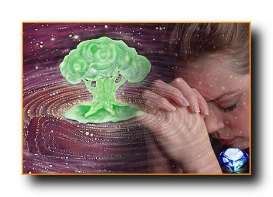

# Удмын энергиэ  цэвэрлэх нь

Энэхүү бясалгал-залбиралын аргыг хэрэглэснээр, таны, өвөг дээдсээс танд дамжин ирж байж болох удам төрлийн программ өөрчилөгддөг. Та, үүний дараа шинэ, илүү таатай тохиолдлуудыг амьдралаас авах бөгөөд амьдралд тань шинэ, урам жигүүр хайрласан программууд ажиллаж эхэлдэг. Мөн таны үр удамд, илүү цэвэрлэгдсэн удам төрлийн энерги очих ба илүү өндөр сэтгэлгээний түвшин, илүү аз жаргалтай амьдралыг өгнө. Хэдийгээр түвэгтэй ч гэсэн та, хийх гээд үзээрэй.

Өөрөөсөө эхлэн 7 үеэ, нэрийг нь мэддэг хүмүүсээ бичиж нэрийг нь мэдэхгүйгээ эрэгтэй эмэгтэйгээр ялгаж тэмдэглэнэ. Эмэгтэй талаа зүүн гар талд, эрэгтэй талаа баруун гар талд бичдэг. Шинийн 4, 10, 12, 13, 28-нд эхлэх сайн. Үүнийг хийхэд цаг хугацаа, сэтгэлийн хүч, хариуцлага ихээхэн шаардагддаг. Гэхдээ амьдралаа сайн сайхан болгохын тулд биеэ дайчлах хэрэгтэй нь гарцаагүй бөгөөд өглөө үүрээр, өөрөөсөө метр хагасын зайд энгийн лаа асаан, зүүн тийш харж өвдгөн дээрээ бохирон сууж, өөрийгөө үндэс нь бат бөх, хоёр салаа мөчирүүдтэй мод мэтээр төсөөлнө. Мөчирүүдийн нэг тал нь эхийн талын, нөгөө тал нь эцгийн тал гэж бодох хэрэгтэй. Төсөөллөө улам идэвхжүүлэн, өөрийн өвөг дээдэстэйгээ нэгдэн уусах байдалд орохыг хичээнэ. Энэ үедээ, зүрхнийхээ угаас, би өөрийгөө хайрлаж байна, би өөрийгөө өршөөж байна, ээж минь намайг уучил, тандаа хайртай, таныгаа уучилж байна, аав минь намайг уучил, тандаа хайртай, таныгаа уучилж байна, миний ээжийн өвөг дээдэс минь намайг уучлаач, миний аавын өвөг дээдэс намайг уучлаач, бид нэг цусных билээ, би бол та нар, та нар бол би юм, би та нарт бүгдэд тань хайртай, би та нартаа хүндэтгэл үзүүлж байна, би та нарынхаа төлөө бурханд залбирч байна, бурхан тэнгэр минь миний удам угсааг хайрлаж хамгаалаач, хайр ивээлээ өгөөч гэж лааг асаж дуустал залбирах юм. Энэ үед таны сэтгэл хэрхэн хувирч байгааг мэдрээрэй. Таны чин сэтгэлийн энэхүү залбирал, өөрийн үелзлээр бие сэтгэлийг тань ариусгадаг байна. Мөн, таны энэ чин зүрхний залбирал, үр удмын тань амьдралыг хатуу, доод давтамжит сөрөг зүйлсээс цэвэрлэж өгдөг. Эхний үед сэтгэл санаа төвлөрөхгүй хэцүү байх боловч удахгүй сэтгэл санаа тань хөнгөрч, амьдралд тань өөрчлөлт орж эхэлдэг. Өөрийн тань ийм залбиралтай тэнцэх хүчтэй зүйл байдаггүй гэнэ. Үр удамдаа, цэвэрлэгдсэн удмын энерги, сайн сайхан амьдралыг өвлүүлэхийн тулд хийхийг хичээгээрэй. Бясалгалд явдаг хүмүүсийн хувьд энэ арга хялбар байх нь гарцаагүй. Өөрийн амьдрал, үр удмынхаа төлөө энэ насандаа хийх нэгэн үүрэг гэж хүлээж аваарай.
