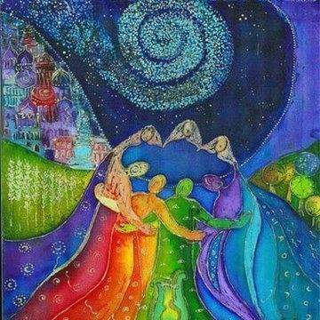

# Удмын хүч

Яагаад нэг ширхэг шоргоолж үүрээ барьж мэддэггүй юм бол? Бүр 10, 20,30 –лаа болсон ч мөн чаддаггүй зүгээр л үймэлдэн гүйлдэж байдаг. Харин, тодорхой тоо хэмжээнд хүрч цуглармагцаа, нэгдсэн нэг командаар юм шиг үүрээ барьж эхэлдэг. Мөн бусад хорхой шавьж, амьтад ч, мөн хүмүүс ч ийм зарчимаар амьдардаг гэнэ. Усны шувууд, мөн нэг хоёроороо хааш нисэхээ мэддэггүй, харин олуулаа болмогцоо нэг нь сүргийн удирдагч болж, бусдыгаа дагуулан урд өмнө нь бусад шувуудын нисдэг байсан замаас хазайлгүй нүүдэллэн нисдэг. Хаанаас, шаардлагатай мэдээллээ авдаг юм бол? Урд нь судлаачид хамгийн туршлагатай ахмадыгаа удирдагч болгодог гэж үздэг байж, гэтэл хамгийн залуу, энэ замаар урд нь огт нисч байгаагүй нь удирдан нисч байдаг гэнэ.

. Хүмүүсийн хувьд, иймэрхүү байдал мөн тохиолдож байдаг. Үүнийг, сая сая жилийн түүхтэй бидний өвөг дээдсийн асар их туршлага, мэдээлэл, бидний мэдээллийн санд генийн түвшинд бичигдэн уламжлагддагтай холбон тайлбарладаг. Энэ бол Агуу их хүч юм. Бидний ухамсрын гүнд, эрт урдны олон зүйлс бичигдэн хураагдсан байдаг бөгөөд түүх домгоор баяжин батжиж байх ба хэрэв үйлдэл, үйл ажиллагаа маань, удмын сангийн мэдээллийн хүсэл зорилготой нийлж байвал, Өвөг дээдсийн уламжлал, ёс заншилаа дээдэлвэл Удмын ухамсараа өвлөн авах боломжтой болдог гэнэ. Өөрөөр хэлвэл, нийт удмын мэдээлэл, ой санамж болон өөр бусад хураагдан хадгалагдсан бүх зүйлийг ашиглаж чаддаг болох аж. Ийм үйлдэлийг далд саруул ухаан гэж нэрлэж ирсэн ба үе удмын хоорондын холбоо хэлхээ, харилцан зохилдлогоог машид чухалчилдаг үйлдэл юм. Удмын холбоогүйгээр оюун санааны өсөлт байх боломжгүй, хэсэг хугацаанд байж болох ч удмын энергиэ авахгүйгээр цаашлах нөхцөл байхгүй гэж үздэг байна. Үүний тулд, Өвөг дээдэстээ хүндэтгэлтэй хандах, сэтгэл зүрхэндээ харилцах, өршөөл эрэх, дурсамж дүүрэн амьдрах, бие биеэ ойлгох, бие биедээ туслах асуудлыг эрхэмлэх хэрэгтэй байдаг. Удам угсаа, гарал үүсэл, өвөг дээдэс гэсэн ойлголт маань өөрөө, биднийг, ахмад настнаа хүндлэх, бие биенээ хүндлэхэд сурган хүмүүжүүлж, оюун санааны өсөлтийн хөрс суурь болж өгдөг. Энэхүү удмын харилцаанд зориулсан хүч хөдөлмөр, эрч хүч хэзээд амьдрал ахуй, ажил үйлсэд үр өгөөжөө өгөхөөс гадна ихэвчлэн тухайн төрлийнхний царай зүс, сайхан царайлаг болох маягаар илэрч, “тэмдэг” үзүүлж байдаг байна.
