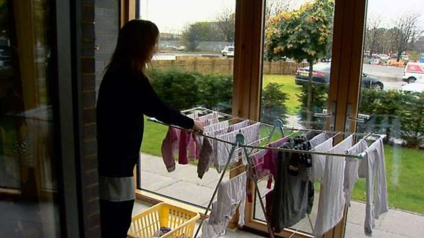
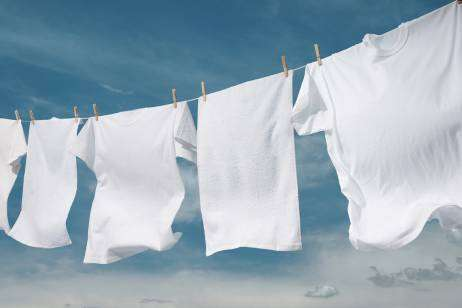

# Угаасан зүйлийг өрөөнд хатааж болохгүй шалтгаан

Бид угаасан зүйлсээ зориулалтын хатаагч дээр, өрөөндөө хатаадаг. Гэтэл саяханы нэгэн судалгаагаар, угаасан зүйлийг өрөөнд хатаах нь, дархлаа султай, да ялангуяа, уушигний өвчлөл, астматай хүмүүст маш муу болохыг тогтоожээ.

Угаасан зүйлс хатах явцад, уг зүйлээс гарах чийгэнд, хөгцний мөөгөнцөрийн тоосонцорууд ууршиж байдаг бөгөөд амьсгалын замаар орж, хамгийн түрүүнд, уушгийг халдварлуулдаг байна. Энэ судалгааг, олон хүмүүсийг хамруулан явуулсан бөгөөд хяналтны хүмүүсийн өвчний сэдрэлт зэрэгт тулгуурлан нотолсон аж.\
Энэ нь, уушигны өвчлөл, астмыг сэдрээж хүндрүүлээд барахгүй, уушигны aspergillys хэмээх мөөгөнцөрийн өвчтэй болоход хүргэдэг байна. Түүнчлэн, угаасан зүйл хатах явцад, өрөөний агаарын чийгшил 30%-д хүрдэг бөгөөд энэхүү чийгтэй агаар, хөгцний мөөгөнцрүүдийн таатай орчин болохоос гадна, уушигны эмгэгтэй, дархлаа султай бие муутай хүмүүст аюултай байдаг байна. Хүний арга ухаан хязгааргүй. Угаасан зүйлээ хатаах өөр аргыг эрэлхийлээрэй. Хүн байнга байдаггүй өрөөнд, тагтан дээр, ванны өрөөнд гэх мэт. Эрүүл мэндээс үнэтэй зүйл энэ хорвоод үгүй билээ.

Урд нь, гадаа хэцтэй,тагтан дээр хэцэн дээр хатаадаг, хөлдөөгөөд оруулдаг байсан маань зөв байж дээ.
