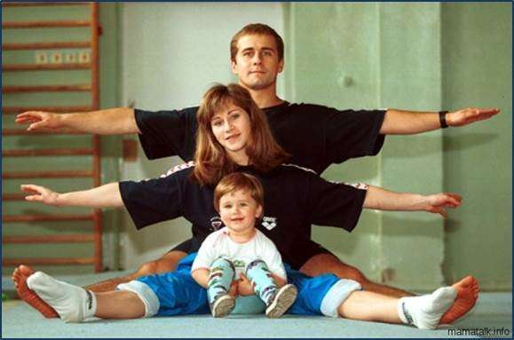

# Ухаалаг ээж аав нарын хүүхдээ хүмүүжүүлдэг 7 үйлдэл.

Хүүхдийг зөв хүмүүжүүлэх олон онол, арга байдаг. Энэхүү хялбар 7 арга нь, хүүхдийнхээ амжилтай, аз жаргалтай амьдралын суурийг тавихад туслах бөгөөд хэрхэн зөв авч хэрэглэснээс ирээдүй нь шалтгаалах юм. Хүүхдийнхээ өдөлж буй жигүүрийг тайрахын оронд, жигүүрээ дэлгэхэд нь тусалсанаар, тэр таны жигүүрийг ч, мөн хэзээ ч хумиулахгүй гэдэгт итгээрэй.

1. Ердийн эцэг эхчүүд, өөрийн дур сонирхлоо орхин, хүүхэдтэйгээ үргэлж хамт байдаг. Ухаалаг ээж аав нар өөрсдийгөө орхихгүй, мөн халамжлах бөгөөд үүнийгээ мөн хүүхэддээ сургадаг.\
2. Ердийн ээж, аав нар оройжингоо гэрийн даалгаварт нь санаа зовж даалгаврыг нь хийдэг. Ухаалаг ээж аав бол гэрийн даалгавар бол хүүхдийн өөрийнх нь хариуцах зүйл гэж тооцдог тул хэрэгтэй бол тусалдаг, хэзээ ч өмнөөс нь даалгавар хийхгүй.\
3. Олонхи ээж аав нар хүүхэддээ, ямар нэг зүйлд буруутай байснаа булах гэсэн санаатай бэлэг авч өгөх нь элбэг байдаг. ухаалаг ээж аав нар, хүүхэддээ жижиг зардалд нь тааруулж бага сага мөнгө өгдөг. Хүүхэд өөрөө худалдаж авах зүйлээ сонгох эсвэл мөнгөө хадгалах зэрэг мөнгийг зөв зарцуулахад сурган, зарцуулалтыг нь хянаж байдаг.\
4. Хүүхдийнхээ дураараа, нийцгүй зангийн учир шалтгааныг олохын оронд, зүгээр л номхруулахыг эрмэлздэг. Ухаалаг ээж аав нар, шалтгааныг нь олж, тэр асуудлыг нь шийдвэрлэхэд тусалдаг.\
5. Ихэвчлэн ээж аав нар, хүүхдээ амжилттай, нэр хүндтэй хүн болоосой гэж хүсдэг. Харин ухаалаг ээж аав нар хүүхэдтэйгээ харьцах харьцаагаа, хүүхэд нь том болсон ч зөөлөн, дулаан хэвээрээ үргэлжлээсэй гэж хүсдэг.\
6. Ердийн ээж аав нар, хүүхдээ янз бүрийн таагүй зүйлсээс хамгаалж хаацайлж, зарим үед бүр хүүхдээ хүсээгүй байсан ч оролцдог. Харин ухаалаг ээж аав нар, зөвшөөрөгдөх хэмжээнд алдаа гаргахыг зөвшөөрдөг бөгөөд алдаагаа засахад сургаж, дахин давтахгүй байх сургамж болгон үлдээдэг.\
7. Олонхи ээж аав нар, хүүхдээ орилж уйлуулахгүй байлгахын үүднээс хүссэн зүйлийг нь авч өгөх буюу шаардлагыг нь биелүүлдэг. Үүнийг нь ч хүүхдүүд гайхалтай ашигладаг. Харин ухаалаг ээж аав нар, хүүхдээ толгойн дээрээ гаргахгүй. Тэд өөрийн хувийн орон зай, өөрийгөө мөн хүүхдийнхээ хувь хүнийг ч хүндэлдэг.
