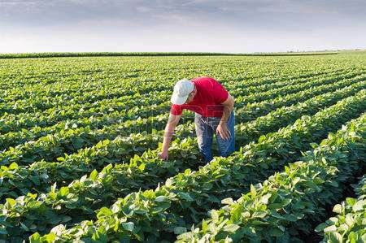

# Ухаалаг фермийн эзэн

Фермийн эздийн дунд зохиогддог үзэсгэлэнд, тариалсан эрдэнэ шишийн ургацын хэмжээ, амт чанараар жил бүр түрүүлдэг нэгэн фермийн эзнээс сурвалжлагч, тариалалтын туршлага, тариалдаг нууцаасаа хуваалцах хүсэлт тавьжээ. Фермийн эзэн, үүнд, -“Би хамгийн сайн гэсэн эрдэнэ эрдэнэ шишүүдээ, хөрш фермүүддээ өгдөг ” гэж хариулав. Гайхсан сурвалжлагч, -“Яагаад, та сайн эрдэнэ шишүүдээ хөршүүддээ өгдөг юм бэ? Тэд чинь таны байнгын өрсөлдөгч нар биз дээ?” гэж асуухад, -“Салхи, миний талбайгаас, хөршийн талбай руу, эргээд миний талбай руу тоос хүртээдэг. Хэрэв хөршийн сорт минийхээс муу бол, минийх ч бас муудна шүү дээ. Тиймээс би тэдэнд, мөн сайныг өгч тариалуулдаг юм. Харин, тариагаа арчлах асуудал хүмүүсээс өөрсдөөс шалгаалдаг” гэж инээмсэглэн хариулав.\
Иймэрхүү асуудал, мөн хүмүүсийн амьдралд ч явагдаж байдаг. Амжилттай байхыг хүсвэл ойр тойрныхноо амжилтад хүрэхэд тусал. Сайхан амьдрахыг хүсвэл, бусдыг сайхан амьдрахад тусал. Яагаад гэвэл, эргэн тойрныхон тань сайхан амьдарч байвал мөн танд сайхан байх юм. Энэ хорвоо ертөнц дээрхи бүх зүйлс хоорондын уялдаатай, хамааралтай байдгийг мартаж болохгүй...
