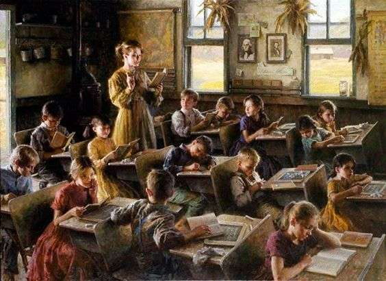

# Ухаантай багш

Минессотын нэгэн сургуулийн математикийн багш, сурагчиддаа, ангийнхаа хүүхдүүдийн нэрсийг жагсаан бичиж, нэр тус бүрийн ард, өөртөө тухайн хүүхдээс юу нь таалагддаг болохыг хичээл дээрээ бичиж хураалгах даалгавар өгчээ.

Тэр, уг даалгаврын ажлуудаа хураан авч, хичээлийн дараа хүүхэд тус бүрийн нэр дээр бичигдсэн ангийнх нь хүүхдүүдийн бичсэн сайн чанаруудыг нь нэг хуудас цаасан дээр нэгтгэн бичээд, дараагийн хичээл дээр тараан өгөв. Хүүхдүүд өөрсдийн хуудсуудыг уншицгаан, энд тэндээс, “Миний тухай ингэж боддог гэж үү?... Надад ийм сайн чанар байдаг гэж мэдээгүй юм байна шүү... Надад ийм хайртай гэж мэдсэнгүй...” гэх мэт шивнэлдэх нь сонсогдоно. Тэд ямар нэг үр дүнгийн тухай ярилцаагүй ч багш эмэгтэй, тэдний яриа, байр байдлаас, сурагчиддаа өөртөө итгэх итгэл төрүүлэх зорилгодоо хүрч чадсанаа мэдэж байв.\
Он жилүүд өнгөрч, олон жилийн дараа, уг ангийн нэг хөвгүүн Вьетнамын дайнд амь үрэгдсэн гунигт явдал тохиолдож, оршуулах ёслол нь төрсөн нутаг Миннесота хотод нь болсноор, багш, ангийнхан нь сүүлчийн замд нь үдэх ёслолд ирцгээв. Энэ үеэр, талийгаач хүүгийн аав, багшид дөхөн ирж:\
-Би танд нэг зүйл үзүүлэх гэсэн юм гээд, дөрөв нугалж эвхсэн, нугалаасаараа элэгдчихсэн нэгэн цаас гаргаж ирэв.\
-Та таньж байна уу? Үүнийг хүүгийн минь халааснаас олсон, биенээсээ огт салгадаггүй байсан гэсэн, гээд багш эмэгтэйд өгөв.\
Энэ нь, хүүгийнх нь ангийнхандаа таалагддаг зан чанарыг нь бичсэн нөгөө хуудас байжээ.\
-Танд их баярлаж явдаг шүү, миний хүү үүнийг ихэд нандигнадаг байсан юм, гэж хүүгийн эцэг хэлэх үед, бас нэгэн сонирхолтой зүйл болж, тэнд байсан ангийнхан нь, ар араасаа нөгөө хуудасны ижил хуудсуудыг гаргаж ирцгээжээ. Тэд, бид үүнийгээ үргэлж уншдаг, биедээ авч явдаг, бидний нэг төрлийн сахиус болсон гэж ам амандаа хэлцгээж байв.\
Хүүхдэд өөртөө итгэх итгэл төрүүлэхийн чухалыг мөн, хүүхдүүд сайн сайхан үгээр дутагдаж явдагийг харуулах наад захын нэгэн жишээ энэ юм.
