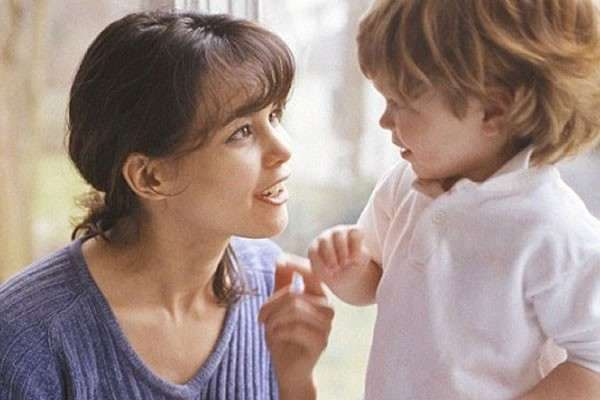

# Ухаантай ээж

Анагаах ухааны салбарт олон нээлтүүдээр нэрд гарсан, тэргүүлэх зэрэглэлийн эрдэмтэнээс ярилцлага авах үедээ, сурвалжлагч, -“Энэхүү гаргуун нээлтүүдэд, тэр хэрхэн хүрсэн, юу түлхэц болдог, бусад хүмүүсээс тэр,юугаараа ялгардаг вэ?” гэсэн асуулт тавьжээ. Эрдэмтэн хэсэг бодолхийлсэнээ, -“Миний энэ бүхэн, бага байхад, ээж минь заасан нэгэн сургамжтай холбоотой гэж боддог” гээд дараах түүхийг ярьжээ.

Бяцхан Роберт, хөргөгчинөөс том лонхтой сүү аван ширээн дээр тавих гэж байгаад алдан асгачихжээ. Галын өрөөний шалаар тэр чигтээ сүү нэлийж, “сүүн далай” шиг болов. Энэ үед ээж нь орж ирээд, хашгирч загинан, шийтгэхийн оронд, -“Роберт, чи, ямар гайхалтай юм хийчихэв ээ? Би хэзээ ч ийм нуур шиг сүү үзэж байгаагүй. Одоо яах вэ дээ. Болоод өнгөрсөн. Харин чи боломжийг ашиглаад, сүүн нууран дунд жаахан тоглочих, дараа нь цэвэрлэцгээе” гэлээ. Хэдэн минутын дараа ээж нь, -“Роберт, ямар ч зүйлийг завааруулсан, дараа нь заавал цэвэрлэх хэрэгтэй байдаг. Одоо үүнийг яаж цэвэрлэмээр байна? Сойзоор уу, алчуураар уу, уудаг пролоноор уу? Алийг нь дээр гэж бодож байна?” гэж асуухад, хүү уудаг пролон сонгож хамтдаа цэвэрлэцгээв. Дараа нь ээж нь, -“Сая энд болсон зүйлийг, том лонхтой зүйлийг хоёр жижигхэн гар шилжүүлж тавих гэж үзээд чадаагүй амжилтгүй туршилт гэж үзэж болно, харин, одоо гадаа гарч, том лонхондоо ус хийгээд, алдахгүй явах арга байгаа эсэхийг үзэцгээе” гэжээ. Хүү, энэ үед, устай лонхыг тагны доод талын лонхны хүзүүнээс барьж явахад алдахгүй болохыг мэдэж авсан аж. Эрдэмтэн цааш нь, -“Би, яг энэ үед алдаа гаргахаас айж болохгүйг, алдаа бол илүү шинэ шинэ зүйлсийг таних боломж гэдгийг ойлгосон, энэхүү багадаа ойлгосон алдаанаас айхгүй чанар маань, шинжлэх ухааны туршилтуудын үндсэн зарчимтай гайхалтай нийцдэг юм даа. Туршилт бүтээгүй ч байсан заавал ямар нэг үнэ цэнтэй зүйл өгч байдаг юм” гэжээ.\
Хүүхдийнхээ алдаанд хандах хандлагаа Робертын ээж шиг болговол, олон суутан төрөх боломжтой мэт. Ээж, аав нараа! Хүүхдийнхээ амжилтаар бахархан амьдрахын жаргал, үр хүүхэд маань өндөрлөгт хүрэх боломж зөвхөн биднээс шалтгаалдаг.
