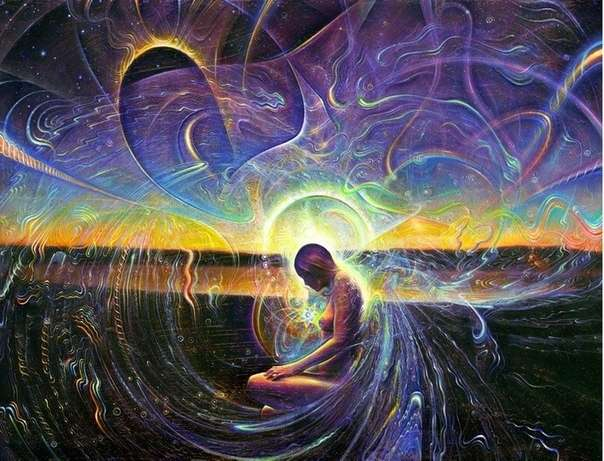

# Ухамсарын эрүүл ахуй

Анх, европчууд индианчуудтай уулзах үед, индианчууд, европчуудыг өрөвдөж, зовсон байдалтай харьцаж, “Та нар ямар бохир юм бэ?” гэж гайхашран асуудаг байсан гэдэг. Энэхүү, “бохир” гэсэн тодотгол нь, европчуудын сэтгэхүй ухамсарыг нь хэлдэг байсан аж.

Одоогийн хөгжингүй нийгэмд, хүмүүс ухамсар сэтгэхүй, төрөлх чанарынхаа эрүүл байдалд анхаарах асуудал зайлшгүй болоод байгаа юм. Тэр үеийн индианчуудын хэлснээр, бидний ухамсар үнэхээр бохиртсон нь нууцгүй билээ. Бид өглөө бүр нүүрээ угааж, шүдээ цэвэрлэдгийн адил ухамсар сэтгэхүйгээ цэвэрлэж байх ёстой бөгөөд атаархал, хардалт, гомдол, сэтгэл хямрал, үзэн ядалт, уур хилэн, хамааралд тэмүүлэх хүсэл, шунал, хэрүүл зөрчилдөөн зэрэг сөрөг чанаруудыг хог, хир мэт үзэж сэтгэлээсээ гаргаж хаяж чаддаг байх ёстой. Ийм цэвэрлэгээ хийхгүй бол, хэзээд ухамсар сэтгэхүй, хогийн сав болон хувирдаг байна. Хүн, өөрийн амьдралд тохиолдож байсан хүнд бэрхшээлтэй үеийг хэрхэн авч үздэгээс, түүнээс хэрхэн сайн талуудыг олж харж чаддаг болохоос, энэхүү цэвэрлэгээ эхэлдэг. Орчин үеийн хүмүүсийн ухамсар ямархуу доройтолд орсоныг дараах жишээ харуулах юм. Нэг эмэгтэйгээс, -“нөхөр чинь үнэнч байгаад үхсэн нь дээр үү? эсвэл хуурч урваад амьд байсан нь дээр үү?” гэсэн асуулт тавихад, эмэгтэй огт тээнэгэлзэхгүйгээр, үхсэн нь дээр гэж хариулсан байна. Энэ хайр мөн үү? Энэ хамтын амьдрал уу? Энэ эмзэг зөөлөн, нигүүлсэнгүй сэтгэлт эмэгтэй хүн мөн үү? Хөгжингүй нийгэмд амьдран буй хүн төрөлхтөн, өнөөдөр хогийн савны гадна хэвтэх гадилын хальснаас хальтрана гэж болгоомжилж арга хэмжээ авдаг ч , ухамсарын хогийн сав, түүний хор уршигийг огт мэдэхгүй байгаа нь харамсалтай юм. Энэхүү хог, өвчин зовлон, гэмт хэрэг, гаж зан авир, хүчирхийлэл зэрэг сөрөг зүйлсээр илэрч, гадилын хальснаас илүү хөнөөлтэй хог болон амьдралыг хальтруулж байдгийн учирыг бид, таамаглаж ч чаддаггүй. Хүн ухамсараа цэвэр байлгаж чадсанаар, орчин тойрноо мөн эрүүлжүүлж байдаг. Ухамсараа цэвэрлэх хамгийн хүнд ч, гол арга бол өөрийгөө хуурахгүй байх, өөртөө худал хэлэхгүй байх асуудал байдаг гэнэ. Үүн дээр, хүн төрөлхтөн тэр чигтээ бүдэрсээр байгаа аж. Өөрөө, өөрийгөө л авар, үүгээрээ бусдыг аварна гэсэн мэргэн үг байдаг.
