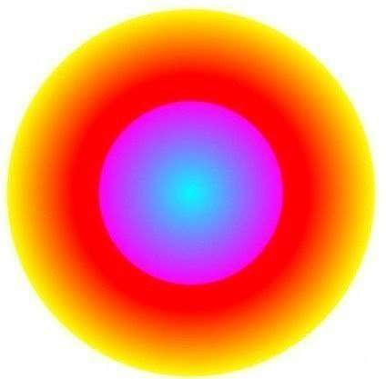

# Ухамсарын тухай бидний мэдэхгүй зүйлс

-Хэрэв та, өөрийгөө насаараа ганцаараа явна гэж бодоод байвал үнэхээр ганцаар явна. Ирээдүйд ганцаараа амьдарна гэж итгүүлэн, ийм бодол хиймлээр суулгаж өгсөн хүмүүсийн бусдад туслах чадвар буурч, тусгаарлагдаж эхэлдэг болох нь судалгаагаар ажиглагджээ. Хэсэг оюутнуудыг, тестээр хувь заяа тодорхойлох боломжтой гэж итгүүлэн туршилтад оруулж, таамгаар хэсэг оюутнуудыг сонгон ганцаар насыг барах юм байна гэсэн хариу гарган итгүүлжээ. Харин нөгөө хэсэгт нь, гэр бүлтэй болж сайхан амьдарна гэсэн хариу гаргав. Ингээд нэг нэгээр нь тусгай кабинд оруулж хариуг нь өгч байсан бөгөөд дэргэд нь, хандив өргөхийг хүссэн бичиг бүхий хандивын хайрцаг байрлуулжээ. Ирээдүйд гэр бүлтэй сайхан амьдарна гэсэн хариу авсан оюутнууд, ганцаар насыг барна гэсэн оюутнуудаас дөрөв дахин их мөнгө хандивлаж байжээ. Мөн дэргэд нь санамсаргүй мэтээр харандаануудтай үзэгний сав алдаж унагахад, гэр бүлтэй сайхан амьдарна гэсэн хүүхдүүд бүгд түүнийг түүхэд нь тусалж байсан бол харин ганцаар амьдарна гэсэн хүүхдүүдээс 6 хүүхдийн нэг нь л тусалж байгаа нь харагджээ.

-Үг оюун санаанд хүчтэй нөлөөлж, ой санамж, төсөөллийг өөрчилдөг. Туршилтад оролцогсдод, авто машины осол гарч буйг харуулсан бичлэг үзүүлээд, “Энэ машинууд хэмх мөргөлдөх үедээ хир зэргийн хурдтай явж байсан бэ?”. “Энэ машинууд мөргөлдөх үедээ хир хурдтай байсан бол?”, “Энэ машинууд шүргэлцэх үедээ хир хурдтай явж байсан бол?” гэж асуулт дахь зөвхөн нэг үгийг л өөрчилж, гурван янзаар асуужээ. Хэсэг хугацааны дараа тэднээс, тухайн ослын талаар харсан зүйлийг нь нарийвчилан асуухад, хэмх мөргөлдсөн гэсэн үг оруулсан асуултад хариулсан хүмүүс, уг ослын машины хэмхэрсэн зүйлсийг нь хэтрүүлэн төсөөлж хариулж байсан бол, мөргөлдсөн гэсэн үгтэй асуултад хариулагсад үнэнд арай ойр, харин шүргэлцсэн гэсэн үг оруулсан асуултад хариулсан хүмүүс бараг эвдрээгүй гэж нэг ижил ослыг зөвхөн асуултад орсон үгсийн ялгаанаас болж өөр өөр хариулт өгцгөөж байжээ. Асуулт дахь, зөвхөн нэг үгийн өөрчилөлт сэтгэхүйд хүчтэй нөлөөлдөг болохыг энэ туршилт харуулжээ.

-Бид аливааг их харах тусам, тэр зүйл улам таалагддаг болдог. Бид өөрсдийгөө дуртай зүйлсээрээ хүрээлүүлдэг үү, эсвэл эргэн тойрондоо байгаа зүйлдээ бид дуртай болж байдаг уу? Эх оронч хүн үнэхээр хайртай улс орондоо азаар төрж амьдарч байна уу? Эсвэл тэр энэ улс оронд амьдардаг учираас түүнийг хайрладаг уу? Эдгээр асуултууд хүний үргэлж байнга хэргэлдэг, харилцдаг зүйлс улмаар дуртай болоход нөлөөлдөг гэдгийг харуулдаг. Бид ээжийнхээ гарын хоолонд дуртай байдаг, энэ нь ухаан орохоосоо байнга идэж хэргэлж дассаар улам дуртай болсоны маань илрэл гэнэ.

-Хүн өөрийгөө даган дуурайхад дуртай байдаг. Дуурайх чанар нь хэдийгээр хуурмаг зүйл боловч бидний сэтгэхүйд хүчтэй нөлөөлдөг. Та, хэн нэгэн өөртөө үйлчилсэн эсвэл сайн зүйл хийсэн хүний гарыг цайлгах болвол, сайхан ааш зан, амттай хоол, гайхалтай сайхан инээмсэглэл зэргийнх ньтөлөө, өөрийнхөө хүссэн хэмжээгээр шагнадаг гэж боддог байх. Гэтэл, бидий энэхүү өгөөмөр сэтгэлийг өрөөл бусад удирддаг гэж болно. Нэгэн туршилтаар, хоол захиалж буй хүний захиалж буй зүйлсийг, “за”, “ойлголоо”, “мэдлээ”, “тиймээ” гэж хэлж хүлээн авахын оронд, хэлснийг нь давтан хэлээд байхаар хүн гайхалтай өгөөмөр загнадаг болох нь нотлогджээ. Туршилтад оролцсон зоогийн газрын үйлчилэгчидийн, захиалга авахдаа хэлснийг нь давтан хэлж захиалга авсан үйлчилэгчидийн цайны мөнгө “за, ойлголоо” гэж захиалга авдаг бусад үйлчилэгчидийнхээс 70%-р илүү байжээ. Энэхүү давтаж хэлж захиалга авдаг үйлчилэгчидийг, захиалагчийг дагаж давтаж хэлэхгүйгээр захиалга авах хүсэлт тавьж ажиллуулахад, цайны мөнгө нь бараг тэг болж буурч байсан байна.

