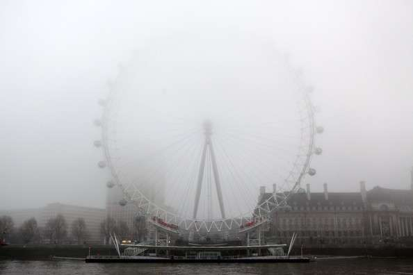
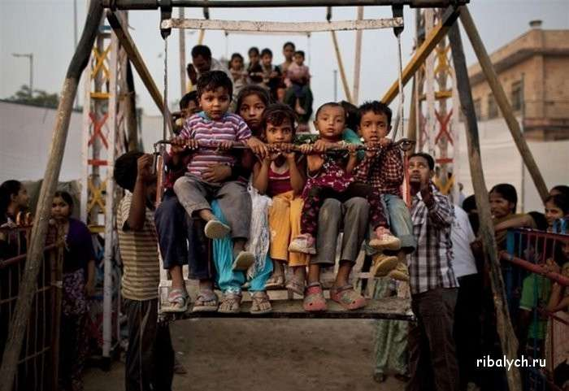
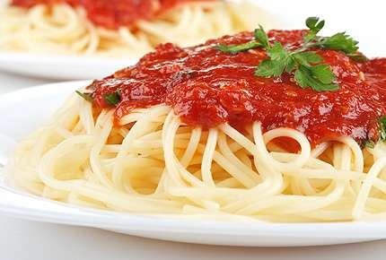
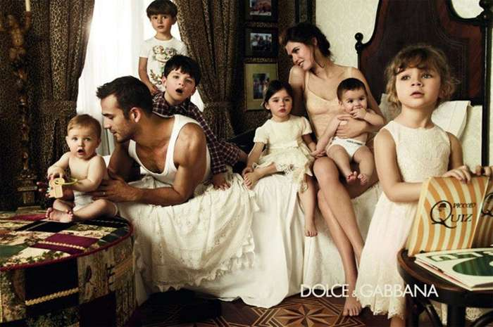
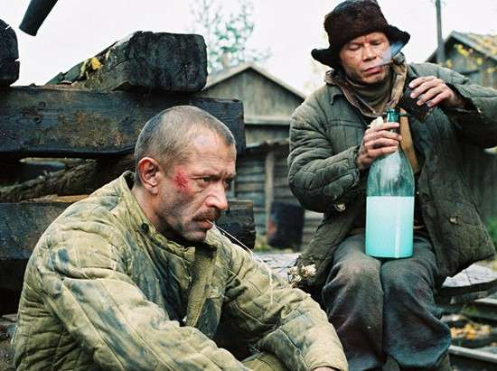
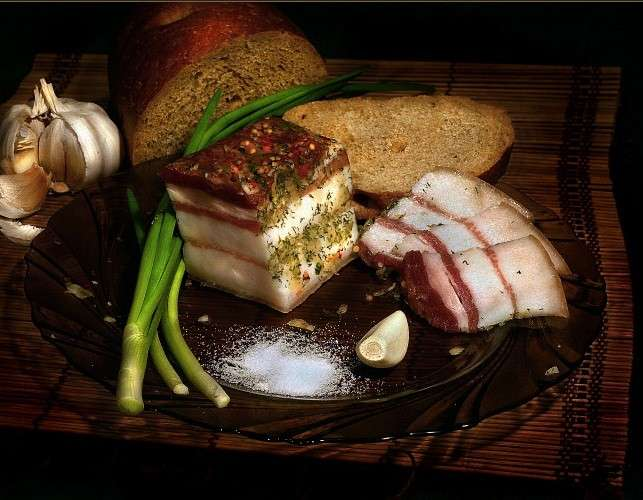
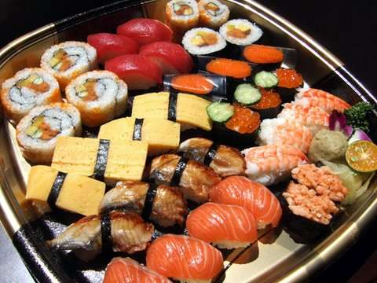

# Улс орнуудыг дүгнэдэг, буруу төсөөллүүд

-Английг мөнхийн манан буданд амьдардаг гэж үздэг нь буруу. Хэдийгээр бүрхэг өдөр олон ч, мөн сайхан өдрүүд байж л байдаг. Харин тэд, цаг агаарын тухай ярих дуртай нь үнэн.

---

-Энэтхэгчүүдийг ядуу зүдүү, бурангуй, бохир гэж үздэг нь худал. Олон жилийн колоничлол, хүний эрхийг зөрчдөг байснаас ийнхүү үзэх болсон. Хэдий, олон ядуустай нь үнэн ч, энэ улс, эмийн үйлдвэрлэл, программ хангамж, кино үйлдвэрлэлээр дэлхийд толгой цохидог, эрчимтэй хөгжиж байгаа улс юм. Тэд гэр орондоо маш цэвэрхэн амьдарч, цэвэрхэн хувцасладаг. Харин, гудамжууд нь их бохир, өмхий үнэртэж байдаг нь сонин.

---

-Америкчуудыг, боловсролтой иргэдийнх нь эзлэх хувь дээр үндэслэн, тэнэгүүд гэж үзэх нь буруу. Тэндэхийн сургалт, ямар ч илүү хичээл заадаггүй, зөвхөн бодит амьдралд хэрэгжүүлэх мэдээллүүдийг өгдөг. Шинжлэх ухааны нээлтүүдийн тоогоор дэлхийд тэргүүлж, Нобелийн шагналыг 326 америкийн иргэн хүртсэн байдаг.

---

-Италичуудыг макароноор төсөөлөх нь олонтаа. Энэхүү паста хэмээх, үндэсний хоол нь, гайхалтай амттай сүмсээр амталсан, нарийн түвэгтэй бэлтгэгддэг хоол юм. Гэхдээ энэ хоолыг өдөр тутам иддэггүй. Бусдын л адил төрөл бүрийн хоол зооглодог.

---

-Италичууд олон хүүхэдтэй, маш өнөр өтгөн гэр бүлээр дүүрэн орон гэж үздэг. Гэтэл, өнөөдрийн хувьд, төрөлт, хүн амын өсөлтийн бууралт асуудал болоод байгаа улс юм. Урд нь, гэр бүлүүд доод тал нь 7 хүүхэдтэй байсан гэдэг.

---

-Герман эмэгтэйчүүдийг царай муутай гэх. Тэд, манайхны эмэгтэйчүүдийн адил гял цал хувцаслаж бусдаас ялгарч харагдахыг эрмэлздэггүй. Энгийн, даруу, биед эвтэйхэн байхаар хувцасладаг. Залуус нь, мөн адил сүүлийн үеийн загвараар хувцасладаг. Харин, нас тогтохоороо, гоёл, хувцсанд мөнгөө зориулахаас илүү аялал, амралтад зарцуулж байдаг.

---

-Оросууд өглөө, оройгүй “водка” ууж байдаг. Арай л хэтэрсэн дүгнэлт, гэхдээ архины хэрэглээгээр дэлхийд нэгд ордог нь харамсалтай. Хөдөө тосгод, хүн амын ядуу давхрага илүү хэрэглэдэг. Залуу үе нь, үүнийг харж өсдөгөөс үүдэлтэй.

---

-Украинчууд зөвхөн “сало” иддэг. Урд нь, айл бүр гахай барьдаг байснаас, ихээр хэргэлдэг байсан гэдэг. Гэхдээ, энэ улс “сало”-раа танигдсан улс гэдэг. Одоо, бусад улс орнуудын адил ердийн хоол хүнс хэргэлдэг.

---

-Япончуудын “суши” алдартай ч, тэд өдөр бүр хэргэлдэггүй. Тэд, хоол хүнсэндээ, цагаан будаа, ногоо түлхүү хэргэлдэг.

---

-Франц бүсгүйчүүд бүгд, гоё сайхан, загварлаг. Парис хот, загварын ертөнцийн төв учираас, ихэнхи хүмүүс, франц эмэгтэйчүүд дэлгүүр гарахдаа, бие барьсан даашинз өмсөж, уруулаа улаанаар буддаг гэж боддог. Харин франц эмэгтэйчүүд, биед эвтэй хувцас өмсөхийг илүүд тооцдог. Харин нүүр будалтын хувьд үнэхээр анхаардаг. Гоо сайхнаа тодотгосон, хөнгөн, хэтэрсэн будалтгүй сайхан явцгааж чаддаг.
