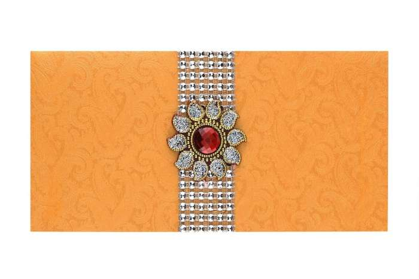
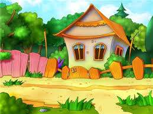

# “Унахаасаа бүү ай”. Ачдаа бичсэн эмээгийн захидал

Энэ захидлыг би, 25 жилийн өмнө, уул нь ээжид чинь бичих байлаа, гэвч тэр үед би залуухан, дөнгөж ээж чинь төрчихсөн, түүнийг хооллох арчлах, яслид хүргэх, авах, гэр орноо цэвэрлэх, хоол ундаа бэлтгэх, өвөөг чинь цэвэрхэн хувцастай явуулах, хичээлдээ явах /оюутан байсан/, даалгавар хийх, энэ бүхнийг амжуулах гээд олон юм бодох завгүй явж дээ. Тэгээд ч, цаг завгүй дээ ч биш биз, 25 настай бүсгүй амьдралын ямар туршлага хуваалцах билээ дээ. Одоо харин би, чиний эмээ, олон зүйлийг амьдралаас сурсан. Чи бид хоёрын бараг бүх зүйлс, мөн хайртай хүмүүс маань ч ижил, биднийх. Би чамайг аз жаргалтай амьдраасай гэж чин сэтгэлээсээ хүсч байна. Тиймээс энэхүү захидлаа бичиж сууна.

Хэзээ ч, унахаасаа бүү айгаарай. Дугуйнаас, савлуураас, чарганаас унахаасаа бүү ай. Өвддөг, бүр тэсвэрлэшгүй өвдөх нь ч бий. Гэсэн ч энэ үед, уйлж байсан ч босох тэвчээртэй, хурдан, шаламгай хөдөлгөөнтэй, баримжаатай болж байдаг юм. Зодолдохоос бас бүү ай, цохилтыг хүлээн авч, шууд хариу үйлдэл хийх туршлага сууна. Нохойноос бүү айж бай. Ээж аав хоёр чинь нохойтой, би ч нохойтой. Чамд тэднийг хайрлахаас өөр сонголт алга даа. Бодож байгаа зүйлээ хэлэхээсээ бүү ай. Чи хүмүүжилтэй хүүхэд томоотой байх ёстой гээд амаа хамхих албагүй. Чи, “нөхөрлөл”, “хайр дурлал”-аа хайрлан, бодсоноо хэлэхгүй нуух ёсгүй. Хэлснийг чинь тоохгүй, хүлцэнгүй байдлыг нэхвэл, тийм нөхөрлөл, хайр, чөтгөр лүүгээ тонилог. Алдаа дутагдлаа хүлээж, уучлалт өршөөл гуйхаас бүү ай. Үүнийг зөвхөн хүчирхэг хүмүүс хийдэг юм. Би, чамайг, “уучлаарай, миний буруу. Алдаагаа яаж засах вэ” гэж хэлж чаддаг хүчтэй байгаасай гэж хүсч байна. Тааруу дүн авахаасаа бүү ай. Энэ үедээ, чи, өөрийнхөө сул талууд, юунд анхаарах ёстойгоо мэдэж авдаг. Муу дүн чамайг муу хүүхэд гэж байгаа юм биш. Дүн бол чамайг, үйлдэлд түлхэх сэдэл гэдгийг ойлго. Бусдад анзаарагдахгүй байхаас бүү ай. Анхаарлын төвд байдаг хүүхдүүд, үдэшлэг болзоонд уригдаж явах хооронд, чи, өөрийгөө хөгжүүлэх цаг заваа ашиглан өсч байдаг. Хайрлаж дурлахаас бүү айгаарай. Хэзээд, дурлал ирдэг. Эсэргүүцээд хэрэггүй, өсөж том болж буйдаа баярла. Хайртай хүн чинь, сэтгэлгүй хүн байвал, түүндээ, байр байдлаа хэлэхээсээ бүү ай, чи юу ч гээхгүй. Хайрыг чинь хариулах сэтгэл хаа нэгтээ байж байгаа. Анхны үнсэлтээс бүү айгаарай. Та нар, бүгд үнсэлдэж чаддаггүй гэж боддог ч, үнсэлт чинь бидний генд байдаг юм. Анхны сексээс бүү айгаарай. Ганцхан, тэр хүн чинь хайртай хүн чинь байвал болох нь тэр. Гэхдээ, дараах, үр дагаврыг нь, харин сайтар бодоорой. Гэрлэхгүй байх, эсвэл гэрлэлтээс бүү ай. Энэ бол чиний эрх. Салалтаас бүү ай. Хэн нэгний чинь, эсвэл хоёулангий чинь бие биеэ дутуу таниснаас болдог асуудал. Энэ бол төгсгөл биш, ямар нэг зүйлийн магадгүй бүр, илүү сайн зүйлийн ч эхлэл байж болдог. Ганцаардлаас бүү ай. Өөрийн төрлөх, ухаантай, чамайг ойлгох ганцхан хүн болох өөртэйгээ байх боломж гэдгийг ойлго. Болвол, энэ байдлаасаа таашаал авч сур. Тэр болгон удаан үргэлжилдэггүй боломж юм шүү. Хүчирхэг байхаасаа бүү ай. Хүчирхэг хүмүүс хүчтэй хүмүүстэй л нөхөрлөдөг. Уйлахаас бүү ай. Хүчтэй хүн л өөрийн уйлах, инээх, бүх асуудлаа өөрөө шийддэг. Шинэ зүйлийг үзээд алдахаас бүү ай. Хүн юу гэх бол, яах бол гэдгээс битгий болгоомжил. Амьдралын өгч буй зүйлсийг авахыг хичээ. Хүсэл чинь бусдад, бүтэшгүй тэнэг санагдсан ч хийгээд үзэх хэрэгтэй. Миний үеийн эмээ мотоцикл уначихсан явна билээ. Түүнийг дэмжиж байсан хүн ховор л болов уу. Хөгшрөхөөсөө бүү айгаарай. Энэ бол аймшигтай зүйл биш. Харин ч амьдралыг илүү үнэлж чаддаг, ойр дотныхноо илүү хүчтэй хайрладаг, ойлгодог болгодог зүйл шүү. Тэгээд ч би чамд ийм хачин захидал бичиж суугаа юм бил үү. Одоо эцэст нь ойр дотныхноо үүрд алдахаас бүү айгаарай. Энэ талаар би, бичих эсэхдээ нилээд эргэлзсэн ч, бичихээр шийдлээ. Эцсийн зам буюу өөд болох, үүрдийн хагацал зайлшгүй гэдгийг чи бид хоёр хоёулаа мэднэ. Тиймээс, амьд байгаа дээр нь, хамт байгаа үед нь чадлаараа хайрлаарай. Хайр үгүй болдоггүй юм. Хайртай шүү! Эмээ нь.
