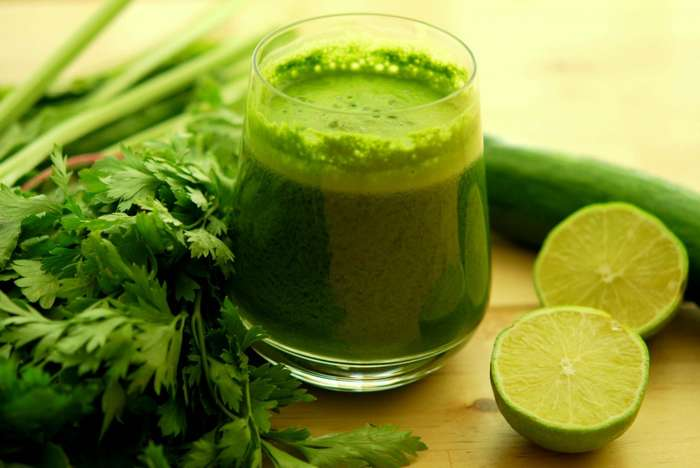
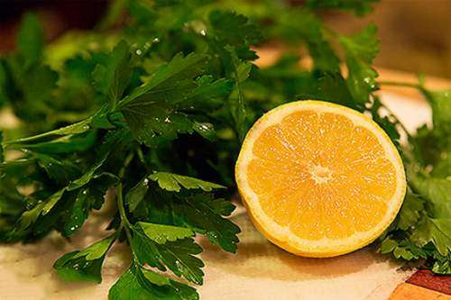

# Унтахаасаа өмнө хэрэглэх ашигтай ундаа

Та бүхэнд, унтахын өмнө ууж хэрэглэснээр, илүүдэл жингээ хасч тайлтай болгох үйлчлэлтэй бие организм цэвэрлэн, бодисын солилцоо сайжруулдаг, гэртээ бэлтгэх ундааны жорыг хүргэж байна.

-Лимон 1 ширхэг\
-Яншуй 1 багц\
-Нунтаг цагаан гаа 1 хоолны халбага\
-Уксус 1 цайны халбага\
-Корица амтлагч 1 цайны халбага /ууттай нунтаг амтлагч/\
-Ус 0.5 литр\
Бүгдийг нь холигчид хийж сайтар хутгаад бэлэн болно. Орой болгон унтахын өмнө ууснаар үр дүн нь биед тань гарах эерэг өөрчлөлтүүдээр илэрнэ.

Үүнийг ууснаар тэр өдөр идэж хэрэглэсэн хоол хүнс гадагшилдаг бөгөөд биед, хорт бодисууд хуримтлагддаггүй учраас жин эрүүлээр хаягдах процесс явагддаг байна.
