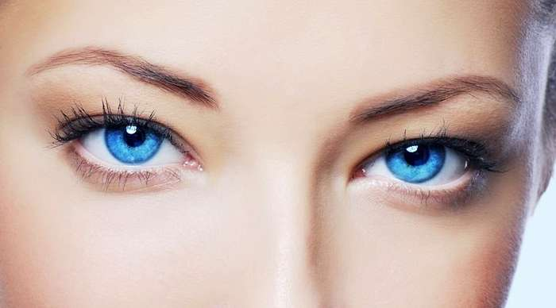

# Унжсан зовхины арьсыг татах хялбар арга

Энгийн гарын доорх зүйлээр хийх энэ маска, эмэгтэйчүүдийн дунд эртнээс хэрэглэгдэж ирснээрээ шалгарсан арга гэж үзэж болдог.

Хөгшрөлт бие махбод, гаднах төрхөнд нөлөөлөн, нүүр царайнд жижиг, гүн үрчлээс үүсч, нүдний эргэн тойронд хамгийн түрүүнд хөгшрөлтийн шинж тэмдгүүд илэрдэг бөгөөд нас ахих тусам коллаген буурч, нүдний ойролцоох булчингийн эд эс суларч, доод зовхинд өөх, шингэн хуримтлагдан, уутанцар үүсдэг. Эдгээр нь, мөн гормоны өөрчлөлт, стресс, нойргүйдэл, хорт зуршил болох архидалт, тамхидалтаас үүсч болдог.

**Нүдний үрчлээ, зовхины унжилтын эсрэг, гэрийн нөхцөлд хийх маска:** \
-1ш өндөгний цагаан\
-1ш хөвөн /гоо сайхны/\
**Хэрэглэх арга:** \
Нүдний зовхины будаг сэлтийг сайтар цэвэрлэнэ. \
Өндөгний цагааныг, шараас нь салгана. \
Гоо сайхны хөвөнгөө өндөгний цагаанд дүрж, нүдээ аньж зовхиндоо түрхэнэ. \
Нүдээ аниастай, бүрэн хаттал нь байлгаад угаана. \
Түргэн хатаах зориулалтаар сэнс хэрэглэж болдог
