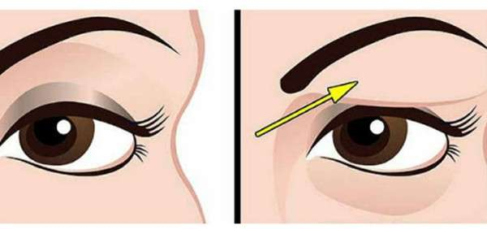
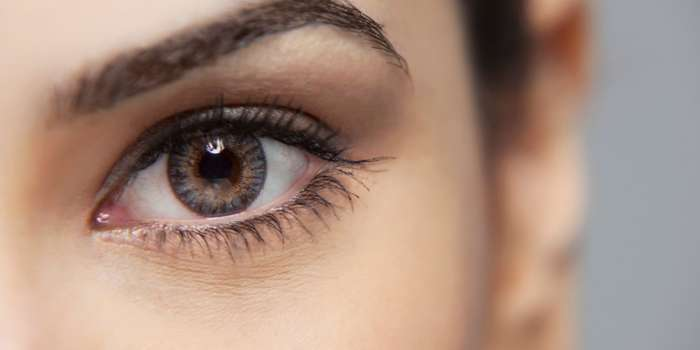

# Унжсан зовхийг татах үр дүнтэй арга

Унжсан зовхи нь, харцны цог, царай зүсэнд нөлөөлдөг, олон эмэгтэйчүүдийн хувьд асуудал болсон, ахимаг овортой харагдуулдаг нэг шинж билээ. Зовхи унжихыг хөгшрөлтийн нэг хэлбэр гэдэг боловч, зовхины мэдрэлийн үрэвсэл, зовхио гэмтээх, зарим арьсны өвчин, өвдөг гарах зэргээс үүдэлтэй унжих нь ч байдаг.

Нас болон бусад шалтгаанаар, унжсан зовхийг татахад, өндөгний цагааныг ашиглан, маска тавих нь, гайхалтай үр дүнтэй аргыг танилцуулъя:\
- Нүүрээ цэвэрлэж, угаагаад, сайтар арчих\
- Өндөгний цагааныг салгаж авна\
- Энэ өндөгний цагаанаа, хөөсөртөл хутгах\
- Жижиг хөвөнгийн тусламжтай, зовхиндоо түрхэнэ\
- Нүдэндээ оруулахгүй болгоомжтой түрхээд, нүдээ аниастай хаттал нь байлгана\
- Хатмагц, бүлээн усаар угаана

Одоогийн, олон төрлийн гоо сайхны бүтээгдэхүүнүүд гарахаас өмнө, эмэгтэйчүүд өндөгийг, нүүр, арьс арчилгаанд, нийтээр хэрэглэж байсан бөгөөд, үр дүн нь баталгаатай энэхүү аргуудаас нэгийг нь ч атугай, танд хүргэж байгаадаа таатай байна.
