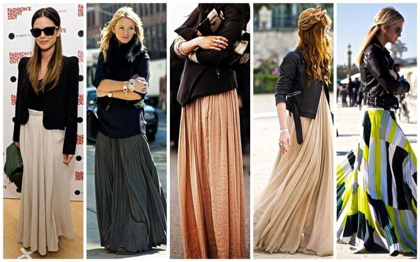
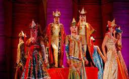

# Урдны эмэгтэйчүүдийн, урт хормойтой хувцасны учир

Урд нь, бүх улс үндэстний эмэгтэйчүүд урт хормойтой хувцас өмсдөг, үүнийг газар дэлхийгээс материйн энерги авдаг, үүнд мөн эд баялагийн энерги ч багтдаг, газар дэлхий нь, элбэг дэлбэгийн энергээ газар шороон дох үр тариа, ургамлаар дамжуулан эмэгтэй хүнд үр үндсийг нь бэхжүүлж, эх хүн болох хүч тамирыг өгдөг гэсэнтэй холбон үздэг байжээ.

Эмэгтэй хүний хувьд, эмэгтэй даавар бүсэлхийнээс доод хэсэгт байдаг, хүүхэд төрүүлэх ариун үйлдэл доош чиглэлд явагддаг зэрэгтэй холбоотой энерги нь доош чиглэлтэй байхыг чухалчлан авч үздэг байна. Хувцасны урт хормой нь, доош дэрвийн, конус хэлбэр үүсгэн газраас, тэтгэгч энерги авах нөхцөл бүрдүүлдэг гэх бөгөөд алхах явах үед, газрын энергийг эрчимжүүлэх, өгөх, чадвартай торсион талбай үүсдэг гэнэ. Мөн хормойтой хувцасыг, доош шувталж тайлахыг таагүй, энергиэ алддаг, зөвхөн дээш толгойгоо давуулан тайлахыг зөвлөдөг байна. Энэ үед, энерги бүх биеэр дамжин биед үлддэг гэнэ. Ийнхүү, зөв хувцаслах, өмсөх тайлах бяцхан дүрмийг мөрдөх нь, газар дэлхий, байгальтайгаа нэгдэх нэгэн сайхан боломж болж өгдөг аж. Эмэгтэйлэг сайхан харагдахын зэрэгцээ, газар дэлхийтэйгээ харьцах боломж өгөх дээл, урт хормойтой даашинз, банзал хааяахан ч атугай өмсөж, өөрийгөө байгал дэлхийн нэгэн хэсэг, гайхалтай гоёмсог бүтээл нь гэдгээ мэдрээрэй. Урт хормойтой хувцас бүсгүйчүүдийг эрхэмсэг, гоолиг харагдуулдаг загвар юм. Амьдралдаа, өөртөө, өөрийн эрүүл мэнддээ, иймэрхүү зүйлийг хүлээн авч, арай илүү нарийн анхааралтай хандах нь, бидний ариун үүрэг бөгөөд уламжлалаа дээдлэх бас нэгэн арга болох болов уу. Байгалийн хамгийн тансаг бүтээл нь, эрхэмсэг, гоо үзэсгэлэнт эмэгтэйчүүд та бүхэн билээ.
