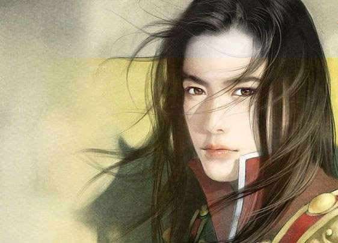

# Урт үсний учир

Вьетнамын дайны үед, америкийн нэгдсэн улсын цэргийн департамент, тусгай хүчиндээ, америкийн индианчуудын ан авын үед гаргадаг, гайхмаар, мөрдөх чадвар, аюулыг урьдчилан мэдрэх зөн, авиа чимээ гаргахгүй хөдлөх, явах чадвар зэргийг тулааны үед ашиглах зорилгоор, индианчуудыг тусгай хүчинд, алба хаалгах нууц ажиллагааг зохион байгуулсан ажээ.

Нэг төрлийн нууц судалгаа, шалгаруулалтаар, ихээхэн амлалт, ятгалгын хүчээр, хамгийн шилдэг индиан залуусыг цэргийн албандаа татжээ. Гэтэл тэдгээр залуус, хүсч хүлээсэн үр дүнг нь үзүүлж чадаагүй гэдэг. Учир нь, эдгээр индианчуудын үсийг, бусад цэргийн алба хаагчдын жишгээр тайрчихсан аж. Үүний дараа, шалтгааныг нь тогтоох судалгаа, туршилт явуулсаны үр дүнд, индианчуудын урт үс, нэг төрлийн энерги дамжуулагч, хамгаалагч болдог байжээ гэж үзжээ. Үүний дараа индиан анчид, үсээ тайрах шаардлагагүй гэсэн тушаал шийдвэр хүртэл гарч байсан аж.

---

Хүний бие организмын, эрхтэн, эд эс бүр, хүнийг амьдрах, оршин байхад зориулагдан заяагдсан гэдгийг, хүн төрөлхтөн эртнээс мэддэг байсны нэг илрэл нь, зарим үндэстнүүдийн одоог хүртэл хадгалж ирсэн үсэндээ хүрэхгүй байх ёс юм. Үсийг нэг талаас, мэдрэлийн системийн ил гарсан үргэлжлэл, “антен” гэж үзэх нь ч бий. Үүний илрэл нь, бид, айх цочих үед, “үс босдог” эвгүй мэдрэмж, харин, самнаж илэхэд таатай байдаг мэдрэмж юм. Дээр үед, бүх үндэстэн, эрэгтэй, эмэгтэйгүй урт үстэй байсныг түүх харуулдаг. Харин, анх үс авахыг, Эртний Римийн император Нерон, гадныхан, олзныхноос бүрдсэн легионуудын, үсийг авахыг тушааснаар эхэлсэн гэдэг. Үүнийгээ, “би эднийг юм боддог байгаасай гэж хүсэхгүй байна. Эд зөвхөн миний тушаалыг л биелүүлж байхад болно” гэж тайлбарласан нь сонирхол татдаг. Үүнийг, үс тайрахыг, “ой санамжаа тайрдаг”, үс хусахыг, “эрхшээлд хялбар ордог” гэх мэт, олон үндэстний дунд явдаг, явган яриануудтай холбож үзэх нь ч бий.

Нэмж сонирхуулахад, урдны хүмүүс, эрэгтэй, эмэгтэйгүй үсээ нэг сүлжиж, нурууныхаа голоор унжуулдаг байсныг, нурууны үеүдийг дагасан мэдрэлийн судлуудад ойр байлгах, нэг шалтгаан байсан гэж тайлбарласан байдаг.
