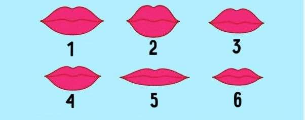
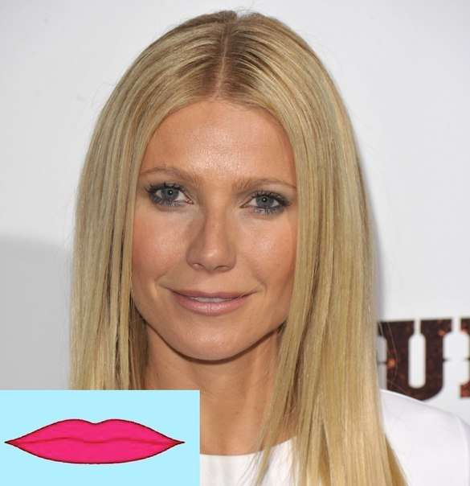

# Уруулын хэлбэрээр шинжих нь

#### Зузаан, өргөн уруул.

Аз туршигч. Тэр таалагдсан зүйлээ авч байж салдаг. Илэн далангүй, эрч хүчтэй тэр, түрүүлж утасдах, болзоонд урих зэрэг санаачлагаа гартаа авахаас ичихгүй. Ийм эмэгтэй ямар нэг зүйлийг хүлээгээд сууж чаддаггүй, харин хэрэгцээт зүйлээ өөрөө олж авч байдаг. Түүний амьдрал сонин тохиолдлуудаар дүүрэн байдаг бөгөөд хэн нэгэн уйтгартай байна гэвэл, огт ойлгохгүй. “Одоо, эсвэл хэзээ ч үгүй” гэсэн уриа, тэднийх. Тэдний хувьд эрх чөлөө, хамааралгүй байх асуудал гол байр эзэлнэ. Амьдралаа зориулах эр хүн нь, гайхалтай амраг, амьдралын том, том асуудлуудыг шийдвэрлэж чаддаг байх ёстой гэж боддог. Сул, “ээжийн хүү” нар түүнд хэрхэвч тохирохгүй, бүр сонирхлыг нь ч татахгүй

---

#### Зузаан боловч жижиг уруул.

Эдгээр эмэгтэйчүүд, хахир хүйтэн, тооцоотой биш, хамгийн түрүүнд сэтгэл хөдлөлөө нэгдүгээрт тавьдаг. Тэдний амьдрал “нисэлт”, “уналт”-аар дүүрэн байдаг. Бусдын зовлонг ойлгодог хайр энэрэлтэй хүмүүс. Тэд, маш аятайхан бүсгүйчүүд. Гэхдээ дурдахгүй байж болохгүй нэг тал байдаг нь тэд, хэцүү асуудлуудад оролцохгүй нүдээ аньж өнгөрөн өөрийгөө хуурч байдаг. Эр хүнийг сонгохдоо, гялгар сэтгүүлийн хавтсан дээрх сайхан залуу эсвэл хайр дурлалын уран зохиолын гол баатар шиг хүнийг төгс гэж тооцдог. Эрчүүл, ийм эмэгтэйчүүдийг, өөрсдийг нь шүтэн бишрээд сууж байх хүмүүс гэж боддог нь алдаа байсан нь удахгүй мэдэгддэг

---

#### Дээд уруул нь, доодохоосоо зузаан.

Маш зорилго бүхий хүмүүс. Эхэлсэн зүйлээ утга учиртайгаар тооцон дуусгаж чаддаг. Хүсч буй зүйлээ бүрэн мэддэг. Аливааг хийхдээ өөрийн зөв гэдэгт 200% итгэлтэй байж байж эхэлдэг. Эхэлсэн зүйлээ дуусгалгүй хаядаг хүмүүсийг үнэлдэггүй. Хүссэндээ хүрэхэд нь, түүний өөрийн өндөр үнэлэмж тусалдаг. Энэ хатагтай нар олон манлайлах чадварыг агуулсан, олонд хүндлэгдсэн хүн байх нь олонтаа. Түүний эр хүн, мөн түүнтэй адил амбицтай, хүссэндээ хүрэхэд нь тус дэм болохуйц байхыг хүсдэг. Энэ холбоог нурахаас, хоёулангийнх нь бүхнийг ялах гэсэн хүсэл нь нийлж байвал аврагддаг.

---

#### Доод уруул нь дээдэхээс зузаан.

Ийм эмэгтэйчүүд олны дундаас ялгарч байдаг. Түүний араас атаархлын харц шидэгдэх нь олонтаа. Ийм бүсгүй, хүмүүсийн дунд тархсан ямар нэг загварын хувцас өмссөний оронд, тааран шуудайгаар биеэ ороогоод явахыг илүүд үздэг. Тэр, өөрийн хувийн өвөрмөц байдлыг өндөрт тавихыг чухалд тооцдог. Энэ нь, түүний хувцаслалт загварт илэрч байдаг. Тэр, маш онцгой эр хүн хэрэгтэй гэдгийг өөрөө мэддэг бөгөөд түүнийг эрж хайхад их хугацаа шаардагдна гэдгийг ч мэднэ. Энэхүү нууцлаг эмэгтэй маань шүтэн бишрэгчидээр огтхон ч дутагдахгүй, мөн түүнд бууж өгөөгүй эрэгтэйг сонирхдог.

---

#### Нимгэн, өргөн уруул.

Маш бодит эмэгтэйчүүд. Юмыг урьдчилан төлөвлөх дуртай, шинэ жилийн бэлгүүдийг намраас, аялалын бэлтгэлээ сарын өмнөөс гэх мэт урьдчилан бэлтгэх бөгөөд үүнээсээ гайхалтай таашаал авч байдаг. Төрөлхийн, бодит хүмүүс, ямарч зүйлийг шалгаж туршиж байж хийдэг ба сэтгэл хөдлөлөө барагтай харуулдаггүй учраас, хүмүүс түүнийг хүйтэн хөндий, их зантай гэж дүгнэх нь олонтаа. Гэвч энэ бүсгүйчүүд, сэтгэлээ нээх нь хэцүү байдгаас л тийм сэтгэгдэл төрүүлдэг. Тогтвортой байдалд дуртай. Итгэл даах эр хүнтэй амьдардаг.

---

#### Нимгэн жижиг уруул.

Адал явдал эрэн хайгч. Түүний хувьд далай тэнгис өвдгөөр татаж, өөдрөг сэтгэл нь 3-4 хүнийхтэй тэнцэхүйц бургилж байдаг. Байнга хөдөлгөөнтэй, ийш тийш аялж явах дуртай. Далайц багатай, ердийн төслүүд сонирхолыг нь татдаггүй. Өөртөө маш итгэлтэй, ямарч үйл хэргийг эргэлзэхгүйгээр барьж авдаг. Тэд жинхэнэ тэмцэгчид, эрч хүчтэй, чөлөөт хүмүүс. Түүний сэтгэлийг булаах эр хүн мөн адил зан чанартай байх ёстой.
