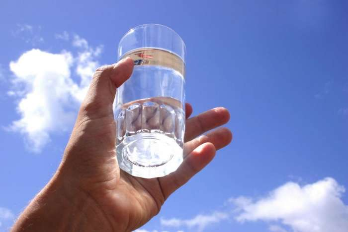
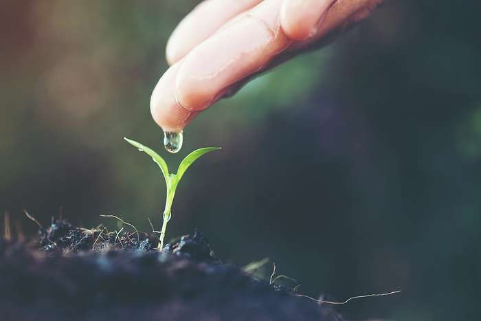

# Ус. Ууж буй усаа хэрхэн ашигтай болгох вэ?

Бидний бие 70% уснаас бүрддэг. Ус нь бие организмыг эрүүлжүүлэх увидастай бөгөөд бие дэх хорыг гадагшлуулж, түүний үйл ажиллагааг тэнцвэржүүлж байдаг. Тиймээс хүн, цэвэр буюу хлоржуулаагүй усыг хангалттай ууж байх хэрэгтэй байдаг ба цай, кофе, ундаа биед шаардлагатай шингэнийг нөхдөггүй зөвхөн ус л ашигтай байдаг байна.

Хэрхэн зөв уух вэ?\
Өлөн дээрээ\
Хооллох хооронд, хооллохоос өмнө\
Бага багаар балгаж шимж уух\
Шууд ихээр залгилж уухгүй байх, ихээр нэг дор залгилан уух нь эд эрхтэнүүдэд ачаалал өгдөг\
Бүлээндүү бол сайн\
Өглөөд өлөн дээрээ аяга хүйтэн ус уух нь, өтгөн хаталтаас сэргийлнэ\
Өглөөд бүлээн аяга ус уух нь, биеэс хор гадагшлуулж, биеийг цэвэрлэнэ\
Аль болох цэвэр ус уух\
Өдөр тутам уух усны хэмжээг биеийн жингээ 30 граммаар үржүүлж гаргадаг\
Ус уух хамгийн ашигтай цаг нь, өглөө сэрмэгцээ уухад, бие цэвэрлэгдэж, организм сэрнэ. Хоолноос өмнө хагас цагийн өмнө уухад, хоол боловсруулах эрхтэний үйл ажиллагааг идэвхижүүлж, хоол хүнсийг боловсруулах хугацааг хурдасгадаг
