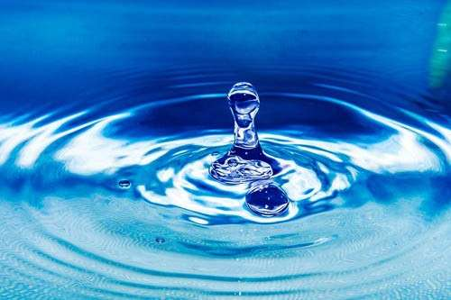
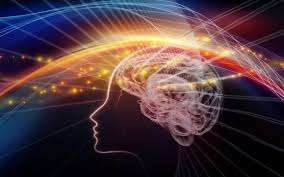

# “Усанд, дэлхийн амьдралын шим шүүс нь байх ид шидтэй эрх мэдэл олгогдсон нь гайхамшиг юм” Леонарда да Винчи.

“Усанд, дэлхийн амьдралын шим шүүс нь байх ид шидтэй эрх мэдэл олгогдсон нь гайхамшиг юм” Леонарда да Винчи. Мөн, усыг ашиглан, хамгийн энгийн зүйлээр хамгийн ер бусын зүйлийг хийж болно гэж үздэг. Хангалттай ус уухад, биеийн эрүүл мэнд сайжирна, мөн тусгай зориулалтын аргаар усыг уухад, нахцөл байдлаа зоихцуулах чадварыг эзэмшинэ гэдэг. Ус гэж нэрлэгдэх энэхүү бодис, түүний молекулын шинж чанар гайхалтай өвөрмөц онцлогуудтай бөгөөд хамгийн хачирхалтай нь, мэдээллийг шингээх, дамжуулах чадвартай байдаг нь юм. Тиймээс, усны энэхүү гайхамшигт чанарыг ашиглан, хүсэл зорилгоо биелүүлэх арга байдаг бөгөөд энэ нь, өглөөд, уух усандаа хүсэл зорилгоо хэлж, уг усаа бага багаар залгиж уух арга юм. Бие организмын маань 70 хувийг бүрдүүлэгч усыг, мэдээлэл бүхий ус нь идэвхижүүлж, организмд, хүсэл зорилго биелэх бүх боломжит аргуудыг эрж хайх зааварчилга өгөгдсөнөөр, хамгийн сайн хувилбарууд сонгогдож, хүсэл биелдэг аж.

