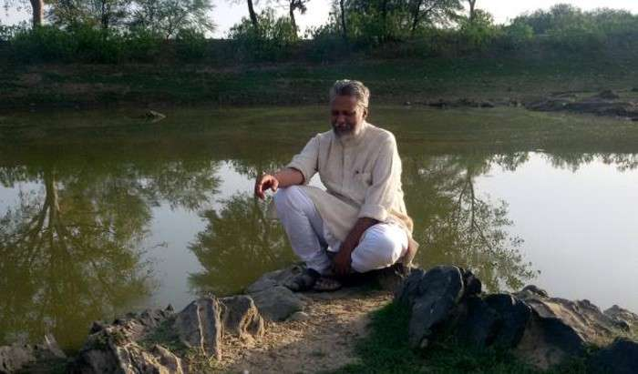
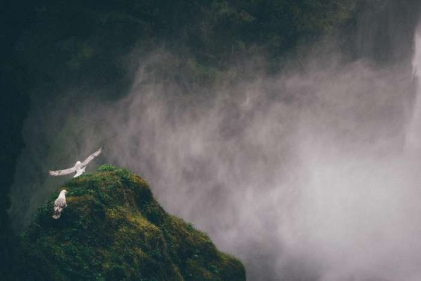

# “Усны хүн”

“Тусламж дэмжлэггүй бол, би ганцаараа юу хийж чадах юм?” гэсэн бодлыг олонхи хүмүүс тээж, өөрийн олон сайхан санаануудаасаа татгалзсаар явдаг. Харин энэтхэгийн иргэн Раджендра Сингх ганцаар зориглон зүтгэсээр, ганц хүн ч түүхийг эргүүлж чадахыг өөрийн замнал, үйлдлээр амьдрал дээр харуулж чадсан хүн юм. Тэрээр ганцаараа голыг сэргээж, хаягдаж гандсан газар орныг усаар тэтгэсэн буянтай үйлс бүтээж, олны дунд “Усны хүн” гэж алдаршжээ. 1985 онд уламжлалт аюрведийн анагаах ухааны чиглэлээр сурч төгссөн залуу хүү, хөдөө ажиллаж амьдарч, өөрийн фермтэй болох зорилготой захын нэгэн тосгонд шилжин суурьжээ. Тэр үед, уг тосгоны ойролцоо, уул уурхай, газрын баялгийн олборлолт ид хүчээ авч байсан болон газар тариалангийн тооцоогүй төлөвлөлт, ой мод огтлох зэрэг хүмүүсийн буруу үйлдлүүдийн уршигаар нутгийн гол нь ширгэж, ган гачиг болсон уг нутгаас чадалтай нь шилжин нүүж, очих газаргүй, чадалгүй хөгшчүүл, ядуус л үлдсэн байв. Энэтхэгт, усны дутмаг байдал болон ус гол ширгэснээс, иргэд нь төв суурин газар бараадаж хот суурин дах хүмүүсийн төвлөрөл ихсэн ядуурал тоймоо алдсан гэж үздэг. Сингх харин, шийдвэрээ өөрчилж буцахыг яарсангүй, түүнд, уг газар нутгийг урд өмнө ямар байсан, яг тэр байдалд нь буцаан өөрчилөх хүсэл төрж, санаагаа хэрэгжүүлэхийн тулд эцэг өвгөдийнхөө эзэмшиж байсан уламжилалт туршлагыг судалж эхэлснээр гарц олсон аж. Ийнхүү тэрээр, урдны энэтхэгчүүдийн хийдэг байсан борооны ус хураах “Джохад” хэмээх эртний байгууламжуудыг барьж эхэлсэн аж. Уг нутагт, 7, 8-р сард, үргэлжилсэн усархаг бороо ордог, бусад үед ганд нэрвэгддэг байжээ. Түүний барьсан “Джохад”-уудын ачаар, бүтэн жилийн турш хэрэглэх борооны ус хуримтлагддаг болов. Уг “джохад”-уудаа, чулуу, шавар, бетон зуурмаг гэх мэт боломжит материалуудаар ганцаар барьж байсан гэдэг. Энэ үед нь нутгийн хүмүүс түүнийг дооглож тохуурхдаг байснаа эхний үр дүнгий нь харж, үр шимийг нь хүртэж байж, ойлгон тусалж эхэлсэн аж. Ийнхүү борооны хураасан усаар тэтгэгдэж, борооны улиралд урсдаг жижиг горхинуудын усны голдирлыг өөрчилж өгснөөр, ширгэж үгүй болсон Арвари гол сэргэн урсаж, тухайн нутгийн байгаль орчин өмнөх төрхөндөө орж, мод, ургамал сэргэн, шувууд, амьтад суурьших болжээ. Мөн хөрсний усны түвшин нэмэгдэж, усанд хүрэхийн тулд 100м ухах шаардлагатай байсан бол, одоо 3-13 метрээс ус гарах болсон гэнэ. Энэхүү буянт үйлсийнх нь төлөө түүнд, Стокгольмын Олон Улсын Усны институтын хүндэт шагнал олгосон байна. Тэрээр, -“Хүмүүст бүтэшгүй олон солиотой мөрөөдөл байдаг. Би тийм мөрөөдлийнхөө үед ч, ийм үр дүн гарна гэж төсөөлөөгүй байсан. Голыг урдны хэмжээндээ сэргэж урсчихна гэж бодоогүй байсан ч, ид шидийн мэт гайхамшиг болсон. Бид байгаль орчиноо хайрлаж байж, өөрсдийн амьдрал, үр удмынхаа амьдралыг хангана гэдгээ ойлгох ёстой” гэж даруухан өгүүлдэг. Сингх хүрсэн амжилтаасаа урам зориг авч, улмаар Tarun Bharat Sangh хэмээх фонд байгуулж, 80-д оноос хойш 8600 гаруй джохад барьж байгуулан, мянга гаран тосгон сууринг усжуулсан гавъяат үйлс бүтээжээ.

“Джохад” буюу борооны ус хураагуур нь, Английн колоничлолын үед мартагдсан энэтхэгийн эртний ус хураагуурын байгууламж. Энэ нь, борооны ус ихээр урсах хэвгий газрыг тосуулан барьдаг эсвэл тэгш газар ч барьж болдог, ёроолыг нь чулуу шавраар бүрсэн нэг төрлийн бассейн маягийн задгай цөөрөм бөгөөд борооны улиралд жилийн нөөц усаа хураах боломжийг өгдөг байна. Мөн хураагдсан борооны ус аажмаар хөрсөнд нэвчихдээ хөрсний усыг тэтгэж байдаг нь ашигтай байдаг. Энэтхэгчүүд, хэрэгцээнийхээ хэмжээгээр, олныг барьж “Борооны ус баригч тал” хэмээн нэрлэж ашигладаг, мөн энэтхэгт ус их үнэтэй байдгаас байгалиас үнэгүй ус хэрэглэхийг эрхэмлэх болжээ. Өрхийн хэрэгцээнд, дөрвөн багананд ус нэвтрэхгүй бөс уяж гол хэсэгт нь нүхэлж, тэнд нь тосох сав суурилуулан хурааж авах аргыг цөлийнхөн хэргэлдэг аж. Манай улсын усаар дутмаг бүс нутгийнхан, говийнхон хэрэгжүүлж бяцхан баян бүрд үүсгэх бүрэн боломжтой санагдсаныг та бүхэнтэйгээ хуваалцлаа.

