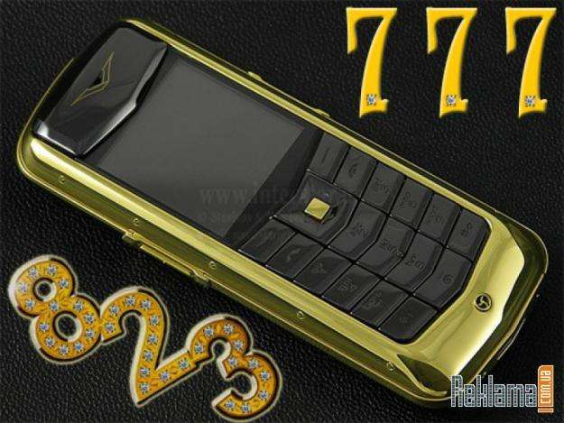

# Утасны дугаарын тоон утга

Нумерологи буюу тоон утгын ухаанаар, бидний байнга харьцдаг зүйлсийн тоо, нийлбэр тоо нь, хүний зан чанарт нөлөөлөөд зогсохгүй, амьдралын үйл явдалд мөн нөлөөлөх боломжтой гэж үздэг. Тиймээс, барьж буй гар утасны дугаарын тоон утга буюу утасны дугаар дах тооны нийлбэрүүдийн тоон нөлөөллийн утгыг танилцуулъя. Дугаарын тоонуудыг хооронд нь нэмснээр нэг оронтой гаргаж, харгалзах тооны тайлбарыг уншаарай.

**1.** Энэ бол хүчтэй дугаар бөгөөд энерги8 эрч хүчийг өсгөж, орчинд нөлөөлөх боломжийг агуулдаг. Гэхдээ, аз, амжилттай тохиолдлуудын явцад хэт найдахгүй анхааралтай байх хэрэгтэй. Албан тушаалын шатаар ахихыг хүсэгчид, бизнесменүүдийн тоо гэдэг.\
**2.** Энэ тоо, өөртөө хөнгөн сэтгэл, сайхан зүйлсийг агуулдаг учираас хайр дурлалыг эрэлхийлэгчидэд ихээхэн зохимжтой бөгөөд сайхан сэтгэл, төвийг сахих ухаалаг чанар, харилцааны чадвар, хамтын хөдөлмөр зэрэг таатай чанаруудыг тээдэг. Хүчирхэг, өөртөө итгэлтэй хүмүүс болон худалдаа наймаа эрхлэгчидэд тохирдог.\
**3.** Энэ дугаар, уран бүтээл, онгод, хөгжил цэнгүүнийг илэрхийлэх ба хөгжимчин, жүжигчин, уран бүтээлчид, залууст тохирдог. Энэ тоо, урам зориг хайрлан, өвөрмөц шинжийг тодруулах, алдар нэрд хүргэх, уран зохиол, яруу найргийн онгод хөглөх увидастай.\
**4.** Итгэлтэй, тогтвортой байдлыг билэгддэг тоо учираас, банк санхүү, итгэлцэл дээр үйл ажиллагаа явуулдаг газруудын ажилтан ажилтануудад ээлтэй гэдэг. Өнөр өтгөн гэр бүлд гайхалтай сайхан таардаг гэнэ.\
**5.** Энэ тоо адал явдал, өөрчилөлтийг билэгддэг тогтвортой бус байдлын тоо. Энэ дугаар, эрх чөлөө, адал явдал аялал эрхэмлэгчидэд сайн тохирно. Сахилга бат, хариуцлагад анхаарах ёстойг сануулж байдаг.\
**6.** Гэр бүлийн тоо. Халуун дулаан уур амьсгал, халамж, хамгаалалтыг авчирч, гэр бүлийн холбоо, нөхөрлөлийг бэхжүүлдэг гэж үздэг. Мөн бизнес эрхлэгчидэд гайхалтай тохирдог тоо гэнэ.\
**7.** Энэ бол хамгийн хүчтэй, нууцлаг увидастай далд ертөнцийн тоо гэдэг. Энэ тоо суралцагчид болон оюун сэтгэхүйг эрхэмлэгчид, уран сэтгэгч, гүн ухаантнуудыг ивээж байдаг. Хүний дотоод ертөнцөд сайнаар нөлөөлж, тогтвортой, тэнцвэртэй байдлыг хангадаг.\
**8.** Бизнес эрхлэгчидэд хамгийн сайн тоо. Учир нь мөнгө, мөн харилцагчидыг дууддаг гэж үздэг. Түүнчилэн, албан тушаал ахихыг эрхэмлэгчид болон санхүүгийн байдлыг ивээж байдаг. Бодит байдал, амьдралыг билэгддэг тоо учираас хувийн өсөлтөд нөлөөлдөггүй.\
**9.** Энэ тооны утга, идеалист үзэл, бусдыг ойлгох гайхалтай чанарыг агуулдаг. Энэ дугаар, эмнэлэг, буяны байгууллагынханд их тохирно. Мөн, хамгийн азтай дугаар гэж үзэж болох бөгөөд энэ дугаарын эздийг аз ивээх нь олонтаа байдаг.
