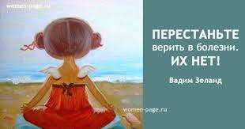

# Вадим Зеланд: Өвчинд бүү итгэ!  Өвчин байхгүй

Амьдралд өвчин гэх зүйлийг байлгахгүй байя гэвэл дараах зүйлсийг хэрэгжүүлэх ёстой гэнэ.

-Архи тамхи хэрэглэхгүй байх. Түргэн хоолны газруудад хооллохгүй байх, ер нь гадуур хооллохоос татгалзаж зөвхөн, гэртээ бэлдсэн, шинэхэн, байгалийн гаралтай зүйлсээр хооллох мөн хоол хүнсэндээ нүүрс ус, сахаргүй зүйлс хэрэглэх. Бохь зажилахгүй байх. Шахдаг оондох фторын нэгдэл бамбай булчирхайг гэмтээдэг тул нунтаг оо хэрэглэж занших. Ходоод гэдсээ цэвэрлэж байх, аль болох паразитийн эсрэг цэвэрлэгээ хийж байх. Эмнээс аль болох татгалзах, гэрийн аптекад йод, ногоон түрхлэг, перекисээс өөр эмийн бүтээгдэхүүн байлгахгүй байхыг хичээх. Эмнэлэг, эмчид юу юугүй очоод байхаас зайлсхийх. Ер нь, өвчин байдаг гэдэгт итгэхээ болих. Учир нь өвчин байхгүй юм. Өөрийн биетэйгээ ярилцаж сонсож сурах. Бие тань таныг агуулдаг бурханаас өгөгдсөн сав. Тэр өөрийн гэсэн дуу хоолой, ухамсартай тул үргэлж юу хэрэгтэй байгаа эсвэл юу хэрэггүйг хэлж байдаг. Түүнийг хүндлэн хайрлаж сурах. Бага үелзэлтэй хоол тэжээлд дурлах, хэрэглэх нь биед эд эсийн хэмжээнд өөрчилөлт орж буйг харуулдаг. Бие организмынхаа эд эс бүртэй харилцаж сонсож сурч, нөхөрлөх. Цэвэрлэх, сэргээх, өөрчилөх даалгавар өгөх, түүнийг биелүүлэх чадвар өөрт тань байдаг. Усанд орох, устай харьцах үедээ устай ярилцаж, гуйж хүсч, талархаж занших. Хумсаа будахгүй, ургуулахгүй байгаагаар нь арчилж сурахыг хичээх. Эмэгтэйчүүдийн гоо сайхны үйлчилгээний газруудыг байгальлаг чадвараас холдуулдаг бага үелзэлтэй газар гэж үздэгээс тэр бүр очихгүй байхыг эрхэмлэх. Үсийг байгалийн антен гэж үздэгээс үсээ задгай тавих нь бусдын хэрэггүй мэдээллийг цуглуулдаг таагүй талтай гэж үздэг. Өдөр бүр дасгал хөдөлгөөн хийж байх. Сонгодог хөгжим сонсож дадах. Долоон хүрд нээхэд тустай үнэрт тоснуудыг ашиглаж занших. Байнга агаар салхинд гарч байх. Байгаль дэлхийтэйгээ ойр байхыг эрхэмлэх. Амьсгалдаа анхаарлаа төвлөрүүлж сурах. Хүн олноор цуглардаг газрууд болон уушийн газраар орохгүй байхыг хичээх. Бусдыг шүүмжлэхээс зайлсхийх. Хэрэггүй харилцаанаас зайлсхийх. Хувцас хунараа сортлох. Биед эвтэй, чөлөөтэй, цэвэр даавуун хувцас өмсөх. Бүх хар өнгийн хувцаснуудаасаа салах. Загвар хөөцөлдөх, хэт хувцаслалтдаа анхаардаг байдлаасаа мөн салах. Хэт их гоёл чимэг зүүхгүй байх. Хүзүүний гинж, бугуйвч, бөгж олон байх тусмаа энергийн урсгалыг хаадаг гэдэг. Гоо сайхны бүтээгдэхүүнүүд, сүрчиг зэргийг цуглуулахгүй, хөөцөлдөхгүй байх. Богино долгионы зуух буюу печиэ хаях. Зурагт үзэхгүй байхыг хичээх. Цахилгаан хэрэгслүүдээ байнга салгаж байх. Утсаар удаанаар ярихгүй байх. Унтах үедээ утсаа салгаж занших. Компьютерээс аргагүй тохиолдлоос бусад үед зугтах. Компьютер тоглоом тоглохоос бүр мөсөн ангижрах. Эмх цэгцтэй байх. Хэрэггүй зүйлсээ хаях. Эвдэрхий зүйлсээ засуулах. Эргэн тойрондоо байгаа амьгүй, амьтай бүх зүйлсээ хайрлаж сурах. Бусдыг өршөөж уучилж чаддаг байх. Амьтад, ургамалтай ойр байж харьцах. Бяцхан хүүхдүүдтэй байнга харьцах нь, эрүүл байхад нэн тустай шалгарсан арга гэдэг. Санаа зовинол болон яарч сандрахаас салах. Бүтээлч байх. Аль болох бодит, үр дүн нь тодорхой харагдах, таашаал авах зүйлсийг хийж байх. /зурах, бичих, дуулах, бүжиглэх, гар урлал/. Инээмсэглэх, инээх. Үргэлж, хаана ч тэр инээмсэглэж явах.

