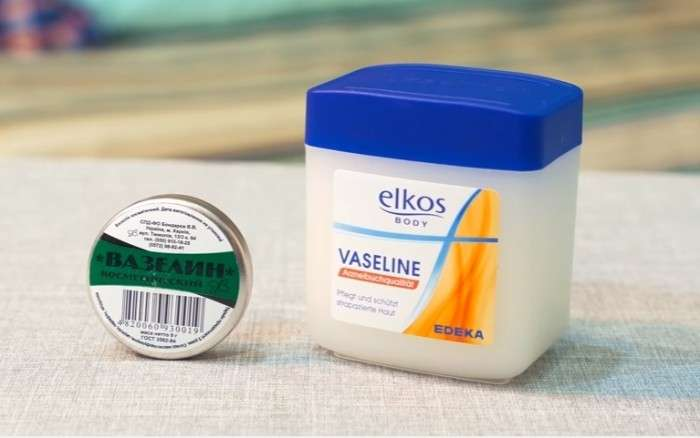
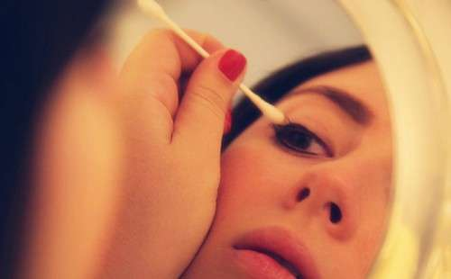

# Вазелиныг хэрэглэх 10 арга

Вазелиныг, анх 1859 онд химич, эрдэмтэн Роберт Чезбро, эрдэст ус, хатуу парафинаар бүтээсэн аж. Эхлээд, ямар ч амт, үнэргүй үйлдвэрлэгдэж байв. Харин орчин үед, шинэ технологиор, вазелиныг төрөл бүрийн үнэртэй үйлдвэрлэдэг болж байна. Түүнийг хэрэглэх аргууд:

1. Гарын дор нүүр цэвэрлэгч бүтээгдэхүүн байхгүй тохиолдолд, хөвөнтэй савх мод, гоо сайхны хөвөнд түрхээд арчихад, нүүрний будаг, тен, сормуусны будаг түвэггүй цэвэрлэгддэг\
2. Сормуусыг бэхжүүлж, уртасгана\
3. Хөлийн өсгий, өлмийний зузаарсан арьс, эврийг зөөлрүүлнэ. Түрхээд оймс өмсөөд унттах хэрэгтэй\
4. Жижигдсэн бөгжийг гараас салгахад тустай\
5. Ээмэгний дэгээ хэсэгт багахан түрхэхэд, зүүхэд амар болно\
6. Хумсны илүүдэл махыг зөөллөж авахад хялбар болдог\
7. Базелиныг элсэн чихэртэй хольж, арьсны скраб хийхэд гайхалтай үр дүн үзүүлдэг\
8. Үнэр барилтыг уртасгах чадвартай. Тухайн үнэртэнгээ удаанаар хадгалахыг хүсвэл, духи, үнэртэн түрхдэг хэсэгтээ вазелин түрх\
9. Үс будахын өмнө, будаг хүрдэг хэсгүүдийн арьсанд вазелин түрхдэг\
10. Хүйтний улиралд, хамар даарч улайдаг. Гарахаасаа өмнө вазелин түрхэхэд улайхгүй
