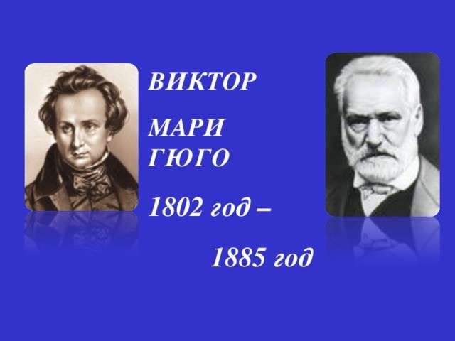

# Виктор Гюгогийн, онч мэргэн үгс

19-р зууны утга зохиолын томоохон төлөөлөгч, Францын суут зохиолч, Виктор Гюгогийн “Гаврош”, “Инээмтгий хүн”, "Парисын дар эхийн сүм", “Шоовдор хүмүүс” сод бүтээлүүдийг нь уншаагүй хүн үгүй биз ээ. Билэг оюун төгс, алдарт зохиолчийн амьдралын талаар оновчтой илэрхийлсэн бодол хайрлах, мэргэн үгсийг толилуулъя.

Бид, амьдралд орилон ирээд гиншин буцдаг. Тэгэхээр инээж амьдрах л үлдэж байна\
Баячуудын диваажин, ядуусын тамаас бүтдэг.\
Эмэгтэйчүүдийн хамгийн агуу шинж чанар нь бууж өгдөгт нь байдаг.\
Дурласан эрийн сэтгэл зүрх, хайртай бүсгүйнх нь сахиусан тэнгэр болдог\
Амьдралд аз жаргалтай байх нь гол бус, өөрөө өөртэйгээ байх нь чухал\
Гэр бүл дэх тэнцвэргүй байдал, сэтгэл санааны таарамжгүйг харуулна\
Уншдаг хүн боддог, боддог хүн шалтгааныг олдог\
Ном бол, тэвчээртэй үнэнч найз\
Тамаас илүү аймшигтай зүйлийг төсөөл гэвэл тэр нь, хий дэмий уйтгарлан суух газар юм\
Бөгтөр байх нь сохор байхаас хэцүү. Учир нь тэр өөрийн дутуу зүйлээ мэддэг\
Аялах нь, төрөх, үхэх мэдрэмжийг хором бүр өгч байдаг, гайхалтай зүйл\
Өөгүй хүнд зэмлэх мэдрэмж байдаггүй
