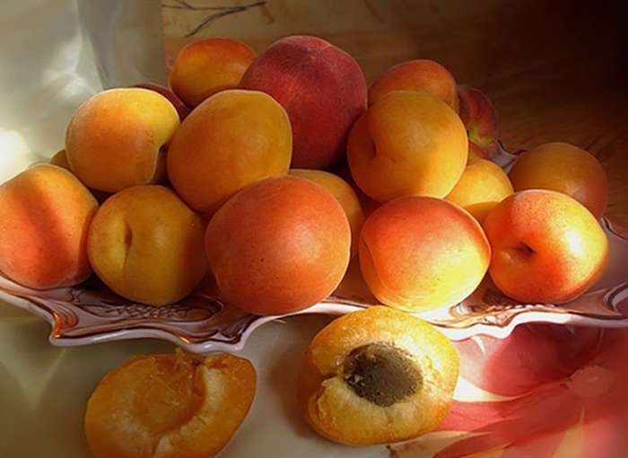
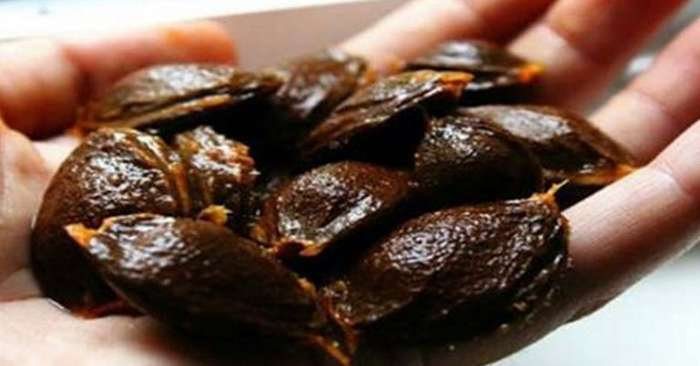
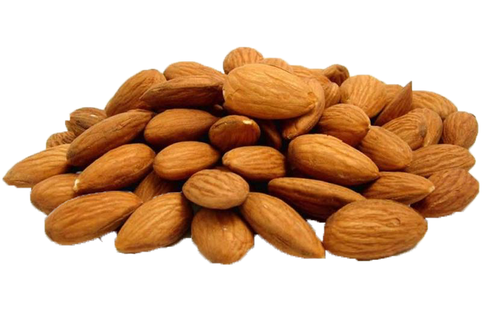

# Витамин B17, хорт хавдарыг устгах, эмчлэх чадвартай

Рак буюу хорт хавдар олон сая хүнийг үхэлд хүргэсэн, өндөр өртөгтэй эмчилгээтэй, энэ нь 100% эмчилэх баталгаагүй аюулт өвчин юм. Химийн эмчилгээгээр дарагддаг гэх ч бусад эрхтэнүүдийг хордуулдагаас муу нөлөөтэй байдаг. Гэтэл энэхүү аюулт өвчинийг дарах, ямар ч хорт хавдарыг устгах үйлчилгээтэй байгалийн B17 витамин ихээр агуулагддаг үр жимсүүд байдаг байна.

Энэхүү B17 витамин үрт жимсгэнүүд, абрикос буюу тоор, персик, алим, интоор, чавганы ясан доторх үрэнд агуулагддаг. B17 –нь, химийн төгс эмчилгээтэй дүйцдэг бөгөөд организмын эд эсийг сонгон үйлчлэх чадвартай, хорт хавдарын эс дэх бета-глюкозидазад шууд хүрч, эрүүл эд эсийг гэмтээхгүйгээр хавдарыг устгадаг байна. Сан-Франциско хотын эрдэм шинжилгээний хүрээлэнгийн биохимич, доктор Эрнст.Т, дэлхийн 2-р дайны үед, витамин С-ийн дутагдлаас болж үүссэн, цинга хэмээх олон мянган хүний амийг авч одсон өвчиний нэгэн адил хорт хавдар нь витамин B17-ийн дутагдал юм. Орчин үеийн хүмүүсийн хоол тэжээлийн найрлага, агууламжийн өөрчлөлтөөс олон хүн энэ өвчинд нэрвэгдэх болсон гэсэн дүгнэлт гаргажээ. Урдны хүмүүс хоол тэжээлдээ, энэхүү витаминаар баялаг хоол хүнс болох байгал, ургамлын гаралтай бүтээгдэхүүнүүд байнга хэрэглэдэг байснаас энэ өвчинг байгаагүй гэж үздэг. Энэхүү үрийг хэрэглэж эдгэсэн эмэгтэйн туршлагаар 10 долоо хоногт хавдар нь үгүй болсон байна. Ийнхүү аюулт өвчинийг эдгээх арга байгаль ертөнцийн гарт байдаг байна.

---

