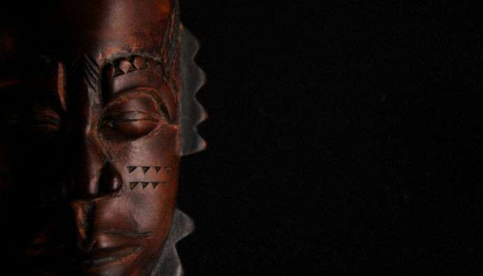
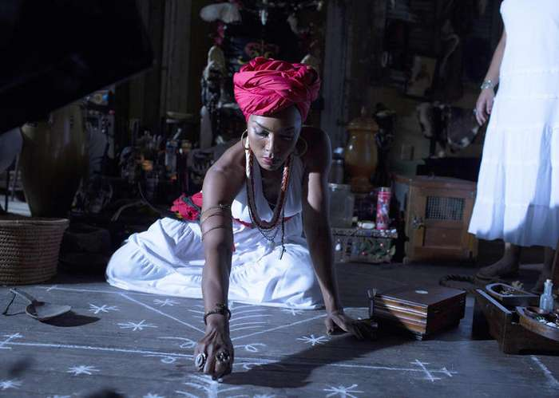

# Вудугийн өвөрмөц зурхай

Вуду нь, дэлхийн хамгийн эртний шүтлэгийн нэгэнд хамаардаг бөгөөд африкийн ард түмний дунд, одоо ч ид шидийг нь ашиглаж байдаг хүчтэй шүтлэг гэж үздэг. Вуду нь, өөр бусад шүтлэг, шашины адил, хүмүүсийн хувь тавилан, зан чанарыг, 36 шүтээнийхээ сүнс эзэгнэдэг үеийн, аль үед нь төрснөөс хамааруулан тодорхойлдог ажээ.

#### 1/01-10/01. Шарлотт /залуу охидын шүтээн/

Харьцах үед, зун цагийг санагдуулдаг, нууцлаг хүмүүс. Маш эмзэг, амархан гомддог. Шөнө төрсөн хүмүүс нь, бүрэг ичимтгий зантай. Өдөр төрсөн нь, зорилгодоо үнэнч, туйлбартай зүтгэдэг хүмүүс. Энэ үед төрсөн хүмүүс эрүүл мэнддээ анхаарч байх ёстой бөгөөд хоолойн өвчинд өртөх эрсдэлтэй байдаг. Эрэгтэй, эмэгтэйгүй нинжин сэтгэлтэй. Тод өнгүүд зохимжтой.

#### 10/01-20/01. Ошоси /ойн эзэн, домч/

Бага байхаасаа ан, олзонд дуртай байдаг. Байнга, адал явдал, хурц мэдрэмжийг эрэлхийлж, дуртай зүйлийнхээ төлөө юугаа ч золиослохоос буцахгүй. Тэд, ямар ч амжилтад хүрсэн, хүнээрээ байж чаддаг гэнэ. Цэнхэр ногоон өнгө зохимжтой.

#### 21/01-31/01. Ошала /бүтээгч, устгагч/

Хуучинсаг, нэг зүйлдээ үнэнч, өмссөн хувцасаа элэгдэж цоортол өмсдөг ч, бусад хүмүүс тэдэнд үргэлж атаархаж байдаг нь хачирхалтай. Амьдралын хүнд бэрх зүйлийг гайхалтай амархан шийдэх авъастай. Тэд амьдралынхаа хоёрдох хагаст, санхүү, оюун санааны өсөлт цэцэглэлтэд хүрдэг.

#### 1/02-10/02. Ошун /дурлалыг зохицуулагч/

Энэ үед төрсөн эмэгтэйчүүд хайр дурлалд амжилттай байдаг. Харин эрчүүд нь, гарахыг хүссэн дурын оргилдоо хүрэх чадвартай. Биеийн тамир, спортод дуртай байдаг. Алтлаг, мөнгөлөг өнгө тохирдог.

#### 11/02-19/02. Йеманджа /үр хүүхэд, хайр, далай тэнгисийн шүтээн/

Гоо үзэсгэлэн, дур булаам байдлаараа бусдаас ялгарч байдаг. Их нууцлаг, тиймээс гайхалтай тагнуулч болох чадвартай. Урьдчилж хараагүй, гэнэтийн тохиолдолд, хүмүүсийг гайхтал хурдтай, оновчтой шийдвэр гаргадаг. Зүйрлэшгүй сайн менеджерүүд. Ийм удирдагчтай ажилтанууд хариуцлагатай ажиллаж чаддаг.

#### 19/02-29/02. Эрзули /хөгжилтэй, хайр татсан дарь эх/

Мэдрэг эмзэг сэтгэлтэй, явган явах дургүй, өвчин даадаггүй. Бүтэлгүйтлийг маш хүнд хүлээн авч шаналдаг. Өөрийнхөө үзэл бодлын төлөө өөрийгөө золиослохоос буцдаггүй. Эрүүл мэнддээ анхаарах хэрэгтэй хүмүүс. Ходоодны шархлаанаас сэрэмжилж байх хэрэгтэй.

#### 1/03-10/03. Алакету /харилцаа, эв эеийг сахидаг шүтээн/

Аливааг мэдрэх мэдрэмж нь илүүтэй хөгжсөн. Анхааралд нь өртсөн хэнийг ч, өөртөө татах гойд авъяастай. Бусад хүмүүс энэхүү увидсаас нь болгоомжилох хэрэгтэй. Нэгэнт өртсөн бол буцаж гарах хэцүү. Амьдралд нь олон саад бэрхшээл таарах ч гарах гарцаа хөнгөхөн олдог. Амьдралынхаа дунд үеэс сайн сайхан, хөгжил цэцэглэлтэд хүрдэг. Цагаан хоолтон болох нь ч бий. Саарал өнгө, модны өнгө зохимжтой.

#### 11/03-20/03. Помба /хайрын мэдээ/

Хорвоо ертөнцөд хайрыг мэдрүүлэгчид. Эмэгтэйчүүд нь, гоо үзэсгэлэнтэй, эрэгтэйчүүд нь дур татам нууцлаг байдаг. Гайхалтай сээтэгнэх авъяастай, нарийн мэдрэмжтэй хүмүүс. Зальжин, худал хэлчих байдал гаргадаг. Эрүүл мэнддээ, ялангуяа шээсний замын өвчилөлөөс болгоомжлох хэрэгтэй. Ногоон өнгө зохимжтой.

#### 21/03-31/03. Да Капа Прета /харын хүчний шүтээн/

Шийдэмгий, зорилготой, ямар ч саад бэрхшээлийг даван гарах чадвартай хүмүүс. Сэтгэлийн тэнхээтэй, тооцоотой, тэвчээртэй. Эдгээр хүмүүс, амжилттай санхүүч, программист, өмгөөлөгч, хуулийн ажилтанууд болдог. Мэдрэлийн системдээ анхаарч байх хэрэгтэй. Хар, бор өнгө зохимжтой.

#### 1/04-10/04. Тэбо Каинде /хүүхдийн бурхан/

Хүүхэд шиг гэнэн, шударга, ичимхий бүрэг хүмүүс. Өшөө хонзон санадаг. Хариугаа авахдаа дадамгай. Заавал дийлж салдаг. Ягаан, улаан шар өнгө зохимжтой.

#### 11/04-20/04. Лалу

Хамгийн томоогүй хүмүүс. Бүжиглэлээ гэхэд унатлаа бүжиглэнэ. Өгөөмөр, хэзээ ч, хэнд ч туслахад бэлэн байдаг. Тав тухтай, цэвэрхэн орчинд дуртай. Цагаан өнгө тохирно.

#### 21/04-30/04. Шанго /шударга ёсыг тогтоогч/

Бусдаас онцгойрохыг эрмэлздэггүй. Хүчээ гамнадаг жинхэнэ алтан дундачууд. Гэсэн ч, тэднээс тусламж гуйх нь их байдаг нь сонин. Эдгээр “Том хүмүүс”, тавьсан зорилгодоо хүрэхийг хичээж явдаг. Хувийн амьдралдаа бүтэлгүйтэх магадлал ажиглагддаг. Мөнгөлөг, төмрийн өнгө сайн.

#### 1/05-10/05. Опин /далд ертөнцийн үүд/

Өгөөмөр зангаараа ялгардаг, нээлттэй, халуун дулаан сэтгэлтэй хүмүүс. Тэднийг гомдоож болохгүй. Учир нь та, тэднээс нэг бус удаа тусламж гуйх, хүсэх байдал гарна. Гайхалтай хамгаалагчид, тэд амжилттай цэргийнхэн болдог. Газрын өнгө зохимжтой.

#### 11/05-21/05. Огун /дайны бурхан/

Хүчээ тооцохгүй, байлдаанч улс. Гэнэтийн цохилтод ч бэлэн байдаг. Гайхалтай гэр бүлсэг хүмүүс. Тэдэнтэй байх маш сонирхолтой ч, бас багахан хүнд. Зүрхээ хайрлах хэрэгтэй. Улаан өнгө зохимжтой.

#### 22/05-31/05. Вара /гэр бүлийн аз жаргалын шүтээн/

Дур татам, энэ нь оюунлаг байдалд нь саад болдоггүй. Ажилыг шилж сонгон хийдэг. Өрсөлдөгчөө ямар ч аргаар замаасаа зайлуулах чадвартай. Хэзээ ч үүндээ харамсдаггүй. Гайхалтай тамирчид болох авъяастай. Ногоон өнгө тохирно.

#### 1/06-11/06. Зака

Төвийг сахисан үзэл нь хэтэрсэн, хүсвэл юу г ч зомгол мэт тараах чадалтай. Хонзонтой. Цаг агаарын өөрчилөлтөөс сэтгэл санаа нь шалтгаалж байдаг. Тээврийн хэрэгсэлд тэгтлээ дуртай биш. Алхах дуртай. Хар, улаан хүрэн өнгө тохирно.

#### 12/06-21/06. Локо /заль мэх/

Зөөлөн, бууж өгөмтгий зантай. Гэр оронсог, гадуур гарах дургүй. Хэдийгээр дайчин чанаргүй гэж хэлж болох ч, өөрийгөө өлхөн хамгаалах нууцлаг чадвартай. Зорилгодоо зүтгэсээр байгаад хүрч байж салдаг. Алтлаг өнгө тохиромжтой.

#### 22/06-1/07 Гого /орлого шударгаар хуваагч/

Хамгийн дурламтгай хүмүүс. Залуудаа, зөвхөн өөрийгөө хайрлан амьдрах нь бий. Эрэгтэйчүүд нь, эмэгтэйчүүдээсээ гэрлэлтийн асуудалдаа азтай байдаг. Алтлаг, мөнгөлөг өнгө тохирно.

#### 2/07-12/07. Транка-Руас /хамгаалагч/

Аливаа зүйлийн ард үлдэх дуртай хүмүүс. Шүүмжлэлээс эхлээд, алдар гавъяаг ч өөртөө шингээдэг. Тэд байнга ямар нэг зүйл эрхэлж байхгүй бол, сэтгэлээр унадаг. Хамгийн хүн чанартай, мөн, гэр орондоо байх нь сайхан санагддаг, бие болон сэтгэлээрээ сайхан хүмүүс. Өтөл насандаа ч гэрлэх, дур булаах увидастай. Хар, хар хөх өнгө тохиромжтой.

#### 13/07-23/07. Элекун /аврагч/

Төрснөөсөө эхлээд өтөл буурай болтлоо, “хаан”-ы зэрэглэлийн хүмүүс. Олны анхаарлын төвд байх дуртай. Гайхамшигтай авъяаслаг уран илтгэгч, улс төрч, удирдах тушаалтан болох авъяастай. Гал улаан, улаан өнгө тохирно.

#### 24/07-2/08. Оро

Төрөхөөсөө хамгаалалттай, тусгаар тогтносон хүмүүс. Өргөстэй юм шиг зан чанар гаргах нь бий. Ялангуяа өөрийн гэсэн зүйлдээ бусдыг хүргэх дургүй байдаг. Улбар, улаан өнгө тохирдог.

#### 2/08-12/08. Агонгон-Гожа /гадаад үзэмж/

Бусад хүмүүс ойлгоход хэцүү. Тэд зальжин, аймхай, мөн тооцоотой, шийдэмгий. Амьдралын бэрхшээлээс гарах гайхалтай чадвартай. Сүүн өнгө тохирно.

#### 13/08-23/08. Рэй /удирдагч/

Зорилгодоо хүрэхэд нь ямар ч бэрхшээл саад болж чадахгүй. Гайхалтай авъяаслаг удирдагчид, уулыг ч эргүүлэх хүчирхэг хүмүүс. Энэ нь, хүмүүсийн атаархлыг хөдөлгөж байдаг ч, үүнийг тэд огт тоодоггүй. Алтлаг, солонгорсон өнгө тохирдог.

#### 24/08-2/09. Омулу /домч/

Сүсэг бишрэлтэй, өөртөө шаардлага тавихдаа сул хүмүүс. Уул хадаар явах, даяанчлах, бясалгах дуртай. Гайхалтай чадалтай шашны зүтгэлтэн лам болдог. Зарим тохиолдолд сонин марзан гаргах нь бий. Цагаан цэнхэр өнгө таарна.

#### 3/09-11/09. Обалуйе

Шулуун зангаараа онцгой. Тиймээс амьдралынх нь замд энэ зангаас нь болж маргаан, асуудлууд их таардаг. Гэсэн ч тэд, өөрийнхөө зөв гэдэгт бүрэн итгэлтэй байдаг нь бахархууштай. Шар, ногоон өнгө таардаг.

#### 12/09-22/09. Ларойе

Бүрхэг саарал ертөнцөд өнгө нэмдэг хүмүүс. Тэд бараг үргэлж, хүнд нөхцөлд ч сайхан сэтгэл гарган, эв эеийг сахих байдаг. Уйтгар гунигийг үлдэн хөөх чадвартай, хамт олныхоо зүрх нь болсон хүмүүс. Тэднийг хүмүүс үргэлж үнэлж байдаг. Ногоон, цагаан өнгө таарна.

#### 23/09-3/10. Исери

Сайхан гадаад төрх, оюун ухаанаараа гайхуулж байдаг. Гарын уртай, өр зээлэнд дургүй, авсан бол буцааж төлдөг хүмүүс. Тэд ямар ч ажлыг, гудамжны цэвэрлэгчээс эхлээд ерөнхий сайдын үүргийг ч гүйцэтгэж чадах хүмүүс. Улаан, цагаан өнгө таарна.

#### 4/10-13/10. Апонаки /дурсамж/

Юуг ч мартахгүй, гэхдээ сайн талуудыг хадгалж дурсаж байдаг. Энэ чанар нь, олон хэцүү зүйлээс мултрахад нь тус болдог. Тэдний уриа, “Гарцгүй зүйл гэж үгүй”. Жүжигчиний гайхалтай ур чадвартай. Сайн жүжигчин, сайхан багш болох боломжтой. Мөнгөлөг, мөн оюу өнгө таарна.

#### 14/10-23/10. Кеве Ле Дунжа

Эдгээр хүмүүс махлаг байх хандлагатай. Овор багатай. Дур булаам, зорилго нь бараг өөрөө, торонд нь орж ирж байдаг. Сэтгэлийн тэнхээтэй, сэтгэл санааны уналтыг даван гарах чадвартай. Хүрэн бор, сүүн өнгө зохино

#### 24/10-2/11. Айеде /зөн билэг/

Туйлбартай зангаараа ялгарч байдаг. Зоримог, зөрүүд. Хэзээ ч шавхагдашгүй, тайлагдашгүй дур татам нэгэн чанарыг агуулдаг. Биеийн эрүүл мэнддээ санаа тавих шаарлагатай хүмүүс. Бие болоод оюуны ядаргаанаас сэргийлж байх хэрэгтэй.

#### 3/11-12/11. Бриджит /шидтэн, домч/

Амьдралынхаа туршид, нууцлаг байсаар өнгөрүүлдэг. Хүмүүс түүнээс тусламж хүсэх дуртай. Хөдөлмөрч, тэсвэртэй, санхүүгийн байдлаа ойшоодоггүй. Гэр орондоо хайртай, ямар ч ажилыг хийнэ. Хар, саарал, цагаан өнгө таарна.

#### 13/11-22/11. Емалья

Сэтгэлийн хөдөлгөөнтэй, тэвчих дургүй. Ямар ч ажилыг хөдөлгөх чадвартай. Энергээ хэт зарцуулсан тохиолдолд “ичээн”-д орчихдог. Хоногт, 8 цагаас бага унтаж болохгүй хүмүүс. Цэнхэр, улбар шар өнгө зохино.

#### 23/11-2/12. Оураже

Энд, энэ орчилон, энэ үед амьдрахад, хэт авъяаслаг хүмүүс. Төсөөлшгүй чадварлаг жүжигчин, хөгжимчин, зохиолч болох боломжтой. Энэхүү шударга үнэийг мөрдөгчид, “Тэвчээр, хөдөлмөр хоёр юуг ч ялна” гэсэн зарчимаар амьдардаг. Хар, саарал өнгө зохимжтой.

#### 3/12-12/12. Марабо

Ухамсарт амьдралынхаа туршид, гэрэл гэгээг түгээж явдаг. Хэнд ч тусална. Тэд, хууль сахиулагчид, мөн гомдож шархалсан хүмүүсийг хамгаалагч болдог. Улаан өнгө таарна.

#### 13/12-22/12. Бон-Бон /гэгээнтэн/

Хорвоо ертөнцийг муу муухайгаас цэвэрлэхээр заяагдсан өвөрмөц сэтгэхүйтэй хүмүүс. Тэднийг тэр бүр ойлгохгүй байх нь бий. Тэд жинхэнэ хайрыг авч чадах, эдлэх эрхтэй хүмүүс. Алтлаг, цагаан өнгө тохиромжтой.

#### 23/12-31/12. Азака

Хангалттай нийтэч зантай. Сайн найз нөхөр, сайн хамтрагч. Итгэлтэй, итгэл даадаг, сэтгэлийн хөдөлгөөнтэй, тэвчээртэй байдаг. Хар, бор өнгө зохимжтой.\
Вудугийн бөө нар, хүний сэтгэл дотор гэрэл, харанхуй хоёр хоёул оршдог. Тиймээс сайхан сэтгэлтэй, сайн хүн байж өөрийнхөө дотор унтаж буй хар хүчийг сэрээхгүй байхыг захидаг бөгөөд хүний төрсөн үед хамаарах шүтээнүүд нь, зөвхөн сайн үйлсийг дэмжиж байдаг гэдгийг сануулдаг байна.
